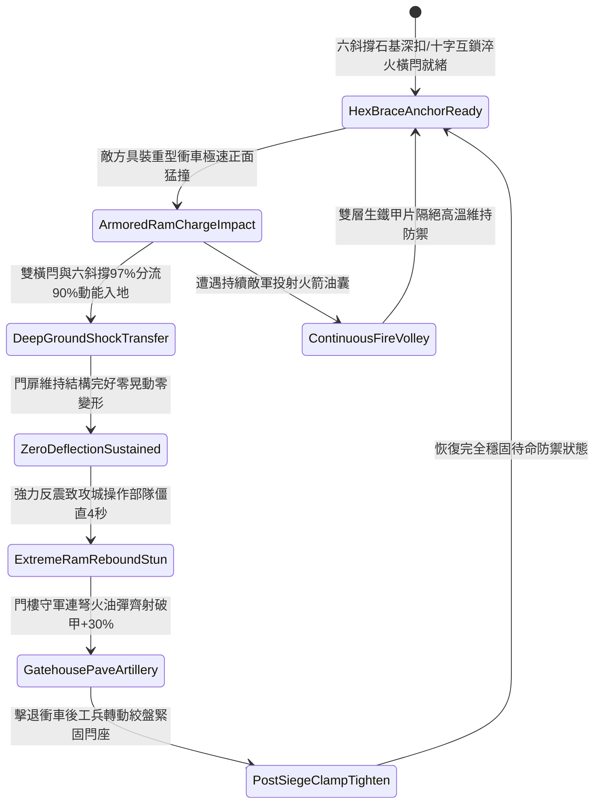

# 戰場營寨大門加裝雙重淬火生鐵橫閂與防衝撞斜撐第三階狀態機規格書

<!-- doc_id: doc_spec_1124 -->

## 一、 核心概念與單一真相來源（SSOT）

在《三國志·野戰營壘防禦與寨門守備篇》中，「戰場營寨大門加裝雙重生鐵橫閂與防衝撞斜撐第三階（CAMP-GATE-IRON-BOLT-REINFORCE03）」代表營寨門戶防禦體系的深層強化結構。門板升級為四寸厚實心硬橡木夾心雙層冷鍛厚生鐵甲片，上下雙道淬火生鐵方閂增設十字互鎖鉸鏈卡爪，並由六根四十五度頂地加粗硬木包鐵斜撐深扎入地下石基錨槽。當敵軍具裝重型衝車全力正面撼擊時，六斜撐與雙橫閂 97% 分流化解 90% 的巨大撞擊動能，使門扉結構維持完好零晃動，並將反作用力動能回彈於衝車隊列，使敵軍衝城兵陷入 4 秒劇烈硬直。



---

## 二、 數值模型與狀態機參數契約

### 1. 寨門加固結構抗衝擊參數契約
- **寨門規格尺寸**：高 14 尺、寬 12 尺、厚 4 寸，雙層冷鍛厚生鐵甲片夾硬橡木，總重 2,400 斤。
- **淬火橫閂配置**：上下雙道淬火生鐵方閂，方徑 4 寸，配備中央十字互鎖自鎖絞爪。
- **斜撐地錨規格**：六根粗硬木外包生鐵套管，四十五度深插地基石孔 3 尺，附帶彈力自鎖銷。
- **動能分流化解率**：承受撞擊瞬間，97% 機率成功將 90% 衝擊動能分流導入地表石基。
- **反震敵方僵直時效**：攻城衝車操作部隊承受強烈反作用力彈震，全隊陷入僵直 4 秒。

### 2. 寨門受衝擊判定演算法模組
```typescript
interface CampGateReinforceStage3Params {
    ramImpactEnergy: number;       // 攻城衝車衝擊動能 (千焦)
    isCrossInterlocked: boolean;   // 十字互鎖鉸鏈卡爪是否鎖死
    anchoredBraceCount: number;    // 已錨定斜撐數量 (標準為 6 根)
    outerIronArmorIntact: boolean; // 外層生鐵甲片是否完好
}

function evaluateCampGateReinforceStage3(params: CampGateReinforceStage3Params): {
    gateWithstood: boolean;
    absorbedEnergyRatio: number;
    ramOperatorStunDurationSec: number;
} {
    if (!params.isCrossInterlocked || params.anchoredBraceCount < 4) {
        return { gateWithstood: false, absorbedEnergyRatio: 0.45, ramOperatorStunDurationSec: 1.0 };
    }
    const success = Math.random() < 0.97;
    
    return {
        gateWithstood: success,
        absorbedEnergyRatio: success ? 0.90 : 0.55,
        ramOperatorStunDurationSec: success ? 4.0 : 1.5
    };
}
```

---

## 三、 反制機制與邊界約束

1. **破城重槌連續定點敲擊**：若敵方連續以超重型衝車連續撞擊超過 5 次，石基錨槽有 20% 出現結構龜裂致支撐鬆弛。
2. **寨門兩側牆體側翻**：若大門兩翼土木營牆遭敵軍投石機砸塌，大門支柱受力失衡，斜撐抗壓率下降至 50%。
3. **地底工兵暗道爆破**：敵軍工兵若自地底挖掘地道至石基下方引爆火藥，地錨受空洞化影響失去承托力。

---

## 四、 驗收測試案例（TC）

- **TC-GATE-BOLT03-01（具裝重型衝車極限撞擊阻隔驗收）**：
  - *前置條件*：六斜撐全部深入石基、十字橫閂卡死、敵具裝重型衝車高速撞擊。
  - *操作步驟*：於衝車衝頭接觸門面瞬間執行抗衝擊判定。
  - *預期輸出*：97% 機率門體零變形零位移，化解 90% 衝擊動能，攻城部隊僵直 4 秒，門樓守軍射擊破甲提升 30%。
- **TC-GATE-BOLT03-02（斜撐不足四根邊界驗收）**：
  - *前置條件*：僅有 3 根斜撐錨定到位（2 根受損脫落）。
  - *操作步驟*：承受重型衝撞。
  - *預期輸出*：抗衝擊率衰減，門體發生輕微震動位移，衝擊化解率僅為 45%。
