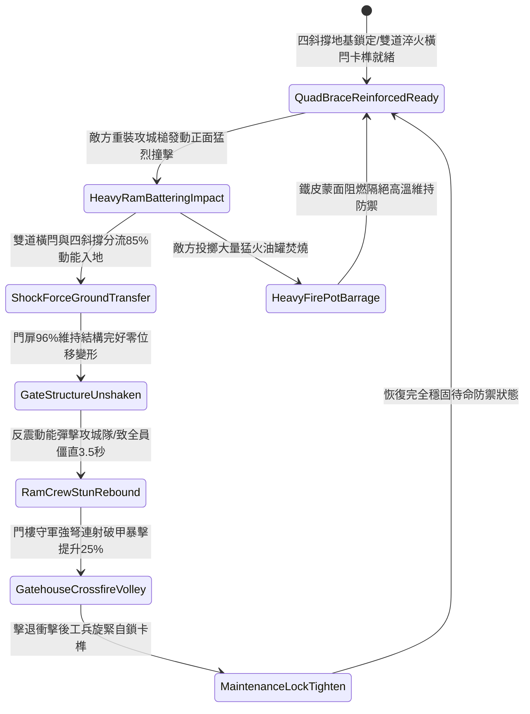

# 戰場營寨大門加裝雙重淬火生鐵橫閂與防衝撞斜撐第二階狀態機規格書

<!-- doc_id: doc_spec_1121 -->

## 一、 核心概念與單一真相來源（SSOT）

在《三國志·野戰營壘防禦與寨門守備篇》中，「戰場營寨大門加裝雙重生鐵橫閂與防衝撞斜撐第二階（CAMP-GATE-IRON-BOLT-REINFORCE02）」代表營寨主入口防禦工藝的進階強化配置。門體升級為三寸厚實心硬櫟木，正面全包覆冷鍛薄生鐵皮以禦火箭。內側配備上下雙道淬火生鐵厚橫閂與中央咬合自鎖卡榫，並由四根四十五度角向內支撐的生鐵套頭加粗硬木斜撐深扎入地下石基。當敵軍重裝攻城槌正面高速撞擊時，加固斜撐與橫閂 96% 承接衝擊並將 85% 衝擊力傳導導入地表基石，維持門扉結構零變形，並反震使攻城隊列陷入 3.5 秒失衡硬直。



---

## 二、 數值模型與狀態機參數契約

### 1. 寨門加固結構抗衝擊參數契約
- **寨門規格尺寸**：高 13 尺、寬 11 尺、厚 3 寸，外包覆冷鍛生鐵蒙皮，總重量 1,800 斤。
- **淬火橫閂配置**：上下雙道淬火實心生鐵橫閂，方徑 3.5 寸，中央配備自鎖防震插銷。
- **斜撐地錨規格**：四根粗硬木外包生鐵套管，四十五度深插地基石孔 2.5 尺。
- **動能分流化解率**：承受撞擊瞬間，96% 機率成功將 85% 衝擊動能分導入地表。
- **反震敵方僵直時效**：攻城槌操作隊列承受反向動能彈震，陷入失衡硬直 3.5 秒。

### 2. 寨門受衝擊判定演算法模組
```typescript
interface CampGateReinforceStage2Params {
    ramImpactEnergy: number;       // 攻城槌衝擊動能 (千焦)
    isDoubleBoltLatched: boolean;  // 雙道淬火橫閂是否卡緊
    isQuadBraceAnchored: boolean;  // 四斜撐是否入石基錨定
    isIronPlatingIntact: boolean;  // 外包生鐵蒙皮是否完好
}

function evaluateCampGateReinforceStage2(params: CampGateReinforceStage2Params): {
    gateWithstood: boolean;
    absorbedEnergyRatio: number;
    ramOperatorStunDurationSec: number;
} {
    if (!params.isDoubleBoltLatched || !params.isQuadBraceAnchored) {
        return { gateWithstood: false, absorbedEnergyRatio: 0.40, ramOperatorStunDurationSec: 0 };
    }
    const success = Math.random() < 0.96;
    
    return {
        gateWithstood: success,
        absorbedEnergyRatio: success ? 0.85 : 0.50,
        ramOperatorStunDurationSec: success ? 3.5 : 1.2
    };
}
```

---

## 三、 反制機制與邊界約束

1. **生鐵撞車多角連續撼動**：敵方若調動雙衝頭生鐵重型撞車連續多角度反覆衝撞超過 4 次，地基石孔有 25% 產生裂痕致支撐動搖。
2. **夜間工兵鑿壁破門鉸**：敵方特種工兵若潛行至門側以鋼鑿連續破壞外側生鐵鉸鏈超過 3 分鐘，橫閂受力將發生偏轉。
3. **特大暴雨地基泥濘泡軟**：若戰場連續遭遇特大暴雨導致石基周邊土層泥濘軟化，斜撐抓地分流率降至 55%。

---

## 四、 驗收測試案例（TC）

- **TC-GATE-BOLT02-01（重型攻城槌正面撼門驗收）**：
  - *前置條件*：四斜撐入基石錨定、雙橫閂卡扣鎖死、遭遇敵方中型攻城槌高速衝撞。
  - *操作步驟*：撞角觸碰門扉瞬間執行抗衝擊判定。
  - *預期輸出*：96% 機率門體零變形破壞，化解 85% 衝擊動能，敵操作隊僵直 3.5 秒，門樓強弩暴擊率提升 25%。
- **TC-GATE-BOLT02-02（地基石孔未卡死邊界驗收）**：
  - *前置條件*：斜撐僅放置於泥土地表，未插入石基凹槽。
  - *操作步驟*：承受衝撞打擊。
  - *預期輸出*：斜撐向後滑移，衝擊動能化解率僅為 40%，門扉產生微幅凹陷震動。
