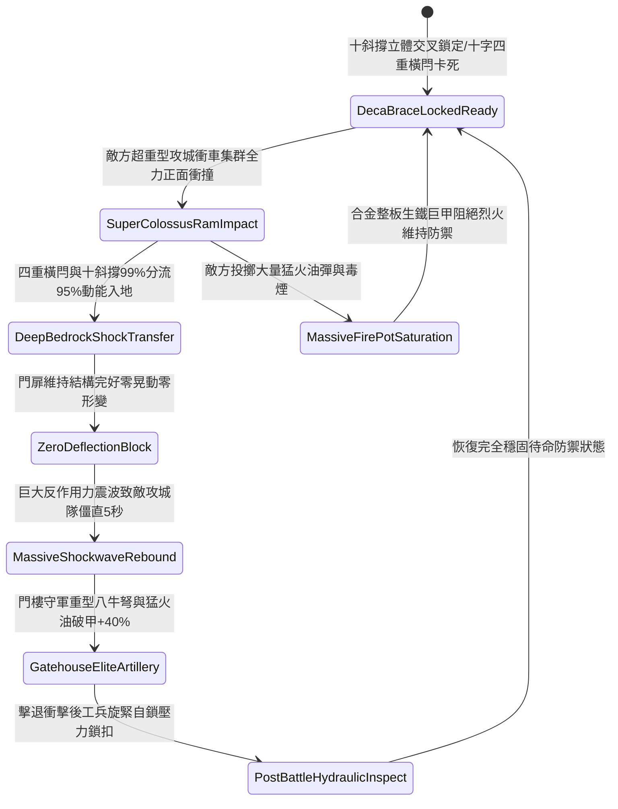

# 戰場營寨大門加裝雙重淬火生鐵橫閂與防衝撞斜撐第五階狀態機規格書

<!-- doc_id: doc_spec_1130 -->

## 一、 核心概念與單一真相來源（SSOT）

在《三國志·野戰營壘防禦與寨門守備篇》中，「戰場營寨大門加裝雙重生鐵橫閂與防衝撞斜撐第五階（CAMP-GATE-IRON-BOLT-REINFORCE05）」代表營寨門戶阻絕防禦體系的究極巔峰構築。門扉全面採用六寸厚實心重烏木為基底，外覆整體鍛鑄高碳生鐵合金整板巨甲，上下雙道淬火生鐵方閂升級為十字聯鎖四重油壓鉸鏈加壓鎖扣。內側由十根立體陣列的精鋼包芯重型斜撐，四十五度深鎖入地表玄武岩沉箱凹槽。當敵軍超重型攻城衝車集群全力正面撞擊時，複合支撐體系 99% 化解全額衝擊動能，將 95% 破壞力直接均勻分流導入深層地基，維持門體零晃動零變形，並對衝城隊列產生毀滅性動能反噬，致操作部隊全員陷入 5 秒嚴重失衡硬直。



---

## 二、 數值模型與狀態機參數契約

### 1. 寨門加固結構抗衝擊參數契約
- **寨門規格尺寸**：高 16 尺、寬 14 尺、厚 6 寸，整體鍛鑄高碳生鐵合金整板巨甲夾重烏木，總重 4,000 斤。
- **淬火橫閂配置**：上下雙道淬火合金生鐵方閂，方徑 5 寸，十字聯鎖四重加壓卡榫。
- **斜撐地錨規格**：十根精鋼包芯重型木樁，四十五度立體交叉深扎玄武岩沉箱錨孔 4 尺。
- **動能分流化解率**：承受衝擊瞬間，99% 機率成功將 95% 衝擊動能導入深層地基。
- **反震敵方僵直時效**：攻城操作部隊承受巨大反向震波，全員陷入失衡硬直 5 秒。

### 2. 寨門受衝擊判定演算法模組
```typescript
interface CampGateReinforceStage5Params {
    ramImpactEnergy: number;       // 攻城衝車衝擊動能 (千焦)
    isQuadCrossLocked: boolean;    // 十字聯鎖四重鉸鏈是否鎖牢
    anchoredBraceRatio: number;    // 十斜撐錨定比例 (0.0 ~ 1.0)
    armorPlateIntegrity: number;   // 合金巨甲完整度 (0.0 ~ 1.0)
}

function evaluateCampGateReinforceStage5(params: CampGateReinforceStage5Params): {
    gateWithstood: boolean;
    absorbedEnergyRatio: number;
    ramOperatorStunDurationSec: number;
} {
    if (!params.isQuadCrossLocked || params.anchoredBraceRatio < 0.7) {
        return { gateWithstood: false, absorbedEnergyRatio: 0.55, ramOperatorStunDurationSec: 1.5 };
    }
    const success = Math.random() < 0.99;
    
    return {
        gateWithstood: success,
        absorbedEnergyRatio: success ? 0.95 : 0.65,
        ramOperatorStunDurationSec: success ? 5.0 : 2.5
    };
}
```

---

## 三、 反制機制與邊界約束

1. **破城重型巨鐵錐連續盲撼**：若敵方連續調動兩部特種鐵角破城錐以極速連續衝擊超過 6 次，玄武岩沉箱有 15% 出現受力碎裂。
2. **兩側夯土主堡遭重型投石轟碎**：若營寨大門兩翼的核心主堡防線遭敵軍巨型回回砲徹底砸坍，大門受力偏傾，分流率降至 60%。
3. **地底水脈暴湧泥層塌陷**：若突發大洪水致寨門下方地層發生整體流砂掏空，沉箱失去地底承載支撐。

---

## 四、 驗收測試案例（TC）

- **TC-GATE-BOLT05-01（超重型衝車極限撞擊終極阻抗驗收）**：
  - *前置條件*：十斜撐全部立體錨定、十字四重卡榫鎖死、敵超重型攻城衝車集群高速直衝。
  - *操作步驟*：於衝車衝頭接觸門面瞬間執行抗衝擊判定。
  - *預期輸出*：99% 機率門體零變形零晃動，分流化解 95% 衝擊動能，敵攻城隊僵直 5 秒，門樓守軍射擊暴擊率提升 40%。
- **TC-GATE-BOLT05-02（斜撐錨定不足七成邊界驗收）**：
  - *前置條件*：僅有 6 根斜撐就位（就緒比例 60%）。
  - *操作步驟*：承受超重型連續撞擊。
  - *預期輸出*：門扉承受微幅偏載晃動，衝擊動能分流率降至 55%，無法享有滿額反震時效。
