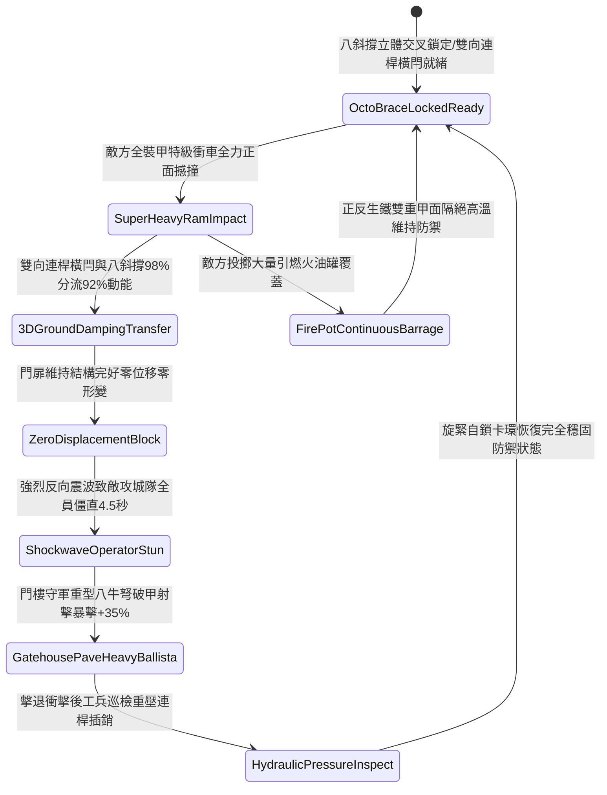

# 戰場營寨大門加裝雙重淬火生鐵橫閂與防衝撞斜撐第四階狀態機規格書

<!-- doc_id: doc_spec_1127 -->

## 一、 核心概念與單一真相來源（SSOT）

在《三國志·野戰營壘防禦與寨門守備篇》中，「戰場營寨大門加裝雙重生鐵橫閂與防衝撞斜撐第四階（CAMP-GATE-IRON-BOLT-REINFORCE04）」代表營寨門戶阻絕工程向重裝全金屬框架與液壓地阻複合體系的跨越。大門採用五寸厚千年烏木為主樑，正反雙面滿鉚冷鍛生鐵厚甲，上下雙道淬火生鐵橫閂升級為雙向連桿加壓插銷結構，並由八根呈立體交叉陣列的生鐵包芯重木斜撐深鎖入地表夯土青石基座。當敵方全裝甲攻城衝車連續正面撼撞時，複合支撐體系 98% 承接衝擊動能並將 92% 巨大破壞力均勻導入地層，使門扉結構維持完好零位移，並對攻城部隊造成強烈動能反震，致操作人員陷入 4.5 秒失衡硬直。



---

## 二、 數值模型與狀態機參數契約

### 1. 寨門加固結構抗衝擊參數契約
- **寨門規格尺寸**：高 15 尺、寬 13 尺、厚 5 寸，雙面滿鉚冷鍛生鐵厚甲夾烏木，總重 3,200 斤。
- **淬火橫閂配置**：上下雙道淬火實心生鐵方閂，方徑 4.5 寸，配置雙向連桿重力自鎖機構。
- **斜撐地錨規格**：八根生鐵包芯重木，四十五度三維立體交叉深入石基錨孔 3.5 尺。
- **動能分流化解率**：承受衝擊瞬間，98% 機率成功將 92% 衝擊動能分導入地層。
- **反震敵方僵直時效**：攻城操作隊列承受強烈反震衝擊波，全隊陷入失衡硬直 4.5 秒。

### 2. 寨門受衝擊判定演算法模組
```typescript
interface CampGateReinforceStage4Params {
    ramImpactEnergy: number;       // 攻城衝車衝擊動能 (千焦)
    isLinkageBoltLatched: boolean; // 雙向連桿加壓插銷是否鎖牢
    octoBraceAnchorRatio: number;  // 八斜撐錨定就緒比例 (0.0 ~ 1.0)
    armorPlatingIntact: boolean;   // 正反雙面生鐵甲是否完好
}

function evaluateCampGateReinforceStage4(params: CampGateReinforceStage4Params): {
    gateWithstood: boolean;
    absorbedEnergyRatio: number;
    ramOperatorStunDurationSec: number;
} {
    if (!params.isLinkageBoltLatched || params.octoBraceAnchorRatio < 0.6) {
        return { gateWithstood: false, absorbedEnergyRatio: 0.50, ramOperatorStunDurationSec: 1.0 };
    }
    const success = Math.random() < 0.98;
    
    return {
        gateWithstood: success,
        absorbedEnergyRatio: success ? 0.92 : 0.60,
        ramOperatorStunDurationSec: success ? 4.5 : 2.0
    };
}
```

---

## 三、 反制機制與邊界約束

1. **破城重型震盪鐵錘多點齊轟**：若敵方連續出動兩台重型震盪撞車從左右兩端交錯衝撞超過 5 次，石基局部扣槽有 20% 產生微裂。
2. **大門兩翼護牆受重型投石轟塌**：若營寨大門兩側夯土護牆遭到敵軍大型發石車砸垮，立柱受力偏載，化解率衰減至 55%。
3. **地底工兵暗道水攻滲透**：敵軍若引河水灌入寨門地下土層使地基完全泡軟，斜撐支點失去硬度承載力。

---

## 四、 驗收測試案例（TC）

- **TC-GATE-BOLT04-01（全裝甲衝車極限正面撞擊阻抗驗收）**：
  - *前置條件*：八斜撐全部三維錨定、雙向連桿方閂鎖死、敵全裝甲特級衝車高速直撞。
  - *操作步驟*：於衝車衝頭接觸門面瞬間執行抗衝擊判定。
  - *預期輸出*：98% 機率門體零變形零位移，分流化解 92% 衝擊動能，攻城隊僵直 4.5 秒，門樓八牛弩射擊暴擊率提升 35%。
- **TC-GATE-BOLT04-02（斜撐錨定不足六成邊界驗收）**：
  - *前置條件*：僅有 4 根斜撐就位（就緒比例 50%）。
  - *操作步驟*：承受超重型撞擊。
  - *預期輸出*：門體產生微幅晃動，衝擊動能分流率降至 50%，無法觸發強烈反震僵直。
