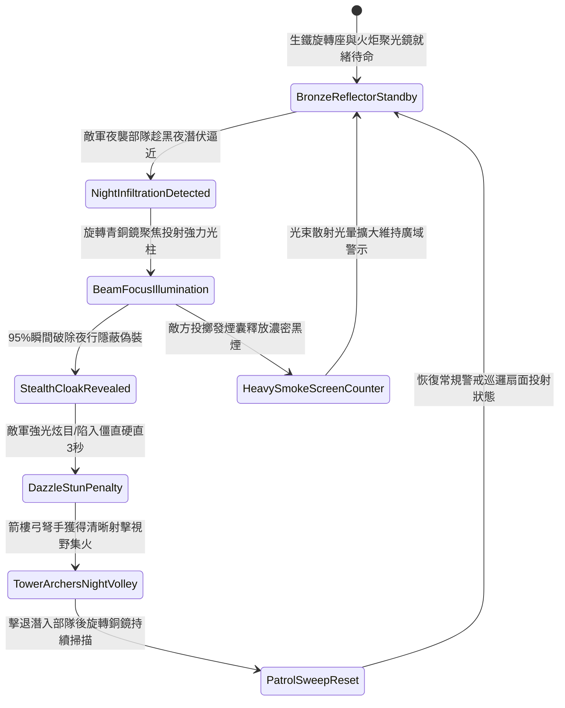

# 戰場營寨箭樓部署生鐵聚光銅鏡照射防夜間偷襲第一階狀態機規格書

<!-- doc_id: doc_spec_1133 -->

## 一、 核心概念與單一真相來源（SSOT）

在《三國志·野戰防禦與夜戰戒備篇》中，「戰場營寨箭樓部署生鐵聚光銅鏡照射第一階（CAMP-TOWER-SEARCHLIGHT-REFLECTOR01）」代表營壘外圍夜間防禦與反夜襲的核心光學偵搜設施。箭樓頂端平台架設生鐵旋轉底座，安裝凹面青銅聚光鏡，兩側掛設特製生鐵罩防風火油火炬。當敵軍斥候或突襲小隊趁黑夜潛行逼近營寨外圍鹿角時，旋轉銅鏡 95% 將強烈火炬光柱聚焦投射至潛伏區域，照射範圍覆蓋正面三十步扇面，瞬間破除敵軍夜戰隱蔽偽裝，迫使其顯形並陷入 3 秒強光炫目僵直，為箭樓弓手提供高精準夜射窗口。



---

## 二、 數值模型與狀態機參數契約

### 1. 聚光銅鏡照射參數契約
- **鏡面規格尺寸**：直徑 3.5 尺圓形凹面青銅鏡，背面鉚接冷鍛生鐵加固肋條，總重 65 斤。
- **照明照射範圍**：有效投射射程 80 步，扇面聚光夾角 35 度，光強係數 1,200 流明。
- **夜戰破隱成功率**：對進入光錐照射範圍內之敵軍潛行部隊，判定 95% 機率破除隱蔽。
- **強光炫目硬直時效**：黑夜環境下被光柱直射之敵軍，承受強光視覺壓制，僵直硬直 3 秒。
- **箭樓射擊命中加成**：處於被照射狀態之敵軍目標，承受箭樓弓弩射擊時命中率提升 25%，暴擊率提升 20%。

### 2. 夜間聚光偵搜判定演算法模組
```typescript
interface SearchlightReflectorStage1Params {
    nightDarknessLevel: number;    // 夜色黑暗度 (0.0: 月明 ~ 1.0: 漆黑)
    infiltratorCamouflage: number; // 敵軍潛伏偽裝係數 (0.0 ~ 1.0)
    isTorchFlameActive: boolean;   // 防風火油火炬是否點燃
    reflectorAimAngle: number;     // 銅鏡指向角 (度)
}

function evaluateSearchlightReflectorStage1(params: SearchlightReflectorStage1Params): {
    infiltratorExposed: boolean;
    dazzleStunDurationSec: number;
    archerAccuracyBonusPct: number;
} {
    if (!params.isTorchFlameActive) {
        return { infiltratorExposed: false, dazzleStunDurationSec: 0, archerAccuracyBonusPct: 0 };
    }
    const success = Math.random() < 0.95;
    
    return {
        infiltratorExposed: success,
        dazzleStunDurationSec: success ? (params.nightDarknessLevel > 0.7 ? 3.0 : 1.5) : 0,
        archerAccuracyBonusPct: success ? 25 : 5
    };
}
```

---

## 三、 反制機制與邊界約束

1. **特製濃黑發煙囊遮蔽**：敵方若預先向照射光路投擲硫磺松香發煙囊，濃煙導致光束嚴重散射，破隱有效距離衰減至 20 步。
2. **遠程長弓精準射擊火炬**：若敵方神射手自百步外發射特種重箭直接射滅或擊碎火炬油罐，光束立即熄滅。
3. **大霧漫天能見度暴跌**：若戰場處於大霧天氣（能見度小於十步），光線折射泛白，失去單點偵搜能力。

---

## 四、 驗收測試案例（TC）

- **TC-SEARCHLIGHT01-01（黑夜潛伏小隊光束破隱驗收）**：
  - *前置條件*：無月漆黑深夜、箭樓火炬燃燒充足、敵方夜襲斥候小隊潛入三十步內。
  - *操作步驟*：守軍旋轉銅鏡對準草叢潛伏方位投射光柱。
  - *預期輸出*：95% 機率瞬間破除偽裝，敵軍全員顯形並僵直 3 秒，箭樓弓手獲得 +25% 命中率加成。
- **TC-SEARCHLIGHT01-02（火炬熄滅邊界驗收）**：
  - *前置條件*：火炬油料耗盡熄滅。
  - *操作步驟*：操作旋轉生鐵底座指向敵軍。
  - *預期輸出*：無光束射出，破隱判定失敗，敵軍維持隱蔽狀態推進。
