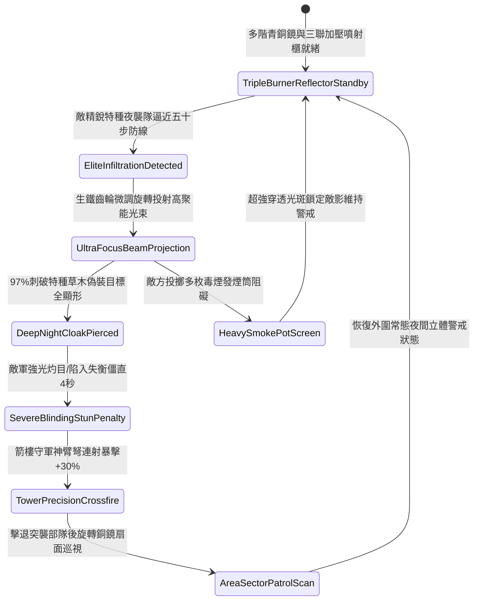

# 戰場營寨箭樓部署生鐵聚光銅鏡照射防夜間偷襲第三階狀態機規格書

<!-- doc_id: doc_spec_1139 -->

## 一、 核心概念與單一真相來源（SSOT）

在《三國志·野戰防禦與夜戰戒備篇》中，「戰場營寨箭樓部署生鐵聚光銅鏡照射第三階（CAMP-TOWER-SEARCHLIGHT-REFLECTOR03）」代表要塞營壘針對夜間突擊特種部隊的深層立體光學偵查體系。青銅鏡面升級為四尺六寸特級拋光多階複合凹面鏡，搭配生鐵齒輪微調雙軸旋轉座與三聯防風加壓火油噴射櫃。當敵軍精銳特種夜襲部隊逼近五十步外圍防禦線時，多階銅鏡 97% 投射高聚能光束，中心光斑亮度倍增，穿透各類深色夜行披風與草木偽裝，並施加 4 秒劇烈炫目僵直，使箭樓神臂弓弩手與重型床弩隊伍獲得夜戰暴擊破甲集火窗口。



---

## 二、 數值模型與狀態機參數契約

### 1. 聚光銅鏡照射參數契約
- **鏡面規格尺寸**：直徑 4.6 尺多階複合凹面高光青銅鏡，生鐵高精度齒輪雙軸微調轉座，總重 110 斤。
- **照明照射範圍**：有效投射射程 120 步，扇面聚光夾角 25 度，光強係數 2,400 流明。
- **夜戰破隱成功率**：對進入光錐照射範圍內之敵軍精銳偷襲部隊，判定 97% 機率破除偽裝。
- **強光炫目硬直時效**：黑夜直射目標承受極強眩目視覺壓制，陷入失衡硬直 4 秒。
- **箭樓射擊命中加成**：處於被照射狀態之敵軍目標，承受箭樓弓弩射擊時命中率提升 35%，暴擊率提升 30%。

### 2. 夜間聚光偵搜判定演算法模組
```typescript
interface SearchlightReflectorStage3Params {
    nightDarknessLevel: number;    // 夜色黑暗度 (0.0: 月明 ~ 1.0: 漆黑)
    eliteInfiltratorStealth: number; // 敵軍精銳潛行技巧 (1 ~ 5)
    isTripleBurnerPressurized: boolean; // 三聯噴射櫃是否正常加壓
    gearTrackingPrecision: number; // 齒輪微調追蹤精度 (0.0 ~ 1.0)
}

function evaluateSearchlightReflectorStage3(params: SearchlightReflectorStage3Params): {
    infiltratorExposed: boolean;
    dazzleStunDurationSec: number;
    accuracyBonusPct: number;
} {
    if (!params.isTripleBurnerPressurized || params.gearTrackingPrecision < 0.5) {
        return { infiltratorExposed: false, dazzleStunDurationSec: 0, accuracyBonusPct: 0 };
    }
    const success = Math.random() < 0.97;
    
    return {
        infiltratorExposed: success,
        dazzleStunDurationSec: success ? 4.0 : 2.0,
        accuracyBonusPct: success ? 35 : 15
    };
}
```

---

## 三、 反制機制與邊界約束

1. **特種濕土發煙氈毯覆蓋**：敵方若動用浸泡濕土的厚氈毯覆蓋發煙筒，產生極低溫沉底白煙，光束下段穿透力衰減 50%。
2. **遠程重型火箭齊射鏡座**：若敵方連續以三具床弩發射巨型穿甲火箭射擊轉軸齒輪箱，有 20% 機率破壞傳動齒槽。
3. **特大雷暴強光閃電干擾**：若戰場處於劇烈雷雨閃電環境，閃電強光頻繁干擾守軍視線，追蹤判定冷卻增加 3 秒。

---

## 四、 驗收測試案例（TC）

- **TC-SEARCHLIGHT03-01（夜間精銳特種突襲光學破隱驗收）**：
  - *前置條件*：無月漆黑深夜、三聯加壓噴射櫃全開、敵精銳死士潛入五十步外圍防禦線。
  - *操作步驟*：搖動齒輪微調轉座鎖定黑影投射高聚能光束。
  - *預期輸出*：97% 機率穿透偽裝目標顯形，敵軍全員陷入 4 秒強光炫目僵直，箭樓守軍射擊暴擊率提升 30%。
- **TC-SEARCHLIGHT03-02（加壓噴射櫃失壓邊界驗收）**：
  - *前置條件*：噴射櫃油路漏氣（處於常壓燃燒狀態）。
  - *操作步驟*：對潛行部隊投射光束。
  - *預期輸出*：光束照度衰減 40%，破隱成功率降至 65%，炫目僵直時間縮減為 2 秒。
