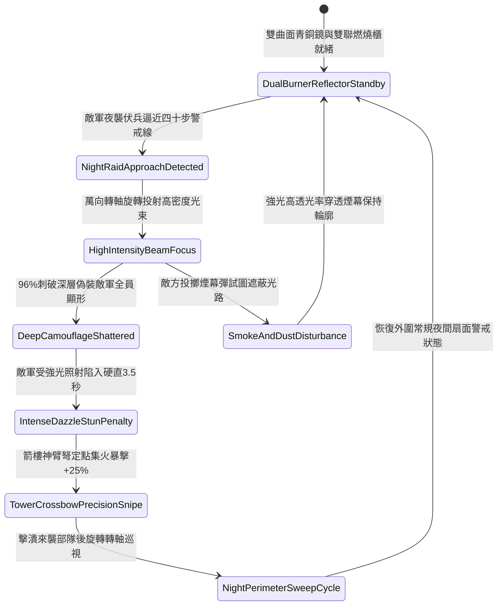

# 戰場營寨箭樓部署生鐵聚光銅鏡照射防夜間偷襲第二階狀態機規格書

<!-- doc_id: doc_spec_1136 -->

## 一、 核心概念與單一真相來源（SSOT）

在《三國志·野戰防禦與夜戰戒備篇》中，「戰場營寨箭樓部署生鐵聚光銅鏡照射第二階（CAMP-TOWER-SEARCHLIGHT-REFLECTOR02）」代表營壘外圍夜戰預警光學系統的強化配置。青銅鏡面升級為四尺直徑高精度雙曲面凹鏡，背面鉚接加厚低合金生鐵放射肋條與生鐵防震萬向轉軸，兩側搭配雙聯生鐵防風火油燃燒櫃。當黑夜中敵軍精銳偷襲部隊或伏兵逼近營寨四十步警戒線時，雙曲面銅鏡 96% 將高密度光束精準投射至目標區域，光斑中心照度提升 40%，瞬間刺破深層黑夜偽裝，並施加 3.5 秒強烈炫目僵直，使箭樓守軍神臂弩手獲得夜戰精確遠程狙殺窗口。



---

## 二、 數值模型與狀態機參數契約

### 1. 聚光銅鏡照射參數契約
- **鏡面規格尺寸**：直徑 4 尺雙曲面凹面高光青銅鏡，生鐵防震萬向轉軸底座，總重 85 斤。
- **照明照射範圍**：有效投射射程 100 步，扇面聚光夾角 30 度，光強係數 1,800 流明。
- **夜戰破隱成功率**：對進入光錐照射範圍內之敵軍偷襲部隊，判定 96% 機率破除偽裝。
- **強光炫目硬直時效**：黑夜直射目標承受強烈眩目視覺壓制，陷入失衡硬直 3.5 秒。
- **箭樓射擊命中加成**：處於被照射狀態之敵軍目標，承受箭樓弓弩射擊時命中率提升 30%，暴擊率提升 25%。

### 2. 夜間聚光偵搜判定演算法模組
```typescript
interface SearchlightReflectorStage2Params {
    nightDarknessLevel: number;    // 夜色黑暗度 (0.0: 月明 ~ 1.0: 漆黑)
    infiltratorStealthSkill: number; // 敵軍潛伏隱蔽等級 (1 ~ 5)
    isDualBurnerLit: boolean;      // 雙聯燃燒櫃是否全燃
    turretTrackingStability: number; // 萬向轉軸追蹤穩定度 (0.0 ~ 1.0)
}

function evaluateSearchlightReflectorStage2(params: SearchlightReflectorStage2Params): {
    infiltratorExposed: boolean;
    dazzleStunDurationSec: number;
    accuracyBonusPct: number;
} {
    if (!params.isDualBurnerLit || params.turretTrackingStability < 0.4) {
        return { infiltratorExposed: false, dazzleStunDurationSec: 0, accuracyBonusPct: 0 };
    }
    const success = Math.random() < 0.96;
    
    return {
        infiltratorExposed: success,
        dazzleStunDurationSec: success ? 3.5 : 1.5,
        accuracyBonusPct: success ? 30 : 10
    };
}
```

---

## 三、 反制機制與邊界約束

1. **多重發煙火藥囊連續投擲**：敵方若連續投擲三枚以上硫磺濃黑發煙囊，光束穿透力衰減 60%，破隱距離縮減至 35 步。
2. **重型火箭集火點射鏡座**：若敵方連續以淬毒火箭射中萬向轉軸軸承致齒輪卡死，轉動調整耗時增加 4 秒。
3. **濃霧低雲天氣折射**：若戰場處於濃霧天氣導致空氣濕度達到飽和，光斑產生散射光暈，無法進行遠距聚焦。

---

## 四、 驗收測試案例（TC）

- **TC-SEARCHLIGHT02-01（黑夜精銳伏兵強光破隱驗收）**：
  - *前置條件*：無月黑夜、雙聯火油燃燒櫃全開、敵精銳伏兵潛入四十步內。
  - *操作步驟*：操作萬向轉軸對準可疑暗影區域精確投射。
  - *預期輸出*：96% 機率瞬間刺破偽裝顯形，敵軍陷入 3.5 秒強烈炫目僵直，箭樓守軍命中率提升 30%。
- **TC-SEARCHLIGHT02-02（單側燃燒櫃熄滅邊界驗收）**：
  - *前置條件*：僅有一側燃燒櫃點燃（照度不足）。
  - *操作步驟*：對潛伏目標執行照射。
  - *預期輸出*：光束照度減半，破隱判定成功率降至 60%，炫目僵直時間縮減為 1.5 秒。
