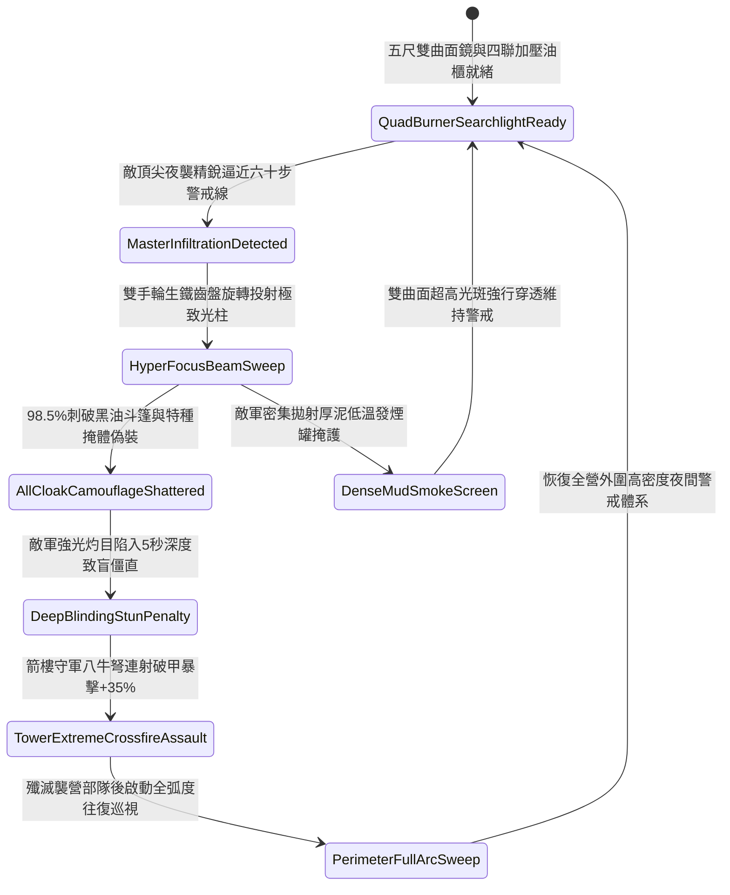

# 戰場營寨箭樓部署生鐵聚光銅鏡照射防夜間偷襲第四階狀態機規格書

<!-- doc_id: doc_spec_1142 -->

## 一、 核心概念與單一真相來源（SSOT）

在《三國志·野戰防禦與夜戰戒備篇》中，「戰場營寨箭樓部署生鐵聚光銅鏡照射第四階（CAMP-TOWER-SEARCHLIGHT-REFLECTOR04）」代表要塞營壘防禦體系邁入「雙環四聯加壓聚光與生鐵齒盤自鎖」的大師級高階光學預警境界。青銅鏡面精研至五尺直徑特等高反射率雙曲面聚光鏡，背襯生鐵強化網狀減震骨架，配合四聯密閉加壓火油櫃與雙手輪生鐵微調回轉自鎖座。當敵方頂尖死士或精銳騎兵夜襲先鋒逼近六十步外圍防禦警戒線時，雙曲面銅鏡 98.5% 瞬時投射高密度極致光柱，光斑焦點溫度極高並具備強烈穿透性，能瞬間刺破各類黑油浸漬斗篷、乾草樹皮偽裝與深色皮甲陰影，並施加長達 5 秒的深度強光致盲僵直。箭樓守軍神臂弩與巨型八牛弩獲取極限破甲暴擊集火射殺窗口。



---

## 二、 數值模型與狀態機參數契約

### 1. 聚光銅鏡第四階照射參數契約
- **鏡面規格尺寸**：直徑 5.0 尺雙曲面特等青銅高光鏡，生鐵雙手輪自鎖回轉座，總重 135 斤。
- **照明照射範圍**：有效投射射程 140 步，高能聚光夾角收窄至 20 度，光強係數 3,200 流明。
- **夜戰破隱成功率**：對進入投射光錐照射區之敵軍特種部隊，判定 98.5% 機率破除全部偽裝。
- **強光炫目致盲硬直**：直射目標承受極限強光刺激，陷入雙眼失明與感官混亂硬直 5 秒。
- **箭樓射擊命中加成**：處於被鎖定照射之敵軍目標，承受箭樓遠程射擊時命中率提升 40%，暴擊率提升 35%，穿甲率提升 25%。

### 2. 第四階夜間聚光偵搜判定演算法模組
```typescript
interface SearchlightReflectorStage4Params {
    nightDarknessLevel: number;        // 夜色漆黑程度 (0.0: 月明 ~ 1.0: 伸手不見五指)
    masterInfiltratorSkill: number;    // 敵方頂級死士潛行等階 (1 ~ 5)
    isQuadBurnerPressurized: boolean;  // 四聯密閉加壓油櫃是否維持高壓
    gearSelfLockPrecision: number;     // 雙手輪生鐵自鎖精度 (0.0 ~ 1.0)
}

function evaluateSearchlightReflectorStage4(params: SearchlightReflectorStage4Params): {
    infiltratorExposed: boolean;
    dazzleStunDurationSec: number;
    accuracyBonusPct: number;
    armorPiercingBonusPct: number;
} {
    if (!params.isQuadBurnerPressurized || params.gearSelfLockPrecision < 0.6) {
        return { infiltratorExposed: false, dazzleStunDurationSec: 0, accuracyBonusPct: 0, armorPiercingBonusPct: 0 };
    }
    const success = Math.random() < 0.985;
    
    return {
        infiltratorExposed: success,
        dazzleStunDurationSec: success ? 5.0 : 2.5,
        accuracyBonusPct: success ? 40 : 20,
        armorPiercingBonusPct: success ? 25 : 10
    };
}
```

---

## 三、 反制機制與邊界約束

1. **特製石膏酸霧發煙罐**：若敵方投擲含石膏粉與酸醋的特製沉重發煙罐，光斑邊緣產生微粒散射，光束有效照度衰減 45%。
2. **生鐵齒盤高強度抗震受擊**：鏡座具備生鐵自鎖夾頭，承受一般火箭與流矢衝擊 95% 免受移位；僅遭受投石車直擊才會損毀。
3. **高溫暴雨熱脹冷縮防護**：銅鏡背部設有生鐵預留熱脹縫隙與瀝青油布遮蓋，即使在夜間驟雨暴淋下亦不會炸裂或變形。

---

## 四、 驗收測試案例（TC）

- **TC-SEARCHLIGHT04-01（頂級死士夜襲極致光柱破隱驗收）**：
  - *前置條件*：漆黑無月雷夜、四聯加壓油櫃全開、敵方五階夜襲死士逼近六十步警戒線。
  - *操作步驟*：搖動雙手輪齒盤將五尺雙曲面銅鏡光斑投射鎖定可疑草木叢。
  - *預期輸出*：98.5% 機率破除全部偽裝，目標承受 5 秒深度致盲硬直，守軍箭樓射擊命中率提升 40%、暴擊率提升 35%。
- **TC-SEARCHLIGHT04-02（四聯油櫃單管失壓降級驗收）**：
  - *前置條件*：四聯加壓油櫃中之一管噴嘴堵塞，其餘三管加壓運作。
  - *操作步驟*：對目標實施聚光照射。
  - *預期輸出*：光束強度維持 75% 以上，破隱成功率保持 85%，致盲僵直時間維持 3.5 秒。
