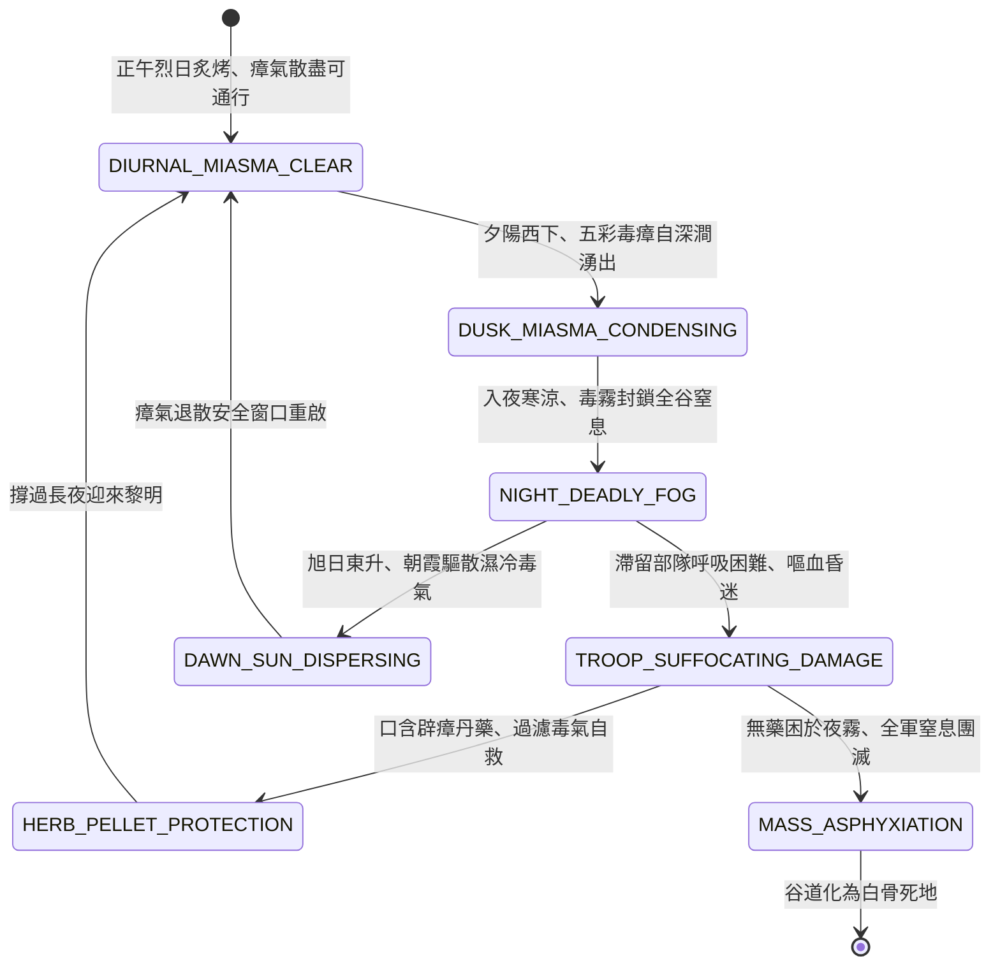

<!-- doc_id: doc_spec_0823 -->
# 3KLife 戰場瘴氣沼澤毒霧日出而散日落而聚呼吸窒息狀態機規格書

## 模組基本資訊
- **模組代號**：`MIASMA-SWAMP-DIURNAL01`
- **系統定位**：三國南中日夜溫差動態瘴氣毒霧環境系統，負責山谷日落毒瘴凝聚、日出烈日暫散、口含辟瘴片呼吸保護與夜宿瘴谷窒息團滅之完整狀態流。
- **架構依賴**：`BattleGridSystem`、`TimeOfDaySystem`、`TroopTypeMovement`、`VFXBlockRegistry`。

---

## 核心設計概念
諸葛亮南征瀘水之戰：「五月渡瀘，深入不毛」。南中原始密林沼澤間，腐爛落葉與毒蛇瘴癘常年堆積，形成具有日夜規律之「惡毒山嵐瘴氣」。日落黃昏至清晨時分，山谷氣溫驟降，毒瘴化為五彩濃重煙霧聚集於地面三尺，人畜吸入即頭痛嘔吐、肺爛窒息；唯有每日午時三刻烈日當空、陽氣最盛之際，瘴霧方被烈日驅散退回深壑。大軍行軍必須嚴格「晝行夜止」，並隨身佩戴雄黃麝香辟瘴囊，方能安然穿透百里死谷。



---

## 狀態機定義與轉換條件

### 1. `DIURNAL_MIASMA_CLEAR`（日間消散窗口狀態）
- **進入條件**：遊戲時辰處於「午時」至「申時」（11:00 ~ 17:00）。
- **行為表現**：
  - 烈日高照，地表瘴氣全部蒸散退回地底深隙。
  - 沼澤谷道地格轉為普通泥濘，無窒息毒傷，大軍可全速行軍通過。
- **轉換**：時辰進入「酉時」（黃昏 17:00 後） -> 轉移至 `DUSK_MIASMA_CONDENSING`。

### 2. `DUSK_MIASMA_CONDENSING`（黃昏瘴聚狀態）
- **行為表現**：
  - 五彩斑斕之毒霧自沼澤泥沼中汩汩冒出，視野能見度急降至 1 格。
  - 提示警告：「天色已晚，毒瘴將起，速退往高地扎營！」。
- **轉換**：戌時（入夜 19:00） -> 轉移至 `NIGHT_DEADLY_FOG`。

### 3. `NIGHT_DEADLY_FOG`（夜間毒霧籠罩狀態）
- **行為表現**：
  - 谷道全部地格被深紫色毒霧覆蓋，禁止非特種部隊進入。
  - 凡身處瘴霧內之部隊立即進入窒息檢定。
- **轉換**：
  - 部隊停留在毒霧內未及時撤出 -> 轉移至 `TROOP_SUFFOCATING_DAMAGE`。
  - 熬至次日辰時（早晨 07:00） -> 轉移至 `DAWN_SUN_DISPERSING`。

### 4. `TROOP_SUFFOCATING_DAMAGE`（窒息侵蝕狀態）
- **行為表現**：
  - 每回合直接扣除 20% 最大生命值，移動力削弱 60%。
  - 士氣每回合 -25 點，士卒發出劇烈咳嗽與哀嚎。
- **轉換**：
  - 部隊背包消耗「辟瘴丹/含片」 -> 轉移至 `HERB_PELLET_PROTECTION`。
  - 連續 3 回合未獲防護 -> 轉移至 `MASS_ASPHYXIATION`。

### 5. `HERB_PELLET_PROTECTION`（辟瘴含片保護狀態）
- **行為表現**：
  - 士卒口含麝香雄黃片，鼻孔抹薄荷油，免疫窒息傷害。
  - 防護效果持續 4 個時辰。
- **轉換**：迎接次日朝陽 -> 轉移至 `DIURNAL_MIASMA_CLEAR`。

### 6. `MASS_ASPHYXIATION`（全軍窒息覆滅狀態）
- **行為表現**：
  - 肺泡被毒氣溶解，全軍士卒窒息倒斃於泥沼之中，部隊覆滅。
- **轉換**：結算清除 -> 結束退出。

---

## 數值公式與配置契約

```typescript
export interface MiasmaSwampConfig {
  swampId: string;
  clearWindowStartHour: number;   // 安全通行起始時辰 (11:00)
  clearWindowEndHour: number;     // 安全通行結束時辰 (17:00)
  nightSuffocateDamageRate: number;// 夜間每回合窒息扣血比
  mobilitySlowPercent: number;    // 毒霧減速百分比
  pelletProtectionHours: number;  // 辟瘴丹藥保護時長 (小時)
}

export const MIASMA_PRESETS: Record<string, MiasmaSwampConfig> = {
  LU_RIVER_VALLEY_MIASMA: {
    swampId: 'MIASMA_LUSHUI_01',
    clearWindowStartHour: 11,
    clearWindowEndHour: 17,
    nightSuffocateDamageRate: 0.20,
    mobilitySlowPercent: 0.60,
    pelletProtectionHours: 8,
  }
};
```

---

## 單元測試與驗收標準
1. **日夜時辰自動切換**：系統時間在 11:00 ~ 17:00 期間，沼澤谷地 100% 解除毒性；19:00 後自動覆蓋深紫毒霧。
2. **夜宿瘴谷窒息致死**：未攜帶辟瘴藥品之步兵部隊夜宿瘴氣地格，連續 3 回合每回合扣減 20% 生命，無誤判定。
3. **辟瘴丹保護時效**：使用「辟瘴丹」後，部隊在夜間毒霧中持續 8 小時完全免疫毒傷與減速。
