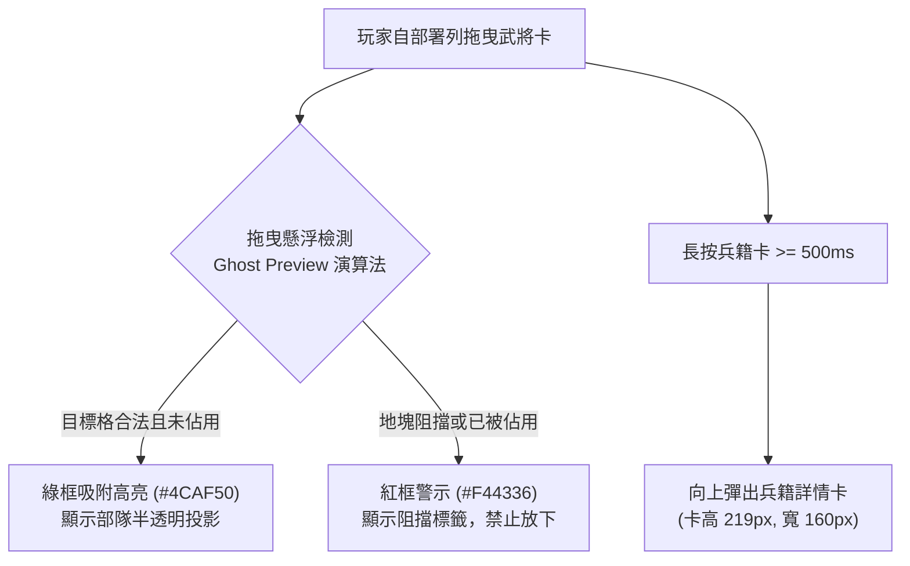

<!-- doc_id: doc_spec_0309 -->
# 戰場策略相剋與即時將階晉升功能規格書 (Battle Dynamic Counters & In-Combat Ascension)

> **所屬分類**：系統規格書 (System Spec)  
> **關聯總目錄**：[`docs/cross-ref/cross-ref-進度.md (doc_index_0017)`](file:///c:/Users/User/3KLife/docs/cross-ref/cross-ref-進度.md)、[`docs/cross-ref/wbs-progress-inventory-matrix.md (doc_index_1054)`](file:///c:/Users/User/3KLife/docs/cross-ref/wbs-progress-inventory-matrix.md)  
> **關聯母規格**：[`MVP核心循環貫通與遊玩動線功能規格書.md (doc_spec_0308)`](file:///c:/Users/User/3KLife/docs/遊戲規格文件/系統規格書/MVP核心循環貫通與遊玩動線功能規格書.md)、[`官職系統.md (doc_spec_0014)`](file:///c:/Users/User/3KLife/docs/遊戲規格文件/系統規格書/官職系統.md)、[`戰場部署系統.md (doc_spec_0040)`](file:///c:/Users/User/3KLife/docs/遊戲規格文件/系統規格書/戰場部署系統.md)、[`兵種（虎符）系統.md (doc_spec_0012)`](file:///c:/Users/User/3KLife/docs/遊戲規格文件/系統規格書/兵種（虎符）系統.md)  
> **制定版本**：v1.0 (MVP Battle Ascension Milestone)

---

## 1. 系統目標與體驗願景

本規格書定義學府畢業武將送入戰場後的**核心驗收機制與即時反饋閉環**。核心設計目標：
1. **告別純數值互撞，強化動態相剋**：槍兵拒馬反騎、騎兵突襲弓手後排、弓兵居高臨下壓制步兵、南蠻兵種林地疾襲，實現以弱勝強的策略深度。
2. **戰場即時升階震撼特寫（Just-In-Time Ascension）**：將「名聲與官職」從戰後冷冰冰的結算彈窗，轉化為**戰鬥關鍵高光時刻（斬將、單挑獲勝）的即時爆發點**。
3. **戰中士氣與帶兵上限即時解放**：當場晉升、當場解鎖更大帶兵上限、全軍士氣瞬間拉滿至 100，帶來絕境逆轉的極致爽快感。

---

## 2. 戰前部署深層機制 (Deployment Mechanics)



### 2.1 半透明 Ghost Preview 與地格吸附演算法
1. **投影渲染**：拖曳部隊時，在地圖上方生成透明度 $\alpha = 0.65$ 的 Ghost Preview 投影。
2. **有效格吸附**：
   - 若鼠標/手指所在位置屬於己方有效部署區，且無友軍佔用：
     - Ghost Preview 自動磁吸至地格中心點。
     - 地格邊框渲染呼吸綠光（`#4CAF50`，脈動週期 $0.8\text{s}$）。
   - 若為障礙物或已有單位佔用：
     - Ghost Preview 呈現灰色斜線遮罩。
     - 地格邊框亮起鮮紅警示（`#F44336`），鬆開手指時單位彈回部署槽。

### 2.2 兵籍卡長按檢視（Long-Press Inspection）
- **觸發閾值**：於戰前部署列長按任意武將/兵籍卡持續 $\ge 500\text{ms}$。
- **彈出介面規格**：
  - 卡高：嚴格鎖定為 **$219\text{px}$**，寬度 **$160\text{px}$**。
  - 內容資訊：
    - 武將頭像、姓名、當前將階稱號（如【偏將軍】）。
    - 基礎五維雷達與當前帶兵上限（如：$8,000$ 兵力）。
    - 所配虎符與兵種特性（槍／騎／弓／特種）。
    - 戰場環境適性（S/A/B/C）與地形加成預覽。

### 2.3 環境與軍事任務加成（Battlefield Recon Bonus）
- **環境純攻擊加成**：戰場偵察判定若為夜戰、山地或雨天，符合適性（A級以上）之部隊獲得**純攻擊力 $+15\%$**。
- **軍事任務情資轉化**：大廳派遣完成之高難/地獄任務，其軍事情報直接轉化為開局全體【軍備整肅】Buff（首回合移動力 $+1$、全軍怒氣開局 $+20$）。

---

## 3. 兵種動態相剋與戰術縱深 (Troop Counterplay)

三國經典三系兵種與特種蠻族部隊之相剋公式如下：

| 攻擊方兵種 | 防禦方兵種 | 相剋關係 | 動態機制與戰術回饋 |
|:---|:---|:---:|:---|
| **槍兵／重步兵** | **西涼／輕重騎兵** | **大剋制（槍克騎）** | **【拒馬槍陣】**：騎兵正面衝鋒撞上槍兵，衝鋒傷害完全無效化，騎兵遭受 $120\%$ 反傷並陷入【停滯】（移動力歸零 $1$ 回合）。 |
| **突擊／重騎兵** | **長弓／短弩兵** | **大剋制（騎破弓）** | **【縱深突襲】**：騎兵繞側或直接突襲弓兵，傷害提升 $+35\%$，必定觸發暴擊並附帶【陣型潰散】（弓兵下回合無法射擊）。 |
| **長弓／連弩兵** | **常規步兵** | **優勢（弓壓步）** | **【高地射程】**：若弓兵處於高地地形，射程 $+1$，對無盾牌保護之常規步兵造成 $+25\%$ 貫穿傷害。 |
| **南蠻勇士** | **全兵種** | **範圍威懾** | **【蠻王狂嘯】**：消耗 $50$ 怒氣釋放戰法，自身周圍 $2$ 格所有敵軍部隊陷入【怯戰】（攻擊力 $-20\%$、防禦力 $-15\%$，持續 $2$ 回合）。 |
| **南蠻豹騎** | **全兵種** | **地形特攻** | **【林地疾襲】**：於林地地形移動力 $+2$，無視林地減速懲罰，且在林地中發動攻擊必定觸發暴擊傷害 $\times 1.5$。 |

---

## 4. 戰場即時升階震撼特寫系統 (Just-In-Time Ascension Engine)

### 4.1 名聲實時累加來源
戰場局內即時監聽以下 4 種高光行為，事件發生瞬間立即累加武將名聲：

```typescript
export enum BattleFameSource {
  VICTORY = 15,          // 擊破敵軍常態部隊
  COMMANDER_KILL = 20,   // 斬殺敵軍主將
  DUEL_VICTORY = 15,     // 戰場單挑獲勝
  BOSS_OR_NATIVE = 40,   // 討伐南蠻/BOSS 勝利
}
```

### 4.2 即時晉升觸發與演出序列
當武將之累計名聲在戰鬥中跨過晉升門檻時，觸發即時升階狀態機：

| 當前名聲門檻 | 晉升新將階 | 階稱 | 帶兵上限解鎖 | 局內即時激勵效果 |
|:---:|:---:|:---:|:---:|:---|
| **100** | Rank 1 | 裨將 / 校尉 | $4,000 \to 6,000$ | 該部隊即時補充 $1,000$ 戰意兵力，解鎖士氣高昂 |
| **300** | Rank 2 | 偏將軍 | $6,000 \to 8,000$ | **全軍士氣瞬間拉滿至 100**，全隊獲得衝鋒追擊狀態 |
| **600** | Rank 3 | 雜號將軍 | $8,000 \to 11,000$ | 解鎖全隊【戰鼓震天】Buff，移動力 $+1$ |
| **1,000** | Rank 4 | 四征四鎮將軍 | $11,000 \to 15,000$ | 觸發【軍勢鼓舞】主動技能，敵全體士氣 $-15$ |
| **1,500** | Rank 5 | 上將軍 / 大將軍 | $15,000 \to 20,000$ | 解鎖【天下無雙】金色光環，全軍暴擊率 $+20\%$ |

#### 🎬 升階演出劇本（Time-Freeze Cutscene）：
1. **全場定格（Freeze Frame）**：
   - 戰場時間流速暫停（`TimeScale = 0`），除晉升武將與其親衛隊外，全屏進入暗角遮罩。
2. **特寫推鏡（Camera Focus）**：
   - 鏡頭在 $0.3\text{s}$ 內平滑平移並推向該武將，頭頂上方降下燙金朱紅戰旗。
3. **官銜宣讀（Title Reveal）**：
   - 畫面中央彈出燙金大字：**【加封：偏將軍】**！伴隨金石戰鼓音效。
4. **戰力解放與士氣拉滿（Surge Activation）**：
   - 該武將部隊血條上限解鎖擴增，部隊金光沖天，全軍士氣條直接爆滿至 $100$！
5. **恢復時間流速**：
   - $1.5\text{s}$ 後平滑恢復常態視角，時間流速恢復 `TimeScale = 1.0`，部隊乘勝追擊。

---

## 5. TypeScript 介面契約與演出控制器架構

```typescript
export interface IBattleAscendEvent {
  generalUid: string;
  generalName: string;
  oldRank: number;
  newRank: number;
  newRankTitle: string;
  newTroopCap: number;
  fameDelta: number;
  currentTotalFame: number;
}

export class BattleAscendPresenter {
  /**
   * 檢查並觸發即時將階晉升
   */
  public static checkAndTriggerAscend(
    generalUid: string,
    currentFame: number,
    fameGain: number,
    rankTable: Array<{ rank: number; title: string; threshold: number; troopCap: number }>
  ): IBattleAscendEvent | null {
    const oldFame = currentFame;
    const newFame = oldFame + fameGain;
    
    let oldRank = 0;
    let newRank = 0;
    
    for (const entry of rankTable) {
      if (oldFame >= entry.threshold) oldRank = entry.rank;
      if (newFame >= entry.threshold) newRank = entry.rank;
    }
    
    if (newRank > oldRank) {
      const rankInfo = rankTable.find(r => r.rank === newRank)!;
      return {
        generalUid,
        generalName: '武將',
        oldRank,
        newRank,
        newRankTitle: rankInfo.title,
        newTroopCap: rankInfo.troopCap,
        fameDelta: fameGain,
        currentTotalFame: newFame,
      };
    }
    
    return null;
  }
}
```

---

## 6. 單元測試案例

1. **TC-ASC-01：斬將名聲即時晉升斷言**：
   - 武將初始名聲 $90$（Rank 0），戰場擊破敵方主將（名聲 $+20$）。
   - **斷言**：名聲達 $110$，觸發升階事件，`newRank === 1`（裨將），帶兵上限由 $4000 \to 6000$。
2. **TC-ASC-02：連續高光跨階晉升斷言**：
   - 武將名聲 $290$，連續觸發斬將 $+20$ 與單挑獲勝 $+15$（名聲達 $325$）。
   - **斷言**：由 Rank 1 直接突破至 Rank 2（偏將軍），全軍士氣即時設定為 $100$。
3. **TC-ASC-03：拒馬槍陣反騎判定斷言**：
   - 西涼騎兵對正面布陣之重槍兵發動突進衝鋒。
   - **斷言**：衝鋒傷害為 $0$，騎兵承受 $120\%$ 反傷，騎兵移動力當回合歸零。
