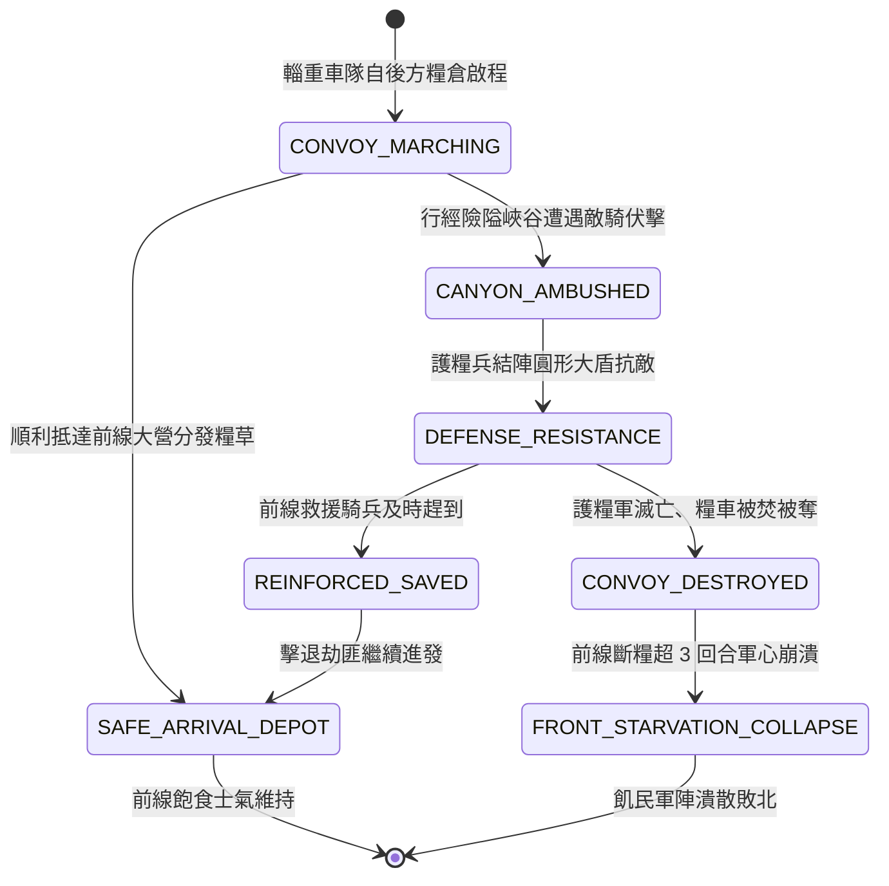

<!-- doc_id: doc_spec_0809 -->
# 3KLife 戰場糧道輜重車隊押運與險隘遇伏斷糧雪崩狀態機規格書

## 模組基本資訊
- **模組代號**：`SUPPLY-TRAIN-CONVOY01`
- **系統定位**：三國戰場動態後勤輜重押運與糧道攻防系統，負責後方糧草轉運車隊推進、險隘峽谷設伏劫糧、前線斷炊士氣暴跌與全軍飢餓潰散判定。
- **架構依賴**：`BattleGridSystem`、`SupplyLineEngine`、`MoraleSystem`、`VFXBlockRegistry`。

---

## 核心設計概念
古代用兵「兵馬未動，糧草先行」。前線數萬大軍每日消耗浩瀚糧餉，完全依賴後方補給線輜重車隊定期輸送。運糧車隊由民夫推挽木車、護糧軍隊隨行護衛，沿狹長峽谷官道慢速蠕動。敵軍精銳騎兵常於咽喉隘口設伏（如截擊糧道、火燒輜重）。若糧車被焚毀或繳獲，前線部隊補給歸零，立刻陷入「軍無糧草則散」之大雪崩絕境。



---

## 狀態機定義與轉換條件

### 1. `CONVOY_MARCHING`（車隊行軍狀態）
- **進入條件**：後方郡縣定期派出「糧道輜重隊」（包含 10 輛雙輪木車、200 名民夫、100 名護糧刀盾兵）。
- **行為表現**：
  - 移動速度為 2 格/回合，沿既定官道或木棧道路徑行進。
  - 對周遭 2 格具備基礎斥候警戒視野。
- **轉換**：
  - 順利行至前線營寨地格 -> 轉移至 `SAFE_ARRIVAL_DEPOT`。
  - 進入隱蔽敵軍伏擊圈（敵軍伏兵於兩側高地或草叢發起進攻） -> 轉移至 `CANYON_AMBUSHED`。

### 2. `CANYON_AMBUSHED`（隘口遇伏狀態）
- **行為表現**：
  - 敵軍伏兵推落滾石或射出火箭截斷車隊頭尾。
  - 民夫陷入驚慌混亂，車隊前進速度歸零。
- **轉換**：護糧隊官拔刀結陣 -> 轉移至 `DEFENSE_RESISTANCE`。

### 3. `DEFENSE_RESISTANCE`（結陣護糧狀態）
- **行為表現**：
  - 護糧兵圍繞糧車結成環形防禦陣，防禦力 +30%。
  - 發射告急狼煙信號火箭向相鄰 8 格範圍求援。
- **轉換**：
  - 護糧部隊全滅 -> 轉移至 `CONVOY_DESTROYED`。
  - 己方救援部隊在 2 回合內馳援並殲滅敵伏兵 -> 轉移至 `REINFORCED_SAVED`。

### 4. `CONVOY_DESTROYED`（糧車覆滅狀態）
- **行為表現**：
  - 糧草被敵軍繳獲或點火焚燒，化為沖天黑煙。
  - 前線大本營「補給計量」中斷，進入斷炊倒數。
- **轉換**：前線連續 3 回合未獲得新糧草補充 -> 轉移至 `FRONT_STARVATION_COLLAPSE`。

### 5. `FRONT_STARVATION_COLLAPSE`（前線斷糧雪崩狀態）
- **行為表現**：
  - 前線全軍部隊陷入「極度飢餓」：戰馬無草倒斃、士卒煮甲充飢。
  - 全軍士氣每回合 -25 點，部隊攻擊力與防禦力強制扣除 40%，部隊大批逃亡潰散。
- **轉換**：全軍戰力喪失或主將撤軍 -> 結束退出。

### 6. `SAFE_ARRIVAL_DEPOT`（糧餉抵達狀態）
- **行為表現**：
  - 糧草運抵前線大營入庫，全軍獲取 5 回合充沛補給。
  - 前線各軍士氣 +10 點。
- **轉換**：糧餉結算完成 -> 結束退出。

---

## 數值公式與配置契約

```typescript
export interface SupplyTrainConfig {
  trainId: string;
  grainCapacityUnits: number;     // 運載糧草單位數
  marchSpeedGrids: number;        // 行軍每回合格數
  convoyEscortHp: number;         // 護糧隊總耐久
  distressSignalRadiusGrid: number;// 求援烽火半徑
  starvationTriggerTurns: number; // 斷糧觸發雪崩寬限回合
  starvationAttackPenaltyRate: number; // 飢餓攻防削弱比
  starvationMoraleDropPerTurn: number; // 飢餓每回合士氣扣除
}

export const SUPPLY_TRAIN_PRESETS: Record<string, SupplyTrainConfig> = {
  STANDARD_GRAIN_CART: {
    trainId: 'TRAIN_STANDARD_01',
    grainCapacityUnits: 5000,
    marchSpeedGrids: 2,
    convoyEscortHp: 400,
    distressSignalRadiusGrid: 8,
    starvationTriggerTurns: 3,
    starvationAttackPenaltyRate: 0.40,
    starvationMoraleDropPerTurn: -25,
  }
};
```

---

## 單元測試與驗收標準
1. **行軍求援烽火廣播**：護糧車隊遇伏後，8 格範圍內己方駐軍即刻收到求援標記與倒數計時。
2. **斷糧雪崩懲罰結算**：前線補給歸零並持續 3 回合未獲得補充時，全軍攻擊力強制降低 40% 且士氣每回合 -25。
3. **安全抵達補給回充**：車隊抵達前線大本營時，補給庫存即刻增加 5000 單位，部隊獲得「糧足士氣振奮」狀態。
