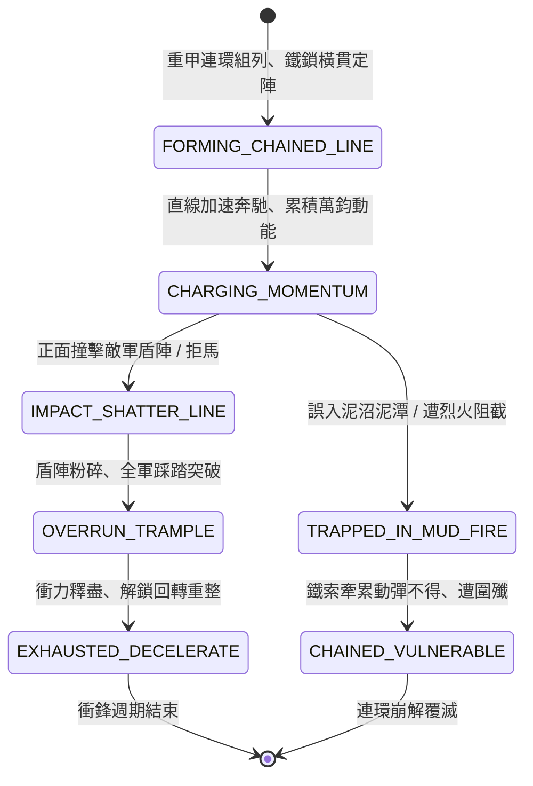

<!-- doc_id: doc_spec_0805 -->
# 3KLife 戰場鐵甲連環重騎衝鋒正面撞碎拒馬盾陣動能狀態機規格書

## 模組基本資訊
- **模組代號**：`CHAINED-IRON-CAVALRY01`
- **系統定位**：三國重裝具裝甲騎（鐵索連環馬）正面破陣與動能衝擊系統，負責連環重甲編組、直線衝鋒蓄積萬鈞動能、撞碎步兵盾陣拒馬與畏泥懼火之完整狀態流。
- **架構依賴**：`BattleGridSystem`、`TroopTypeMovement`、`BattleDamageEngine`、`VFXBlockRegistry`。

---

## 核心設計概念
三國時期北方精銳之巔峰極致（如袁紹大戟士之對手公孫瓚、曹操虎豹騎甲騎具裝、西涼鐵騎），重甲騎兵人馬皆披沉女生鐵鎖子甲，以橫木鐵索數騎或數十騎連為一列。平原交戰時，連環鐵騎排山倒海直線推進，憑藉無與倫比之恐怖質量與重力加速度動能，能硬生生正面撞碎步兵大盾列陣與木質拒馬。但其弱點亦極度明顯：回轉笨重無比、懼怕泥沼深潭與火箭火攻。



---

## 狀態機定義與轉換條件

### 1. `FORMING_CHAINED_LINE`（連環列陣狀態）
- **進入條件**：3 支相鄰重騎兵小隊具備「連環鐵索」戰法，下達組列指令。
- **行為表現**：
  - 小隊橫向連接鎖定，轉變為不可分割之寬幅衝擊正面（寬度 3 格）。
  - 防禦力提升 60%，但轉向耗費行動力翻倍。
- **轉換**：陣列鎖定完成 -> 轉移至 `CHARGING_MOMENTUM`。

### 2. `CHARGING_MOMENTUM`（動能蓄積衝刺狀態）
- **行為表現**：
  - 直線奔馳，每移動 1 格衝擊動能累積 +25%（最高累積至 200%）。
  - 馬蹄震天，前方 2 格步兵陷入「震懾」狀態，無法主動走位。
- **轉換**：
  - 正面接觸敵步兵盾陣或木質拒馬 -> 轉移至 `IMPACT_SHATTER_LINE`。
  - 接觸泥沼、水坑或火海地格 -> 轉移至 `TRAPPED_IN_MUD_FIRE`。

### 3. `IMPACT_SHATTER_LINE`（破陣撞碎結算狀態）
- **行為表現**：
  - **撞碎拒馬**：無視拒馬穿刺反衝，以巨大動能直接將木質拒馬碾為碎屑。
  - **粉碎盾陣**：步兵大盾被撞飛破裂，前排步兵受到 700~1100 點粉碎性衝擊傷害，全隊向後擊退 2 格。
- **轉換**：正面障礙粉碎貫通 -> 轉移至 `OVERRUN_TRAMPLE`。

### 4. `OVERRUN_TRAMPLE`（鐵蹄踩踏突破狀態）
- **行為表現**：
  - 順勢碾壓穿過敵軍破裂防線，對殘存步兵造成二次踩踏傷害。
  - 敵步兵防線徹底被撕開 3 格豁口。
- **轉換**：穿透 2 格距離或動能衰減歸零 -> 轉移至 `EXHAUSTED_DECELERATE`。

### 5. `TRAPPED_IN_MUD_FIRE`（泥火受困失控狀態）
- **行為表現**：
  - 沉重鐵甲深陷泥漿或戰馬被烈火燒身，連環鐵索互相拉扯絆倒。
  - 移動力強制降為 0，防禦力驟降 70%。
- **轉換**：陷入任人宰割之絕境 -> 轉移至 `CHAINED_VULNERABLE`。

### 6. `EXHAUSTED_DECELERATE`（衝力耗盡減速狀態）
- **行為表現**：
  - 戰馬體力消耗殆盡，速度歸零，解開鐵索鎖定以便個別轉向。
- **轉換**：冷卻重整完畢 -> 結束退出。

---

## 數值公式與配置契約

```typescript
export interface ChainedIronCavalryConfig {
  cavalryId: string;
  chainUnitsCount: number;         // 連環單位數 (通常為 3)
  momentumAccumulateRate: number;  // 每格奔馳動能累積率
  maxMomentumBonusMult: number;    // 最大動能傷害倍率 (2.0 ~ 3.0)
  shieldBreachChance: number;      // 撞碎大盾防禦機率 (0.0 ~ 1.0)
  mudTrappedVulnerability: number; // 泥沼受困易傷倍率
  turnMobilityPenalty: number;     // 轉向機動懲罰
}

export const CHAINED_CAVALRY_PRESETS: Record<string, ChainedIronCavalryConfig> = {
  HEAVY_IRON_CHAIN: {
    cavalryId: 'CAV_IRON_CHAIN_01',
    chainUnitsCount: 3,
    momentumAccumulateRate: 0.25,
    maxMomentumBonusMult: 2.0,
    shieldBreachChance: 0.95,
    mudTrappedVulnerability: 2.5,
    turnMobilityPenalty: -3,
  }
};
```

---

## 單元測試與驗收標準
1. **動能疊加與撞碎拒馬**：直線衝刺達 4 格後動能達到 200%，正面撞擊木質拒馬 100% 直接撞毀，不承受常規拒馬貫穿反傷。
2. **正面盾陣擊飛**：重步兵大盾防禦在連環鐵騎撞擊下直接破碎，部隊強制後退 2 格且防禦值清空。
3. **泥沼受困致命反噬**：連環重騎踏入泥潭地格時，立即中斷衝鋒，移動力降為 0 且受到攻擊傷害提升 2.5 倍。
