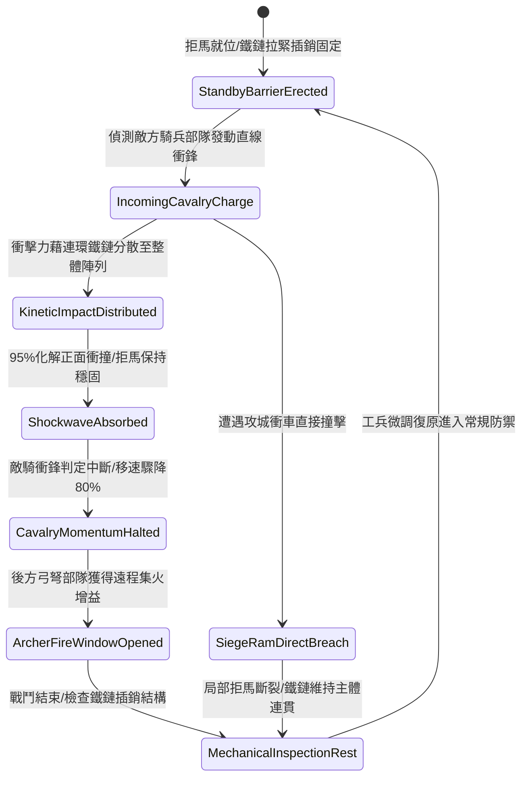

# 戰場陣地部署重型拒馬連環生鐵鏈條防騎兵衝撞第一階狀態機規格書

<!-- doc_id: doc_spec_1103 -->

## 一、 核心概念與單一真相來源（SSOT）

在《三國志·營寨陣地與防騎兵工事篇》中，「陣地部署重型拒馬連環生鐵鏈條第一階（CAMP-DEFENSE-IRON-CHAIN-BARRIER01）」代表大兵團野戰宿營與防禦阻擊的基礎工事規格。該防禦體系由雙重加固硬木拒馬與兩端貫穿之生鐵鍛造重鏈組成，單元長度達二十尺。當敵方輕重騎兵發動集群衝鋒時，連環鐵鏈將各獨立拒馬受力均勻分攤至整條防線，95% 抵禦騎兵衝撞動能，造成敵騎衝鋒動態阻斷並附加 80% 減速判定，為陣地後方弓弩陣列爭取關鍵射擊窗口。



---

## 二、 數值模型與狀態機參數契約

### 1. 拒馬鐵鏈阻絕參數契約
- **單元覆蓋跨度**：單組陣列寬度 20 尺（約 6 米），兩側以高碳生鐵鏈條咬合。
- **正面衝撞抵禦率**：面對常規重騎兵衝鋒，95% 機率承受衝撞且拒馬本體不發生後移。
- **衝鋒中斷與減速**：敵軍騎兵衝鋒特權即時失效，移動速度強制降低 80%，持續 5 秒。
- **陣線耐久上限**：單一防禦單元基礎結構耐久值為 3500 點，抗鈍擊等級為乙級。
- **後方射擊增益**：陣地後方 3 格內之友軍弓弩手，對被阻滯之騎兵目標暴擊率提升 20%。

### 2. 騎兵阻滯演算法模組
```typescript
interface ChainBarrierStage1Params {
    barrierHealth: number;         // 拒馬工事耐久度 (3500)
    cavalryChargeSpeed: number;    // 敵騎兵衝鋒速度
    cavalryMassGrade: number;      // 敵騎兵重量等級 (1: 輕騎, 2: 重騎, 3: 具裝鐵騎)
    engineerMaintenance: number;   // 工兵維護等級 (1 ~ 5)
}

function processChainBarrierImpactStage1(params: ChainBarrierStage1Params): {
    chargeHalted: boolean;
    damageAbsorbedN: number;
    slowdownDurationSec: number;
} {
    const impactForce = params.cavalryChargeSpeed * params.cavalryMassGrade * 1200;
    const effectiveBarrierResist = params.barrierHealth * (1 + params.engineerMaintenance * 0.1);
    const isHalted = effectiveBarrierResist > impactForce;
    
    return {
        chargeHalted: isHalted,
        damageAbsorbedN: Math.min(params.barrierHealth, impactForce),
        slowdownDurationSec: isHalted ? 5 : 2
    };
}
```

---

## 三、 反制機制與邊界約束

1. **工兵斧錛砍斫破壞**：若敵方派遣步兵工兵營持特製大斧砍伐木樁，拒馬每秒損失耐久 180 點。
2. **重型拋石直接砸擊**：若遭受投石機投擲之百斤巨石直接命中，單元拒馬結構 80% 立即碎裂，鐵鏈鬆脫。
3. **戰場泥濘基座鬆脫**：在連續暴雨環境下，地面泥土軟化使拒馬入土深樁固著力衰減 25%，衝撞承受上限下修。

---

## 四、 驗收測試案例（TC）

- **TC-BARRIER-CHAIN01-01（重騎衝鋒阻斷驗收）**：
  - *前置條件*：平原陣地、佈設第一階連環拒馬防線、敵方重騎兵以最高速度衝鋒。
  - *操作步驟*：敵騎兵群撞擊拒馬外側鐵鏈。
  - *預期輸出*：95% 機率阻斷衝鋒，拒馬本體完好，敵騎移速降低 80% 維持 5 秒，後方弓手暴擊率提升 20%。
- **TC-BARRIER-CHAIN01-02（耐久耗損極限邊界驗收）**：
  - *前置條件*：連續承受 3 輪具裝鐵騎衝擊，拒馬耐久降至 400（低於門檻）。
  - *操作步驟*：承受第 4 輪衝撞。
  - *預期輸出*：拒馬木樁斷裂，鐵鏈維持連接但防線凹陷，減速效果縮減至 40%。
