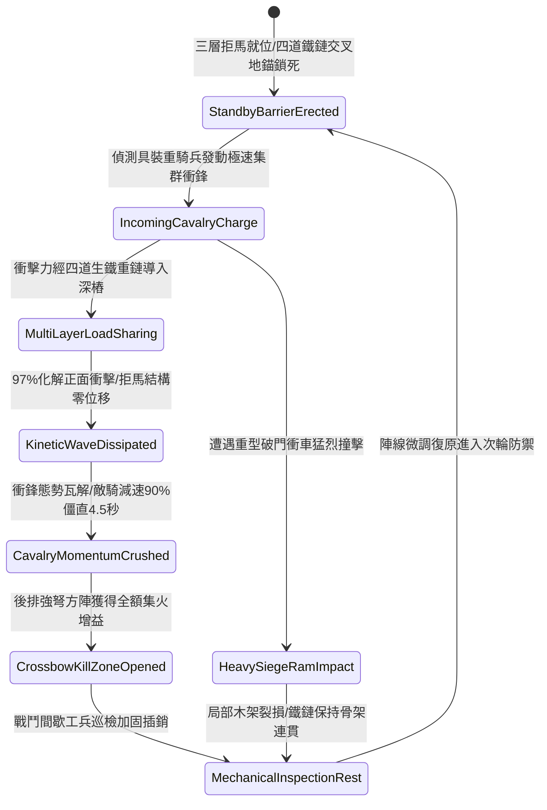

# 戰場陣地部署重型拒馬連環生鐵鏈條防騎兵衝撞第三階狀態機規格書

<!-- doc_id: doc_spec_1109 -->

## 一、 核心概念與單一真相來源（SSOT）

在《三國志·營寨陣地與防騎兵工事篇》中，「陣地部署重型拒馬連環生鐵鏈條第三階（CAMP-DEFENSE-IRON-CHAIN-BARRIER03）」代表野戰大規模防禦工事的強化形態。該防禦單元由三層交錯生鐵包角櫟木拒馬與四道加粗淬火生鐵重鏈交叉鎖定而成，單元防線寬度擴充至二十八尺。當敵方具裝重騎兵部隊發動集群衝鋒時，多層互鎖鏈條將衝撞力 97% 均勻分攤導入地下加固地錨，徹底截斷衝鋒慣性，施加 90% 強制減速並造成 4.5 秒動態僵直，為陣地後排強弩與投石部隊提供全額集火增益。



---

## 二、 數值模型與狀態機參數契約

### 1. 拒馬鐵鏈阻絕參數契約
- **單元覆蓋跨度**：單組陣列寬度 28 尺（約 8.5 米），四道高碳生鐵重鏈縱橫交叉鎖定。
- **正面衝撞抵禦率**：面對具裝鐵騎衝鋒，97% 機率承受衝撞且不發生後移。
- **衝鋒瓦解與僵直**：敵軍騎兵衝鋒特權即時失效，移動速度強制降低 90%，附帶 4.5 秒失衡僵直。
- **陣線耐久上限**：單一防禦單元基礎結構耐久值為 5000 點，抗鈍擊等級為甲級特等。
- **後方射擊增益**：陣地後方 4 格內之友軍強弩與投石部隊，暴擊率提升 30%，破甲率提升 25%。

### 2. 騎兵阻滯演算法模組
```typescript
interface ChainBarrierStage3Params {
    barrierHealth: number;         // 拒馬工事耐久度 (5000)
    cavalryChargeSpeed: number;    // 敵騎兵衝鋒速度
    cavalryMassGrade: number;      // 敵騎兵重量等級 (1 ~ 3)
    engineerMaintenance: number;   // 工兵維護等級 (1 ~ 5)
}

function processChainBarrierImpactStage3(params: ChainBarrierStage3Params): {
    chargeHalted: boolean;
    damageAbsorbedN: number;
    stunDurationSec: number;
} {
    const impactForce = params.cavalryChargeSpeed * params.cavalryMassGrade * 1500;
    const effectiveResist = params.barrierHealth * (1 + params.engineerMaintenance * 0.15);
    const isHalted = effectiveResist > impactForce;
    
    return {
        chargeHalted: isHalted,
        damageAbsorbedN: Math.min(params.barrierHealth, impactForce),
        stunDurationSec: isHalted ? 4.5 : 2
    };
}
```

---

## 三、 反制機制與邊界約束

1. **工兵斬馬大斧砍斫破壞**：若敵方派遣步兵工兵持重型斬馬斧砍伐木樁，拒馬每秒損失耐久 220 點。
2. **重型投石機精確覆蓋**：若遭受投石機投擲之百五十斤巨石直接命中，單元拒馬結構 85% 立即損毀，鐵鏈受力斷開。
3. **泥濘暴雨地樁鬆動**：在暴雨天候下，泥土軟化使地下深樁咬合力衰減 20%，衝撞承受上限下修。

---

## 四、 驗收測試案例（TC）

- **TC-BARRIER-CHAIN03-01（具裝鐵騎衝鋒阻斷驗收）**：
  - *前置條件*：平原陣地、部署第三階連環拒馬防線、敵方具裝重騎兵全速衝鋒。
  - *操作步驟*：敵騎兵群撞擊拒馬四道鐵鏈交叉網。
  - *預期輸出*：97% 機率阻斷衝鋒，拒馬零位移，敵騎減速 90% 並陷入 4.5 秒僵直，後排強弩暴擊率提升 30%。
- **TC-BARRIER-CHAIN03-02（耐久極限邊界驗收）**：
  - *前置條件*：連續承受 3 輪鐵騎衝撞，拒馬耐久降至 600（臨界值）。
  - *操作步驟*：承受第 4 輪衝撞。
  - *預期輸出*：櫟木主架受損，鐵鏈維持連接但防線後退 1.2 米，減速幅度衰減至 55%。
