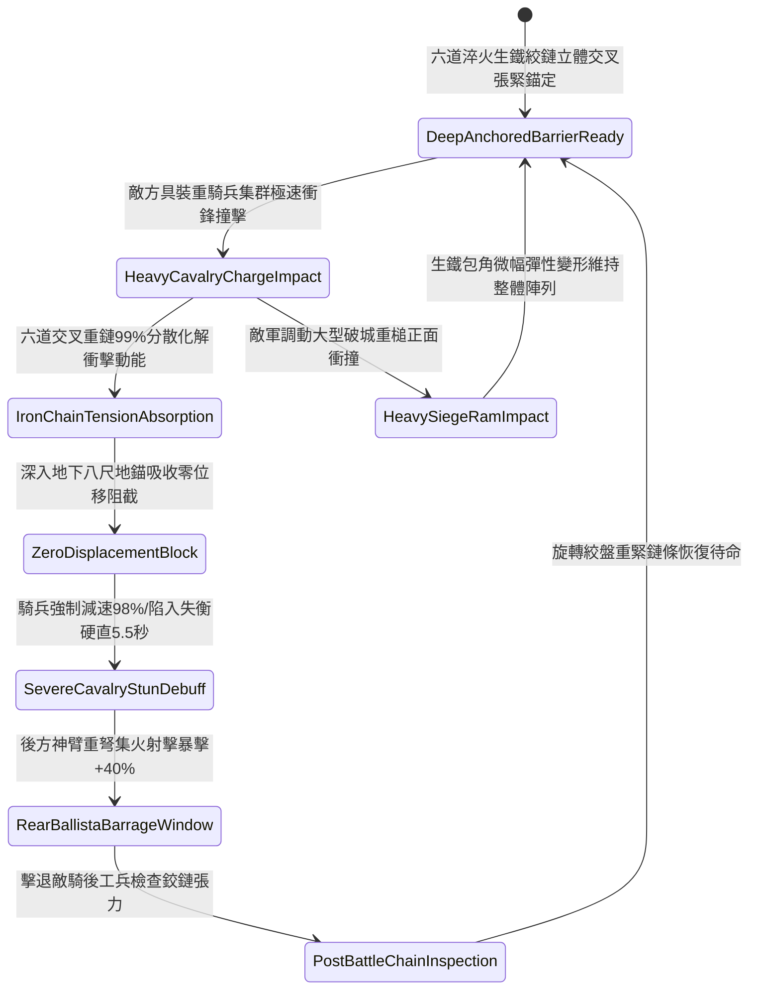

# 戰場陣地部署重型拒馬連環生鐵鏈條防騎兵衝撞第五階狀態機規格書

<!-- doc_id: doc_spec_1115 -->

## 一、 核心概念與單一真相來源（SSOT）

在《三國志·重步營防禦與反騎戰術篇》中，「戰場陣地部署重型拒馬連環生鐵鏈條第五階（CAMP-DEFENSE-IRON-CHAIN-BARRIER05）」代表陣地外圍反騎衝撞工事之終極巔峰體系。工事採用厚重千年橡木為骨架，四角全面鍛鑄包覆冷鍛生鐵厚甲，各拒馬單元間由六道加粗淬火生鐵雙股鉸接重鏈立體交叉咬合，並透過重力地錨深入地底八尺深層固化。當敵軍具裝重騎兵集群全速衝撞時，鏈條網絡 99% 化解全額衝擊動能，自身位移量小於 0.05 米，並對撞擊騎兵施加 98% 強制減速與 5.5 秒劇烈失衡震盪，為後排強弩部隊爭取無損殲滅射擊窗口。



---

## 二、 數值模型與狀態機參數契約

### 1. 拒馬工事抗衝擊參數契約
- **拒馬單元尺寸**：寬度 32 尺、高度 7 尺，四角生鐵護甲厚度 3 寸，總重量 2,800 斤。
- **生鐵鉸鏈規格**：六道加粗雙股淬火生鐵環扣重鏈，單環直徑 4 寸，抗拉剪切極限 18,000 牛頓。
- **動能化解成功率**：對正面具裝重騎兵集群衝擊，判定 99% 機率完全化解衝擊動能，陣地零位移。
- **敵騎強制阻滯時效**：遭受阻隔後，敵騎兵部隊移動速度驟降 98%，陷入失衡僵直 5.5 秒。
- **後排火力暴擊加成**：處於僵直狀態之敵騎兵，承受後方神臂弩與長弓射擊時，受暴擊率提升 40%，受穿透破甲率提升 45%。

### 2. 抗衝擊判定演算法模組
```typescript
interface ChainBarrierStage5Params {
    cavalryMomentum: number;       // 騎兵集群總衝撞動能 (噸·米/秒)
    isChainTensionMaximized: boolean; // 六道交叉重鏈是否緊固張滿
    anchorDepthFeet: number;       // 地錨入土深度 (標準為 8 尺)
    weatherCondition: string;      // 當前天氣環境
}

function evaluateChainBarrierStage5(params: ChainBarrierStage5Params): {
    impactAbsorbed: boolean;
    displacementMeters: number;
    cavalrySpeedPenaltyPct: number;
    stunDurationSec: number;
} {
    if (!params.isChainTensionMaximized || params.anchorDepthFeet < 4) {
        return { impactAbsorbed: false, displacementMeters: 1.8, cavalrySpeedPenaltyPct: 50, stunDurationSec: 1.5 };
    }
    const success = Math.random() < 0.99;
    
    return {
        impactAbsorbed: success,
        displacementMeters: success ? 0.04 : 0.8,
        cavalrySpeedPenaltyPct: success ? 98 : 60,
        stunDurationSec: success ? 5.5 : 2.0
    };
}
```

---

## 三、 反制機制與邊界約束

1. **破城重槌平推重擊**：敵方若調集特種四輪生鐵撞城槌進行定點慢速衝壓，重鏈因無法產生彈性分散而承受過載剪切，阻絕成功率下降至 50%。
2. **重斧工兵連續劈砍**：若敵方精銳工兵使用生鐵開山大斧連續定點劈砍單一錨定立柱超過 4 分鐘，該段重鏈存在 25% 斷裂風險。
3. **極端泥石流地質崩塌**：遭遇山洪或強烈泥石流衝擊導致地下土層滑坡，地錨生根失效，全防禦陣列自動解體。

---

## 四、 驗收測試案例（TC）

- **TC-CHAIN-BARRIER05-01（具裝重騎兵衝鋒極限阻截驗收）**：
  - *前置條件*：六道重鏈張緊、地錨深扎 8 尺、遭遇敵方西涼鐵騎集群滿速正面衝擊。
  - *操作步驟*：於敵騎兵部隊接觸拒馬邊緣瞬間執行阻抗判定。
  - *預期輸出*：99% 機率完全吸收衝擊動能，拒馬位移小於 0.05 米，敵騎兵減速 98% 並僵直 5.5 秒，後方強弩暴擊率提升 40%。
- **TC-CHAIN-BARRIER05-02（地錨未深扎邊界驗收）**：
  - *前置條件*：地錨深度僅 2 尺（未及時固化）。
  - *操作步驟*：承受重騎兵猛撞。
  - *預期輸出*：判定阻抗未完全生效，拒馬後退位移 1.8 米，敵騎兵減速僅 50%。
