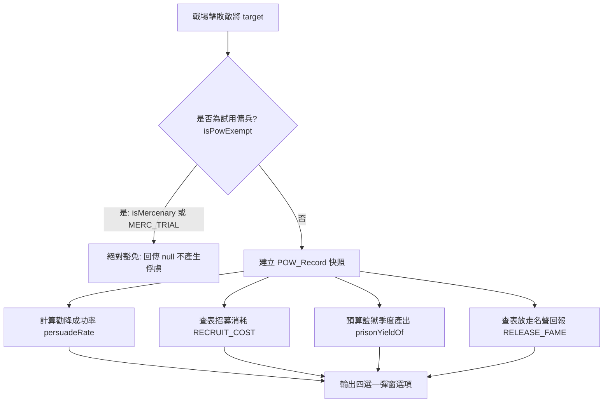

<!-- doc_id: doc_spec_0499 -->
<!-- spec_id: POW-03 -->
# 戰後俘虜勸降機率模型與招募城市兵源扣減規格書

> 標籤：`系統規格` `戰場俘虜` `勸降率` `招募消耗` `POW-03` `POW-04`
> 狀態：`正式生效` · 責任模組：`PrisonerOfWar` · 參照：`POW-03` / `POW-04` / `doc_spec_0021`

---

## 1. 模組定位與設計理念

戰後俘虜處置是三國亂世中擴充名將陣容、削弱敵對國力的核心途徑。
戰場勝利俘獲敵將後，玩家面臨「勸降（Persuade）、招募（Recruit）、關押（Imprison）、釋放（Release）」四選一決策。
本規格書定義俘虜處理核心演算法（`PrisonerOfWar.ts`），遵循以下原則：
1. **試用傭兵絕對豁免**：契約傭兵戰敗後必定安全撤退，嚴禁產生俘虜紀錄。
2. **多屬性勸降精算模型**：融合說客魅力與幸運、俘虜自身抗性與忠誠度，數值嚴格鎖定在 1%~95% 區間。
3. **招募雙資產扣減機制**：直接招募除需消耗大量黃金撫恤金外，強制扣減所屬「城市兵源（City Troops）」，象徵為其重組親衛私兵。
4. **即時快照生成與無副作用計算**：戰後立即封裝 `POW_Record` 預算全部選項收益與消耗，便於 UI 無延遲呈現。

---

## 2. 傭兵豁免與俘虜產生守衛

戰鬥結算時，系統檢核敵方敗將是否具備俘虜豁免權限：

- **試用傭兵標籤 (`MERC_TRIAL`)**：
  若 `target.isMercenary` 為真，或攜帶 `MERC_TRIAL` 旗標，戰敗後自動安然撤退，絕不轉化為戰俘（回傳 `null`）。

---

## 3. 勸降成功率精算公式 (persuadeRate)

勸降成功率受說客才智與俘虜心理抗性交互影響，以百分比表示（保留 1 位小數）：

$$\text{Rate} = \text{clamp}\left(1\%, 95\%, 20\% + (\text{CHR}_{p} - \text{CHR}_{t}) \times 0.5 + \text{LUK}_{p} \times 0.2\% - \text{Loyalty}_{t} \times 0.3\% + \text{Bonus}_{item}\right)$$

### 3.1 參數細則與常數定義
- `PERSUADE_BASE_RATE = 20`（基礎起步成功率 20%）。
- **說客魅力壓制**：$(\text{persuader.cha} - \text{target.cha}) \times 0.5$（魅力差每大 10 點，成功率 $+5\%$）。
- **說客幸運加成**：$\text{persuader.luk} \times 0.2$。
- **俘虜忠誠抵抗**：$\text{target.loyalty} \times 0.3$（忠誠越高越寧死不屈，預設為 60 點）。
- **上下界防護**：
  - `PERSUADE_RATE_MIN = 1.0%`（杜絕 0% 絕望感）。
  - `PERSUADE_RATE_MAX = 95.0%`（杜絕 100% 必然收服，保留歷史變數）。

---

## 4. 招募雙資產扣減矩陣 (RECRUIT_COST)

若玩家選擇放棄口舌、直接消耗重金招募收買，依武將稀有度（`rarity`）雙向扣除國庫黃金與城池儲備兵源：

| 武將稀有度 (`PowRarity`) | 扣除黃金 (`gold`) | 扣除城市兵源 (`troops`) | 象徵意義與戰略代價 |
|:---:|:---:|:---:|---|
| **`R`** (精銳) | **500** | **200** | 基層偏將，配發少量巡邏私兵 |
| **`SR`** (良將) | **2000** | **500** | 中堅校尉，重建精銳親衛營 |
| **`SSR`** (名將) | **8000** | **1500** | 國士無雙，組建獨立軍團專屬軍勢 |

- **防呆校驗**：若城池兵源或黃金不足，決策立即被拒，彈窗提示「城市兵源不足」或「黃金不足」。

---

## 5. 監獄收益與放走回報

除勸降與招募外，其餘兩項處置具備確定性數值產出：

### 5.1 關押監獄季度產出 (`prisonYieldOf`)
若選擇押入大牢，俘虜每季為勢力產出情報與物資：
- **情報產出**：$\lfloor \text{target.int} \times 0.1 \rfloor$ 點情報。
- **物資產出**：$\lfloor 50 + \text{target.pol} \times 0.5 \rfloor$ 點物資。
- **容量上限**：主城等級 1~15 級對應 $3 \sim 10$ 個牢房格位，滿倉時禁止關押。

### 5.2 釋放遣返回報 (`RELEASE_FAME` / `FUTURE_RETURN_CHANCE`)
- **名聲回報**：R 級獲取 100 點、SR 級獲取 300 點、SSR 級獲取 500 點大眾名聲。
- **主動來投種子**：被釋放之將領，後續每季有 **5%**（`FUTURE_RETURN_CHANCE = 0.05`）機率感念仁德，主動來投歸附。
