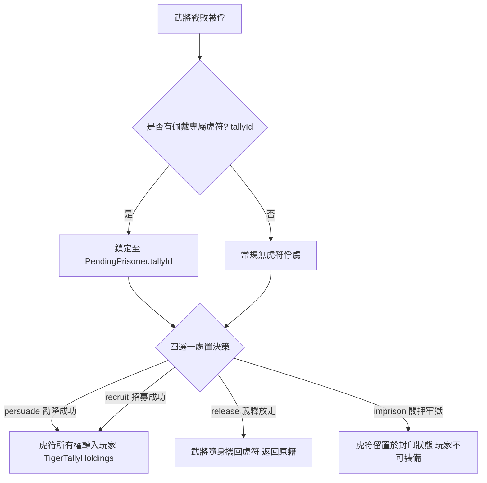

<!-- doc_id: doc_spec_0508 -->
<!-- spec_id: POW-08 -->
# 戰敗武將虎符沒收歸屬與義釋帶走規則規格書

> 標籤：`系統規格` `戰場俘虜` `英靈虎符` `資產歸屬` `POW-08`
> 狀態：`正式生效` · 責任模組：`PrisonerOfWar` · 參照：`POW-08` / `doc_spec_0040` / `doc_spec_0021`

---

## 1. 模組定位與設計理念

英靈虎符（Tiger Tally）是調度特種軍勢與釋放血脈戰法的神兵信物。武將在戰場落敗被俘時，其所佩戴之專屬虎符處置涉及嚴謹的物權歸屬與政治倫理。
本規格書定義戰後俘虜虎符沒收、攜回與身故回歸之物權轉移規則（`PrisonerOfWar.ts`），確立以下原則：
1. **投降方可易主（Surrender Transfers Ownership）**：虎符象徵軍心所向，唯有敵將心悅誠服歸降（勸降成功）或接受重金聘攬（招募成功）時，虎符方正式易主為玩家所有。
2. **義釋連帶攜回（Release Retains Tally）**：若玩家選擇仁道義釋，敵將必定攜帶其專屬虎符安然返回原籍，嚴禁強制剝奪其隨身信物。
3. **身故回歸宗廟（Death Reverts to Liege）**：若俘虜未及歸順便於牢獄中逝世或陣亡，其英靈虎符自動化為流光回歸原君主祖廟或大地圖在野神祠。
4. **杜絕刷物防禦機制**：嚴防利用重複俘虜與放走機制進行虎符洗練或無損拆裝。

---

## 2. 虎符綁定與待處置資料結構

戰鬥結算產生俘虜時，系統將敗將及其佩戴之虎符原子鎖定於 `PendingPrisoner`：



### 2.1 待處置俘虜模型 (PendingPrisoner)
```typescript
export interface PendingPrisoner<T = unknown> {
    record: PowRecord;     // 俘虜處置四選項快照
    target: T;             // 武將完整屬性
    tallyId?: string;      // 該俘虜佩戴之虎符唯一識別碼
}
```

---

## 3. 四選一決策對虎符之轉移狀態矩陣

| 處置決策 (`PowDecision`) | 執行結果狀態 | 虎符最終歸屬處置 (`Tally Resolution`) | 系統行為約束 |
|---|---|---|---|
| **勸降 (`persuade`)** | 成功歸順 | **正式轉移給玩家** (`Transfer to Player`) | 虎符入庫至玩家背包，該武將解鎖該兵種指揮權 |
| **招募 (`recruit`)** | 成功收買 | **正式轉移給玩家** (`Transfer to Player`) | 耗費重金與兵源，虎符隨將領共同轉入玩家麾下 |
| **義釋 (`release`)** | 釋放遣返 | **武將隨身攜走** (`Retained by General`) | 玩家**不得扣押**該虎符，虎符伴隨該將回歸原勢力 |
| **關押 (`imprison`)** | 投入大牢 | **臨時封印凍結** (`Temporarily Sealed`) | 虎符被收繳在庫保管，但玩家**不可裝備亦不可分解** |

---

## 4. 異常與死亡回歸機制

1. **獄中身故或處決**：
   若關押期間該武將因壽命終結或體力耗盡死亡，被封印之虎符不可由玩家無償繼承，自動觸發：
   `虎符銷蝕 → 回歸其原勢力君主神祠` 或以 30% 機率降格流入大地圖在野神龕（對應 `doc_spec_0498`）。
2. **勸降失敗後續處置**：
   勸降失敗時（`PERSUADE_FAILED`），虎符依然維持在 `PendingPrisoner` 鎖定態，玩家後續改選 `imprison` 則封印、改選 `release` 則歸還。
3. **單元測試驗收**：
   - 釋放攜帶虎符之俘虜，驗證玩家背包 `TigerTallyHoldings` 數量不增加。
   - 招募成功時，`tallyId` 正式掛載於玩家名下並可於戰場部署出征。
