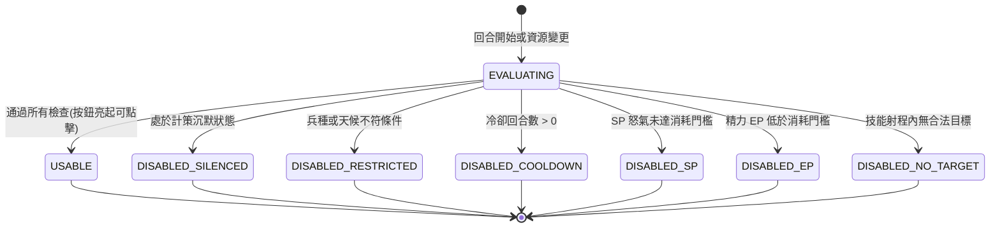

# 戰法施放可用狀態決策與灰化原因解析規格書

<!-- doc_id: doc_spec_0606 -->

> 本規格書依據 WBS `TAC-14`（UI 資料出口：GeneralDetail Skills 分頁、BattleScene 戰法摘要/可施放狀態/灰化原因）制定，為戰場 HUD 與武將戰法可用性決策單一真相來源（Single Source of Truth）。
> 核心約束：無副作用純邏輯架構、階梯優先級灰化判定、精確本地化灰化原因對照、戰報與UI共用狀態機、全繁體中文台灣慣用術語。

---

## 1. 業務定位與戰法槽位狀態機

在戰鬥操作階段，武將配置的 1~6 個戰法槽位必須即時評估當前能否施放。若不可施放，按鈕必須灰化並在點擊或長按時顯示明確原因，防止玩家誤判。



### 1.1 灰化評估優先級鏈（Evaluation Hierarchy）
當戰法同時存在多重不可用原因時，系統依據「根本限制 $\rightarrow$ 資源不足 $\rightarrow$ 戰場動態」之嚴格順序回傳第一優先級原因：
1. **`DISABLED_SILENCED`（優先級 1）**：武將被施加沉默／混亂 DEBUFF，計策全數封鎖。
2. **`DISABLED_RESTRICTED`（優先級 2）**：兵種限制不匹配（如步兵帶騎兵戰法）或天候禁用。
3. **`DISABLED_COOLDOWN`（優先級 3）**：戰法處於冷卻計時（尚餘 $N$ 回合）。
4. **`DISABLED_SP`（優先級 4）**：怒氣不足（需 100 SP）。
5. **`DISABLED_EP`（優先級 5）**：精力不足（單場上限或消耗門檻未達）。
6. **`DISABLED_NO_TARGET`（優先級 6）**：周圍無敵軍或無合法受傷友軍。

---

## 2. 灰化原因解析與本地化對照表

戰法按鈕灰化時，提供統一的 `reasonCode` 與在地化繁體中文提示文案：

| 狀態代碼 | 原因代碼 (`reasonCode`) | 繁體中文提示文案 | UI 視覺提示 |
|---|---|---|---|
| `DISABLED_SILENCED` | `ERR_STATUS_SILENCED` | 處於沉默狀態，無法施展計策 | 灰色按鈕 + 鎖鏈圖示 |
| `DISABLED_RESTRICTED` | `ERR_TROOP_RESTRICTED` | 兵種不符（限騎兵部隊發動） | 灰色按鈕 + 兵種警告角標 |
| `DISABLED_COOLDOWN` | `ERR_IN_COOLDOWN` | 冷卻中（剩餘 {n} 回合） | 灰色按鈕 + 倒數數字遮罩 |
| `DISABLED_SP` | `ERR_SP_INSUFFICIENT` | 怒氣不足（需 {cost} 怒氣） | 灰色按鈕 + 怒氣條閃爍橘光 |
| `DISABLED_EP` | `ERR_EP_INSUFFICIENT` | 精力耗盡，無法發動 | 灰色按鈕 + 汗滴圖示 |
| `DISABLED_NO_TARGET` | `ERR_NO_VALID_TARGET` | 射程內無有效目標 | 灰色按鈕 + 紅色準心斜線 |

---

## 3. 資料結構與純邏輯決策函式

```typescript
export type TacticSlotStatus =
    | 'USABLE'
    | 'DISABLED_SILENCED'
    | 'DISABLED_RESTRICTED'
    | 'DISABLED_COOLDOWN'
    | 'DISABLED_SP'
    | 'DISABLED_EP'
    | 'DISABLED_NO_TARGET';

export interface ITacticRequirement {
    readonly isSilenced: boolean;
    readonly isTroopMatched: boolean;
    readonly cooldownTurns: number;
    readonly requiredSP: number;
    readonly currentSP: number;
    readonly requiredEP: number;
    readonly currentEP: number;
    readonly hasValidTarget: boolean;
}

export interface ITacticEvaluationResult {
    readonly status: TacticSlotStatus;
    readonly isUsable: boolean;
    readonly reasonCode: string | null;
    readonly remainingCooldown?: number;
}

export function evaluateTacticAvailability(req: ITacticRequirement): ITacticEvaluationResult {
    if (req.isSilenced) {
        return { status: 'DISABLED_SILENCED', isUsable: false, reasonCode: 'ERR_STATUS_SILENCED' };
    }
    if (!req.isTroopMatched) {
        return { status: 'DISABLED_RESTRICTED', isUsable: false, reasonCode: 'ERR_TROOP_RESTRICTED' };
    }
    if (req.cooldownTurns > 0) {
        return {
            status: 'DISABLED_COOLDOWN',
            isUsable: false,
            reasonCode: 'ERR_IN_COOLDOWN',
            remainingCooldown: req.cooldownTurns,
        };
    }
    if (req.currentSP < req.requiredSP) {
        return { status: 'DISABLED_SP', isUsable: false, reasonCode: 'ERR_SP_INSUFFICIENT' };
    }
    if (req.currentEP < req.requiredEP) {
        return { status: 'DISABLED_EP', isUsable: false, reasonCode: 'ERR_EP_INSUFFICIENT' };
    }
    if (!req.hasValidTarget) {
        return { status: 'DISABLED_NO_TARGET', isUsable: false, reasonCode: 'ERR_NO_VALID_TARGET' };
    }
    return { status: 'USABLE', isUsable: true, reasonCode: null };
}
```

---

## 4. 驗收測試案例（Test Cases）

| 測試編號 | 測試情境 | 輸入條件 | 預期輸出 |
|---|---|---|---|
| `TC-TACUI-01` | 沉默優先級最高判定 | `isSilenced=true`, `cooldownTurns=2`, `currentSP=10` | 回傳 `DISABLED_SILENCED`，優先度高於冷卻與 SP |
| `TC-TACUI-02` | 冷卻狀態倒數計時輸出 | `cooldownTurns=3`, 其餘條件皆滿足 | 回傳 `DISABLED_COOLDOWN`, `remainingCooldown=3` |
| `TC-TACUI-03` | 射程內無目標攔截 | SP 與冷卻皆正常，但 `hasValidTarget=false` | 回傳 `DISABLED_NO_TARGET`, `isUsable=false` |
| `TC-TACUI-04` | 滿額條件全數通過 | SP 充足、冷卻為 0、兵種匹配、有合法目標 | 回傳 `USABLE`, `isUsable=true`, `reasonCode=null` |
