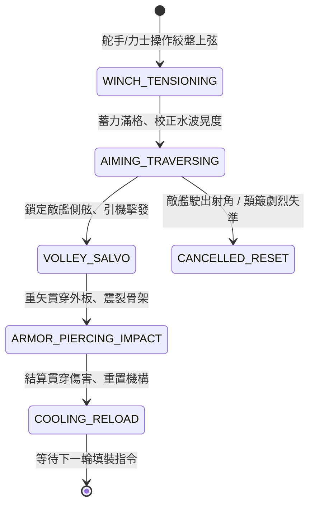

<!-- doc_id: doc_spec_0795 -->
# 3KLife 戰艦三弓床弩連珠重矢齊射撕裂船體狀態機規格書

## 模組基本資訊
- **模組代號**：`REPEATING-BALLISTA-BOAT01`
- **系統定位**：三國大型水軍戰艦遠程重型破甲艦載武器系統，負責三弓床弩蓄力絞弦、搖晃瞄準、連珠巨矢破甲齊射與船體結構震碎結算。
- **架構依賴**：`NavalCombatController`、`NavalShipMovement`、`NavalHullDamageEngine`、`VFXBlockRegistry`。

---

## 核心設計概念
三國時期長江水戰，大型樓船與主力鬥艦配備三弓複合絞盤床弩，以粗大鋼絲麻索蓄積極高彈力，發射長達丈許、如標槍般粗重之「一槍三劍箭」或「連珠鐵鏃巨矢」。重矢於 150 步外破空而出，具有毀滅性穿透力，能直接擊穿生牛皮木質女牆，射穿敵船舷板造成貫通大洞，甚或連環撕裂敵艦操帆桅索與擊殺核心舵手。



---

## 狀態機定義與轉換條件

### 1. `WINCH_TENSIONING`（絞盤上弦蓄力狀態）
- **進入條件**：甲板弩手收到射擊指令，床弩處於待機狀態。
- **行為表現**：
  - 4 名力士推動棘輪絞盤，蓄能計量條由 0% 充能至 100%（需時 4.5 秒）。
  - 若艦體遭受巨浪或撞擊，蓄力時間延長 25%。
- **轉換**：蓄能條達到 100% -> 轉移至 `AIMING_TRAVERSING`。

### 2. `AIMING_TRAVERSING`（水波顛簸瞄準狀態）
- **行為表現**：
  - 床弩底座滑軌轉向目標敵船，扇形射角為艦首左右各 45 度。
  - 計算水面晃動補償：戰艦航速越快、波浪等級越高，瞄準收束圓擴散越大。
- **轉換**：
  - 鎖定目標且準心收斂至 80% 以上 -> 轉移至 `VOLLEY_SALVO`。
  - 目標超出射程（最大 180 步）或射角障礙 -> 轉移至 `CANCELLED_RESET`。

### 3. `VOLLEY_SALVO`（重矢連珠齊射狀態）
- **行為表現**：
  - 擊發扳機，床弩連續釋放 3 枚或 5 枚巨型標槍箭矢。
  - 釋放劇烈回衝力，己方戰艦產生微量側向震盪；播放撕裂空氣音效與軌跡線 VFX。
- **轉換**：箭矢抵達彈道終點 -> 轉移至 `ARMOR_PIERCING_IMPACT`。

### 4. `ARMOR_PIERCING_IMPACT`（穿甲貫穿結算狀態）
- **行為表現**：
  - 檢定敵船防護層：若敵船裝備「生牛皮蒙皮」，削減 25% 動能；若裝備「生鐵板甲」，削減 40% 傷害。
  - 貫穿後判定：直接削扣目標艦體耐久 600~900 點，並有 35% 機率產生「舷板穿透大孔」（小漏水）或「舵手陣亡」事件。
- **轉換**：傷害數值結算與碎木破片特效生成完畢 -> 轉移至 `COOLING_RELOAD`。

### 5. `COOLING_RELOAD`（冷卻重裝狀態）
- **行為表現**：
  - 檢查弓弦磨損度（每射擊 1 次磨損 4%）；清理滑道木屑。
  - 冷卻冷卻時間 3.0 秒。
- **轉換**：冷卻完畢且耐久正常 -> 結束並重置至待機。

---

## 數值公式與配置契約

```typescript
export interface NavalBallistaConfig {
  ballistaId: string;
  bowType: 'THREE_BOW_TRIPLE' | 'FIVE_BOW_HEAVY' | 'REPEATING_RAPID';
  maxRangeMeters: number;         // 最大有效射程 (公尺)
  pierceMultiplier: number;       // 穿甲倍率 (1.0 ~ 3.5)
  baseDamagePerBolt: number;      // 單枚巨箭基礎傷害
  boltsPerSalvo: number;          // 單次齊射箭矢數 (3 或 5)
  waveInaccuracyPenalty: number;  // 風浪晃動命中懲罰權重
  hullBreachChance: number;       // 撕裂船板漏水機率 (0.0 ~ 1.0)
}

export const BALLISTA_PRESETS: Record<string, NavalBallistaConfig> = {
  THREE_BOW_STANDARD: {
    ballistaId: 'BAL_3BOW_01',
    bowType: 'THREE_BOW_TRIPLE',
    maxRangeMeters: 220,
    pierceMultiplier: 2.2,
    baseDamagePerBolt: 320,
    boltsPerSalvo: 3,
    waveInaccuracyPenalty: 0.18,
    hullBreachChance: 0.35,
  },
  SUPER_HEAVY_SIEGE: {
    ballistaId: 'BAL_5BOW_SIEGE',
    bowType: 'FIVE_BOW_HEAVY',
    maxRangeMeters: 280,
    pierceMultiplier: 3.5,
    baseDamagePerBolt: 680,
    boltsPerSalvo: 1,
    waveInaccuracyPenalty: 0.25,
    hullBreachChance: 0.65,
  }
};
```

---

## 單元測試與驗收標準
1. **穿甲減免檢定**：針對未覆鐵皮之艨艟，齊射 3 發命中造成完整額定傷害；針對生鐵覆甲艦船，確認減傷 40% 精確生效。
2. **射角極限鎖定**：目標離開艦首左右 45 度視角範圍時，狀態機自動由 `AIMING_TRAVERSING` 中斷回退至待機，不觸發空射消耗。
3. **連續射擊疲勞**：連續射擊超過 15 輪後，弓弦磨損觸發「斷弦告警」，必須消耗備用弦線重裝，防止無限連發。
