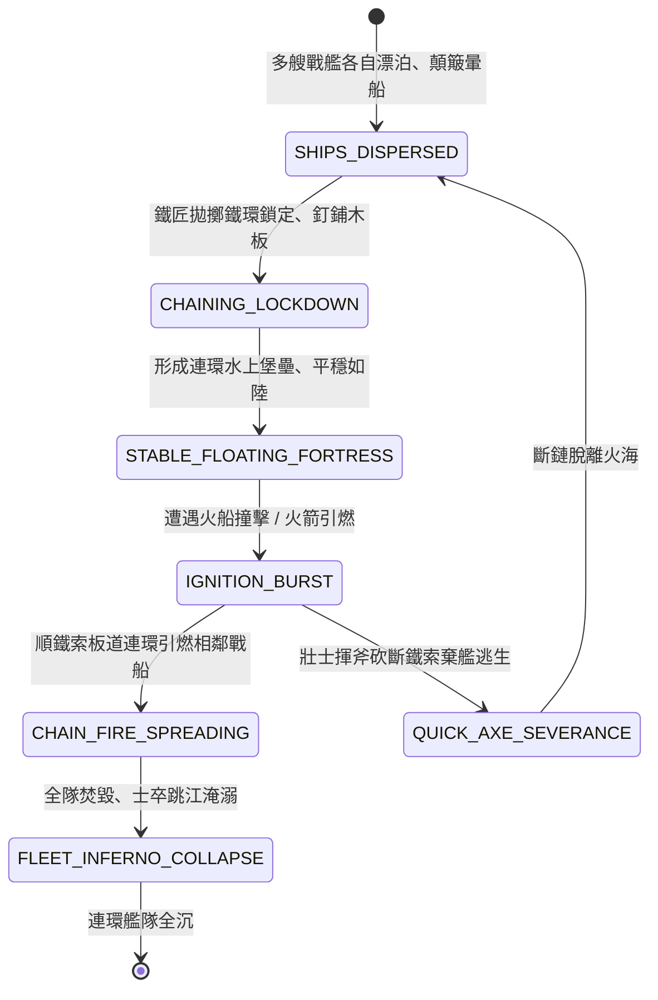

<!-- doc_id: doc_spec_0812 -->
# 3KLife 戰艦鐵鏈釘板首尾連環釘鎖平穩與懼火引燃連環覆滅狀態機規格書

## 模組基本資訊
- **模組代號**：`CHAINED-SHIPS-LINKAGE01`
- **系統定位**：三國江面大型艦隊鐵索連環戰術與連帶殉爆系統，負責戰艦首尾鐵鏈鎖定、鋪設走道板、抗浪穩度暴增、失火連環蔓延與無法解扣覆滅之完整狀態流。
- **架構依賴**：`WaterGridSystem`、`NavalShipMovement`、`FireSpreadEngine`、`VFXBlockRegistry`。

---

## 核心設計概念
赤壁之戰中，北方大軍乘江而下，士卒因長江風浪劇烈顛簸而暈船嘔吐、疫病蔓延。主帥採納連環之計，命隨軍鐵匠鑄造巨型生鐵鏈環，將大型樓船與中型鬥艦三十艘或五十艘一隊，首尾相連、橫向釘板貫通。連環戰船宛如長江浮島，平穩如陸地，人馬可馳突，北方步騎戰力瞬間倍增。然而其致命致命死穴亦在於此：全軍艦體動彈不得、舵機鎖死；一旦遭遇火攻，大火循鐵索木板瞬息蔓延，全隊戰艦無處可避。



---

## 狀態機定義與轉換條件

### 1. `SHIPS_DISPERSED`（散列各自航行狀態）
- **進入條件**：3 艘以上己方中大型戰艦處於相鄰水域地格。
- **行為表現**：
  - 航行受風浪顛簸影響，北方士卒部隊產生「暈船眩暈」減益（攻擊力 -25%）。
  - 單艦各自機動靈活。
- **轉換**：旗艦下達「鐵索連環」指令 -> 轉移至 `CHAINING_LOCKDOWN`。

### 2. `CHAINING_LOCKDOWN`（鐵鏈貫通鋪板狀態）
- **行為表現**：
  - 工兵與鐵匠拋出重型粗鐵鏈穿過船首船艉銅環，釘牢厚木走道板（耗時 3 回合）。
  - 鎖定為一個巨型水上複合實體。
- **轉換**：釘鎖完成 -> 轉移至 `STABLE_FLOATING_FORTRESS`。

### 3. `STABLE_FLOATING_FORTRESS`（水上浮城狀態）
- **行為表現**：
  - **極致平穩**：抗浪穩定度提升 200%，完全清除全軍「暈船」減益；騎兵可在甲板奔馳衝擊。
  - **轉向鎖死**：轉舵機動性降為 0，整體移速每回合固定僅 1 格。
- **轉換**：任一相鄰艦體遭遇火攻引燃 -> 轉移至 `IGNITING_BURST`。

### 4. `IGNITION_BURST`（初生火勢引燃狀態）
- **行為表現**：
  - 被火攻撞擊之邊緣戰艦陷入大火（每秒耐久扣減 150 點）。
  - 木板塗有桐油，火舌沿連環木板道高速蔓延。
- **轉換**：
  - 守軍有精銳斧手在 1 回合內砍斷鏈環與木板 -> 轉移至 `QUICK_AXE_SEVERANCE`。
  - 未能及時斬斷鐵索 -> 轉移至 `CHAIN_FIRE_SPREADING`。

### 5. `CHAIN_FIRE_SPREADING`（連環蔓延狀態）
- **行為表現**：
  - 大火每回合自動傳染相鄰 1~2 艘戰艦，火勢疊加倍增。
  - 甲板高溫灼熱，火煙漫天，艦上部隊士氣每回合 -35 點。
- **轉換**：連環船隻 80% 以上起火 -> 轉移至 `FLEET_INFERNO_COLLAPSE`。

### 6. `FLEET_INFERNO_COLLAPSE`（火海連環覆滅狀態）
- **行為表現**：
  - 全隊戰艦龍骨燒穿斷裂，全體沉入江底；江面留下一片焦黑殘骸與漂浮油火。
  - 艦上未跳水士卒全部燒死或淹溺。
- **轉換**：艦隊完全沉沒 -> 結束退出。

---

## 數值公式與配置契約

```typescript
export interface ChainedShipsConfig {
  fleetLinkId: string;
  minChainedShipsCount: number;   // 最少連環艦船數
  seasickImmunity: boolean;       // 暈船減益免疫
  stabilityCombatBonus: number;   // 平穩射擊與戰鬥加成比
  mobilityLockedPenalty: number;  // 機動懲罰 (移速固定為 1)
  fireSpreadRatePerTurn: number;  // 每回合火勢蔓延艦船數
  chainSeverHpThreshold: number;  // 斬斷鐵索所需斧砍傷害量
}

export const CHAINED_FLEET_PRESETS: Record<string, ChainedShipsConfig> = {
  CHIBI_GRAND_CHAIN: {
    fleetLinkId: 'CHAIN_CHIBI_01',
    minChainedShipsCount: 3,
    seasickImmunity: true,
    stabilityCombatBonus: 0.30,
    mobilityLockedPenalty: -0.85,
    fireSpreadRatePerTurn: 2,
    chainSeverHpThreshold: 500,
  }
};
```

---

## 單元測試與驗收標準
1. **暈船狀態即刻免疫**：多艘戰艦完成連環組裝後，艦上所有部隊「暈船」減益標籤即刻清除，命中率恢復 100%。
2. **連環火勢無阻蔓延**：當第一艘船引燃且未斬斷鏈條時，第二回合相鄰 2 艘戰艦 100% 轉入著火狀態，無滯後漏算。
3. **揮斧斬索斷鏈救生**：斧手小隊對特定鐵索節點造成累計 500 點劈砍傷害後，該側艦船即刻斷開連環，脫離火海蔓延鏈。
