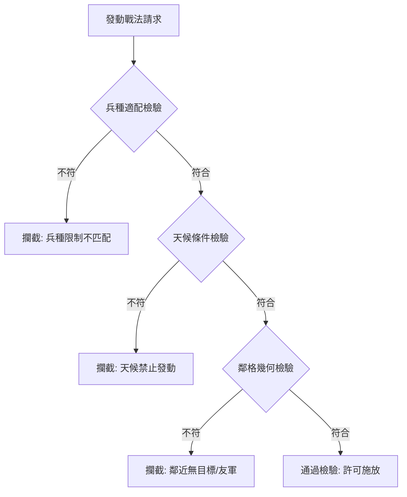
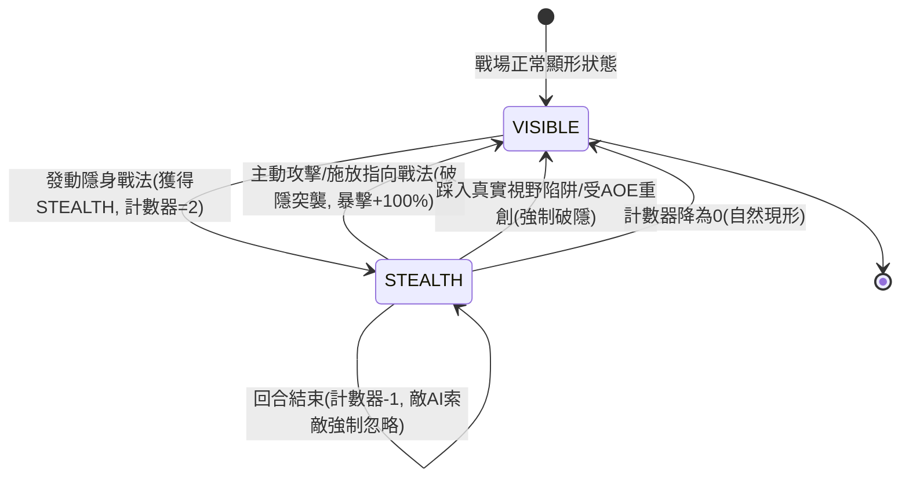

# 戰術條件檢核與隱身匿蹤忽略索敵狀態機規格書

<!-- doc_id: doc_spec_0605 -->

> 本規格書依據 WBS `TAC-07`（TSTEALTH/TCOND 條件觸發：鄰格/天氣/兵種限制、隱身忽略索敵）制定，為戰場戰術觸發與匿蹤對決之單一真相來源（Single Source of Truth）。
> 核心約束：無副作用純邏輯架構、兵種天候嚴格前置檢驗、隱匿狀態敵方 AI 強制忽略索敵、破隱突襲暴擊加成、全繁體中文台灣慣用術語。

---

## 1. 業務定位與戰術條件檢核（TCOND）

戰法發動前必須通過多維度環境與身分條件檢驗。若未滿足條件，戰法槽位立即進入禁用灰化狀態並標註不可發動原因。



### 1.1 檢核維度與規則
1. **兵種限制（Troop Affinity）**：
   - 騎兵專屬戰法（如「千軍突進」）：主將率領兵種必須為 `CAVALRY`，步兵或弓兵發動時直接攔截。
   - 弓兵專屬戰法（如「百步穿楊」）：主將率領兵種必須為 `ARCHER`。
   - 通用步兵／全兵種戰法：無兵種限制。
2. **天候相剋限制（Weather Condition）**：
   - 火系戰法（如「火燒連營」）：天候為 `RAIN`（大雨）或 `SNOW`（大雪）時強制禁用；天候為 `WIND`（大風）時傷害倍率 $\times 1.30$。
   - 奇襲匿蹤戰法：天候為 `FOG`（大霧）或 `NIGHT`（夜戰）時，成功率提升至 100%。
3. **鄰格拓撲限制（Adjacency Condition）**：
   - 近戰連環戰法：首領相鄰 1 格（曼哈頓距離 $= 1$）必須存在至少 1 名敵方單位。
   - 援護防禦戰法：首領相鄰 1 格必須存在受傷友軍。

---

## 2. 隱身匿蹤狀態機（TSTEALTH）

當武將成功施放匿蹤戰法（如「暗度陳倉」、「遁影藏形」）後，進入為期 2 回合之 `STEALTH` 狀態。



### 2.1 敵方 AI 忽略索敵演算法
當敵方單位執行 `SelectTarget` 階段時，依序走訪所有我方單位：
1. 若目標單位帶有 `BUFF_STEALTH`，且當前尋敵單位不具備 `TRUE_SIGHT`（真視之眼），則該目標從候選目標集合中**強制剔除**。
2. 若戰場上我方所有存活單位皆處於 `BUFF_STEALTH` 狀態，敵方 AI 判定為「失去目標」，本回合切換為原地警戒防禦姿態。

### 2.2 破隱突襲（Ambush Strike）加成
處於隱身狀態下的單位，若主動發動普通攻擊或單體傷害戰法：
- 本次攻擊**必定觸發暴擊**（暴擊率 100%）。
- 忽視目標 30% 物理與計策防禦。
- 結算完成後，立即移除 `BUFF_STEALTH` 顯形。

---

## 3. 資料結構與純邏輯介面

```typescript
export type TroopType = 'INFANTRY' | 'CAVALRY' | 'ARCHER' | 'SPECIAL';
export type WeatherType = 'CLEAR' | 'RAIN' | 'WIND' | 'FOG' | 'SNOW' | 'NIGHT';

export interface ITacticConditionConfig {
    readonly allowedTroops?: readonly TroopType[];
    readonly forbiddenWeathers?: readonly WeatherType[];
    readonly requireAdjacentEnemy?: boolean;
}

export interface IConditionCheckResult {
    readonly isAllowed: boolean;
    readonly failureReason: string | null;
}

export function evaluateTacticCondition(
    config: ITacticConditionConfig,
    unitTroop: TroopType,
    currentWeather: WeatherType,
    adjacentEnemyCount: number
): IConditionCheckResult {
    if (config.allowedTroops && !config.allowedTroops.includes(unitTroop)) {
        return { isAllowed: false, failureReason: 'ERR_TROOP_MISMATCH' };
    }
    if (config.forbiddenWeathers && config.forbiddenWeathers.includes(currentWeather)) {
        return { isAllowed: false, failureReason: 'ERR_WEATHER_RESTRICTED' };
    }
    if (config.requireAdjacentEnemy && adjacentEnemyCount <= 0) {
        return { isAllowed: false, failureReason: 'ERR_NO_ADJACENT_TARGET' };
    }
    return { isAllowed: true, failureReason: null };
}

export interface IUnitStealthState {
    readonly isStealthed: boolean;
    readonly remainingTurns: number;
}

export function tickStealthTurn(state: IUnitStealthState): IUnitStealthState {
    if (!state.isStealthed) return state;
    const nextTurns = state.remainingTurns - 1;
    return {
        isStealthed: nextTurns > 0,
        remainingTurns: Math.max(0, nextTurns),
    };
}
```

---

## 4. 驗收測試案例（Test Cases）

| 測試編號 | 測試情境 | 輸入條件 | 預期輸出 |
|---|---|---|---|
| `TC-TCOND-01` | 騎兵專屬戰法步兵施放攔截 | `allowedTroops=['CAVALRY']`, 單位為 `INFANTRY` | `isAllowed=false`, `failureReason='ERR_TROOP_MISMATCH'` |
| `TC-TCOND-02` | 雨天火計禁用攔截 | `forbiddenWeathers=['RAIN']`, 天氣為 `RAIN` | `isAllowed=false`, `failureReason='ERR_WEATHER_RESTRICTED'` |
| `TC-STEALTH-01` | 敵方 AI 索敵強制忽略 | 我方 A 隱身、B 顯形；敵方尋找攻擊目標 | 敵方候選清單僅包含 B，A 被完全忽略 |
| `TC-STEALTH-02` | 破隱一擊必暴與防禦穿透 | 處於隱身發動近戰攻擊 | 暴擊判定為 true，穿甲 30%，攻擊後隱身狀態解除 |
