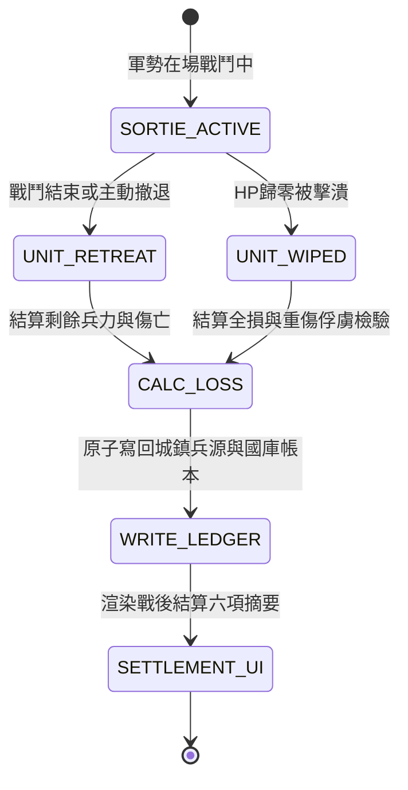

# 戰鬥兵力返還戰損結算與六項戰後統計規格書

<!-- doc_id: doc_spec_0608 -->

> 本規格書依據 WBS `DEP-05`（部隊退場/戰鬥結束兵力返還與戰損結算 + 戰後結算顯示）制定，為出征軍勢戰損與結算面板資料流之單一真相來源（Single Source of Truth）。
> 核心約束：無副作用純邏輯架構、傷兵轉化與陣亡折損原子結算、結算面板六項統計指標契約、城鎮兵源即時扣減回流、全繁體中文台灣慣用術語。

---

## 1. 業務情境與戰損結算狀態機

出征部隊在戰鬥結束（勝利／戰敗／撤退）或中途全滅退場時，系統執行兵力清算。清算結果分為「完好歸營」、「輕傷可治癒」與「陣亡減員」，並向戰後結算面板輸出六項結構化指標。



### 1.1 傷亡折算公式
設出征編制總兵力為 $T_{\text{deployed}}$，戰鬥結束時單位存活兵力為 $T_{\text{survived}}$：
1. **總損失兵力（Total Loss）**：
   $$T_{\text{lost}} = T_{\text{deployed}} - T_{\text{survived}}$$
2. **傷兵回收（Wounded Recovery）**：
   受醫療科技與後勤官 POL 屬性加成，預設傷兵回收率 $R_{\text{med}} = \min(60\%, 30\% + \lfloor \text{POL}_{\text{logistics}} \times 0.2\% \rfloor)$：
   $$T_{\text{wounded}} = \lfloor T_{\text{lost}} \times R_{\text{med}} \rfloor$$
3. **永久陣亡（Killed in Action）**：
   $$T_{\text{dead}} = T_{\text{lost}} - T_{\text{wounded}}$$
4. **返還城鎮兵源（Returned Troops）**：
   $$T_{\text{returned}} = T_{\text{survived}} + T_{\text{wounded}}$$

---

## 2. 戰後結算面板六項統計契約

戰後結算 UI 摘要欄必須精確呈現以下六項指標，不允許缺漏或欄位漂移：

| 指標代碼 | 欄位名稱 | 計算來源 | 顯示範例 |
|---|---|---|---|
| `METRIC_SORTIE_INIT` | 出征初始兵力 | $T_{\text{deployed}}$ | `8,000` |
| `METRIC_SURVIVED` | 戰場倖存兵力 | $T_{\text{survived}}$ | `5,200` |
| `METRIC_WOUNDED_RECOVERED` | 救治收容傷兵 | $T_{\text{wounded}}$ | `1,680` |
| `METRIC_KIA` | 陣亡折損兵力 | $T_{\text{dead}}$ | `1,120` |
| `METRIC_TOTAL_RETURNED` | 最終返城總數 | $T_{\text{returned}}$ | `6,880` |
| `METRIC_FOOD_CONSUMED` | 戰役耗損糧草 | 部署糧耗 + 回合維持費 | `320 糧草` |

---

## 3. 資料模型與無副作用純函式

```typescript
export interface ISortieSettlementInput {
    readonly deployedTroops: number;
    readonly survivedTroops: number;
    readonly logisticsPol: number;
    readonly foodSpent: number;
}

export interface ISortieSettlementReport {
    readonly deployedTroops: number;
    readonly survivedTroops: number;
    readonly woundedRecovered: number;
    readonly killedInAction: number;
    readonly totalReturned: number;
    readonly foodConsumed: number;
    readonly recoveryRate: number;
}

export function calculateSortieLoss(input: ISortieSettlementInput): ISortieSettlementReport {
    const deployed = Math.max(0, input.deployedTroops);
    const survived = Math.min(deployed, Math.max(0, input.survivedTroops));
    const lost = deployed - survived;

    // 後勤傷兵回收率：基礎 30% + POL * 0.2%，最高 60%
    const polBonus = Math.floor(input.logisticsPol * 0.002);
    const recoveryRate = Math.min(0.60, Math.max(0.30, 0.30 + polBonus));

    const wounded = Math.floor(lost * recoveryRate);
    const dead = lost - wounded;
    const returned = survived + wounded;

    return {
        deployedTroops: deployed,
        survivedTroops: survived,
        woundedRecovered: wounded,
        killedInAction: dead,
        totalReturned: returned,
        foodConsumed: Math.max(0, input.foodSpent),
        recoveryRate,
    };
}
```

---

## 4. 驗收測試案例（Test Cases）

| 測試編號 | 測試情境 | 輸入條件 | 預期輸出 |
|---|---|---|---|
| `TC-LOSS-01` | 標準大捷低損兵返還 | 出征 8,000，倖存 7,000，後勤 POL=50 | 損失 1,000，傷兵回收 400 (40%)，陣亡 600，返城 7,400 |
| `TC-LOSS-02` | 全軍覆沒高階後勤搶救 | 出征 5,000，倖存 0，後勤 POL=95 | 損失 5,000，傷兵回收率鎖定上限 49%，救回 2,450 兵力 |
| `TC-LOSS-03` | 無損通關完美撤收 | 出征 6,000，倖存 6,000，POL=80 | 損失 0，陣亡 0，返城 6,000 滿額 |
| `TC-LOSS-04` | 糧草消費非負約束 | 糧草消耗傳入負數異常 | `foodConsumed=0`，不造成國庫反向溢增 |
