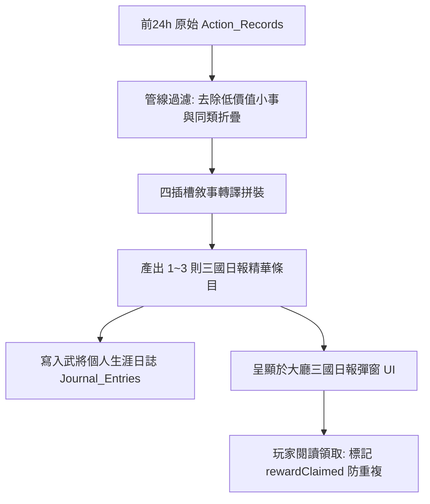

# 戰鬥日誌向三國日報轉譯與個人生涯日誌整併規格書

<!-- doc_id: doc_spec_0621 -->

> 本規格書依據 WBS `JRN-08`（三國日報 Log 解析：24h Log→事件，整併至日誌；裁決與 RET-04 重複）制定，為全域行動日誌、三國日報新聞與個人生涯檔案整併之單一真相來源（Single Source of Truth）。
> 核心約束：歷史重複問題正式裁決整併、無副作用純邏輯架構、前24小時日誌清洗去重、四插槽敘事轉譯、獎勵防雙重發放原子鎖、全繁體中文台灣慣用術語。

---

## 1. 業務定位與裁決收斂（Single Source of Truth）

過去盤點標註「JRN-08 與 RET-04 存在重複需裁決」。本規格書正式收斂定案：
- **`JRN-08` 定位**：數據管線層（ETL Pipeline），負責從前 24 小時全域原始 `Action_Records` 中萃取、去重並轉譯為結構化事件。
- **`RET-04 / RET-05` 定位**：表現與結算層，負責將萃取之事件呈現於「三國日報 UI」並核發對應之戰術收益。
- **雙向連動**：萃取後的日報精華條目，自動雙向寫入武將個人之「生涯日誌（`Journal_Entries`）」，達成單一真實資料庫。



---

## 2. 四插槽敘事拼裝與轉譯規則

原始戰鬥日誌（如 `ACTION_KILL_BOSS`, `ACTION_DEFEND_SIEGE`）透過四插槽語法轉譯為古典戰報：

$$\text{Headline} = \text{[主角主體]} + \text{[心理／時態]} + \text{[關鍵行動]} + \text{[最終結果與戰果]}$$

| 原始事件類型 | 角色主體 | 時態情境 | 關鍵行動 | 結果戰果 |
|---|---|---|---|---|
| `BATTLE_DECISIVE_WIN` | 關羽將軍 | 雄姿英發 | 陣前親斬敵將 | 大破敵營，繳獲軍糧 {food} 石！ |
| `AMBUSH_DEFEND_SUCCESS` | 趙雲部隊 | 處變不驚 | 密林識破敵方夜襲 | 伏兵盡殲，俘獲戰馬 {horses} 匹！ |
| `RECON_DISCOVERY` | 斥候前哨 | 宵衣旰食 | 深入敵後刺探軍情 | 探明敵軍主力囤糧重地！ |

---

## 3. 資料模型與純邏輯轉譯函式

```typescript
export interface IRawActionLog {
    readonly id: string;
    readonly timestamp: number;
    readonly actionType: string;
    readonly generalId: string;
    readonly generalName: string;
    readonly valueA: number; // 繳獲糧草/兵力等
    readonly isSignificant: boolean;
}

export interface INewsArticleItem {
    readonly articleId: string;
    readonly headline: string;
    readonly relatedGeneralId: string;
    readonly rewardFood: number;
    readonly rewardClaimed: boolean;
}

export function parseLogsToNewsArticles(
    logs: readonly IRawActionLog[],
    currentTime: number
): readonly INewsArticleItem[] {
    const ONE_DAY_MS = 24 * 60 * 60 * 1000;
    const windowStart = currentTime - ONE_DAY_MS;

    // 1. 過濾前 24 小時之重大事件
    const validLogs = logs.filter(l => l.timestamp >= windowStart && l.isSignificant);

    // 2. 依武將去重折疊，最多挑選 3 則最高價值事件
    const pickedLogs = validLogs.slice(0, 3);

    return pickedLogs.map((l, index) => {
        let headline = `【戰報】${l.generalName} 督軍奮戰，擊退來犯之敵！`;
        if (l.actionType === 'BATTLE_DECISIVE_WIN') {
            headline = `【大捷】${l.generalName} 陣前親斬敵將，繳獲軍糧 ${l.valueA} 石！`;
        } else if (l.actionType === 'AMBUSH_DEFEND_SUCCESS') {
            headline = `【奇謀】${l.generalName} 密林識破夜襲，全殲敵方先鋒！`;
        }

        return {
            articleId: `NEWS_${l.id}_${index}`,
            headline,
            relatedGeneralId: l.generalId,
            rewardFood: l.valueA > 0 ? l.valueA : 50,
            rewardClaimed: false,
        };
    });
}
```

---

## 4. 驗收測試案例（Test Cases）

| 測試編號 | 測試情境 | 輸入條件 | 預期輸出 |
|---|---|---|---|
| `TC-NEWS-01` | 超過 24 小時過期日誌過濾 | 日誌時間戳記在 30 小時前 | 該日誌被剔除，不入選日報條目 |
| `TC-NEWS-02` | 重大勝利轉譯四插槽標題 | `BATTLE_DECISIVE_WIN`, 獲糧 200 | 標題含「大捷」、「陣前親斬敵將，繳獲軍糧 200 石」 |
| `TC-NEWS-03` | 日報條目上限約束 | 輸入 10 則符合條件的重大日誌 | 嚴格截取前 3 則條目輸出 |
| `TC-NEWS-04` | 獎勵初始未領取狀態 | 生成新日報條目 | `rewardClaimed=false`，領取後切為 true 防重複領取 |
