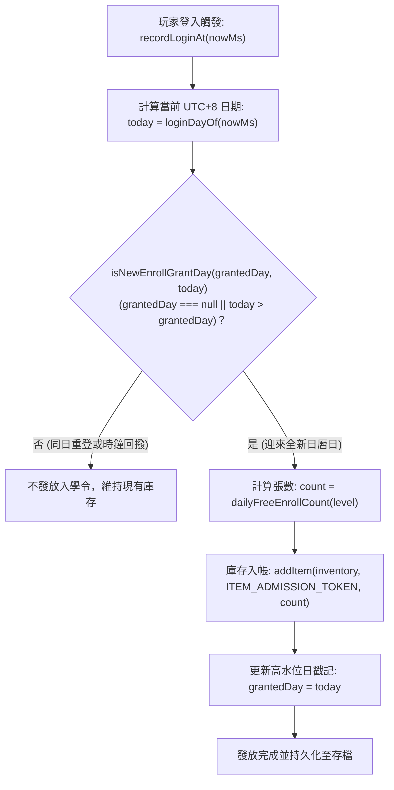

<!-- doc_id: doc_spec_0416 -->
# 掛機離線產出模型與設施等級階梯補給規格書

> 本規格書為 3KLife 掛機離線產出模型、太守府設施階梯發放公式與登入高水位防回撥防刷機制之唯一真相來源（Single Source of Truth）。
> 相關實作對齊：`assets/scripts/core/systems/DailyFreeEnroll.ts`、`PlayerInventory.ts`、`GameSession.ts`。

---

## 1. 系統定位與核心設計

1. **長期留存與低門檻養成循環**：
   - 掛機產出機制賦予玩家每日登入穩定獲取書院「入學令」（`ITEM_ADMISSION_TOKEN`）之免費途徑，保障平民玩家具備基礎武將培育資源。
   - 產出數量與主城「太守府設施等級」嚴格掛鉤，建立主城建設回饋培育體系之正向經濟閉環。
2. **高水位防弊機制（High-Water Mark Anti-Tamper）**：
   - 發放判定記錄「已發放之最大日期戳記」（UTC+8 `YYYY-MM-DD`），時鐘回撥或重複登入均無法重複領取，具備冪等性。

---

## 2. 產出階梯公式與數值分佈

### 2.1 每日免費入學令產出公式（dailyFreeEnrollCount）
$$\text{daily\_free\_enroll} = \left\lfloor \frac{\text{level}}{5} \right\rfloor + 1$$

其中：
- $\text{level} = \text{floor}(\text{facilityLevel})$，若傳入非有限數字或小於 1，一律以保底等級 $1$ 進行計算，避免崩潰。

### 2.2 設施等級對照階梯表

| 太守府設施等級 (`facilityLevel`) | 階梯折算項 $\lfloor \text{level}/5 \rfloor$ | 每日發放入學令張數 | 養成與經濟回饋 |
|:---:|:---:|:---:|---|
| **1 ～ 4 級** | 0 | **1 張** | 新手開局基礎保底 |
| **5 ～ 9 級** | 1 | **2 張** | 前期主城小成，每日培育頻率翻倍 |
| **10 ～ 14 級** | 2 | **3 張** | 中期名門擴建，支援多子嗣並行深造 |
| **15 ～ 19 級** | 3 | **4 張** | 後期巨府，提供充足學府交流門票 |
| **20 級（滿級）** | 4 | **5 張** | 頂級郡望核心，極限育成自由度 |

---

## 3. 切日發放與高水位判定狀態機



### 3.1 跨日發放準則（isNewEnrollGrantDay）
- 只有當前登入日 `today` **嚴格大於**（ASCII 字典順序晚於）存檔中的 `grantedDay` 時，方視為有效新日。
- 若玩家竄改本機系統時間倒退，`today > grantedDay` 判定為 `false`，安全封鎖作弊。

---

## 4. 介面型別契約

```typescript
export function dailyFreeEnrollCount(facilityLevel: number): number;
export function isNewEnrollGrantDay(grantedDay: string | null, today: string): boolean;
export function normalizeEnrollGrantDay(value: unknown): string | null;
```

---

## 5. 驗收標準與測試用例

1. **等級邊界覆蓋驗證**：
   - 設施等級 1 級與 4 級均產出 1 張。
   - 設施等級 5 級與 9 級均產出 2 張。
   - 設施等級 10 級產出 3 張。
   - 非法輸入（`0`, `-5`, `NaN`）自動保底產出 1 張。
2. **存讀檔高水位驗收**：
   - 存檔中 `grantedDay` 格式非 `YYYY-MM-DD` 正規表示式者，正規化為 `null` 並視為首次領取。
