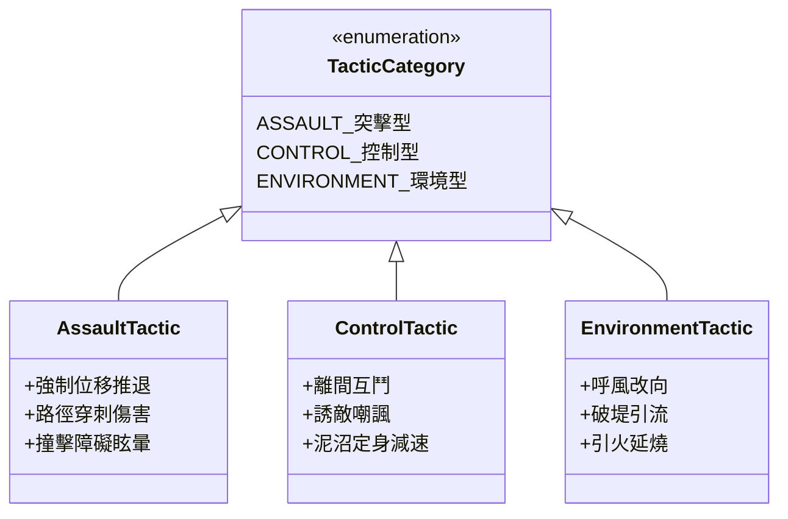
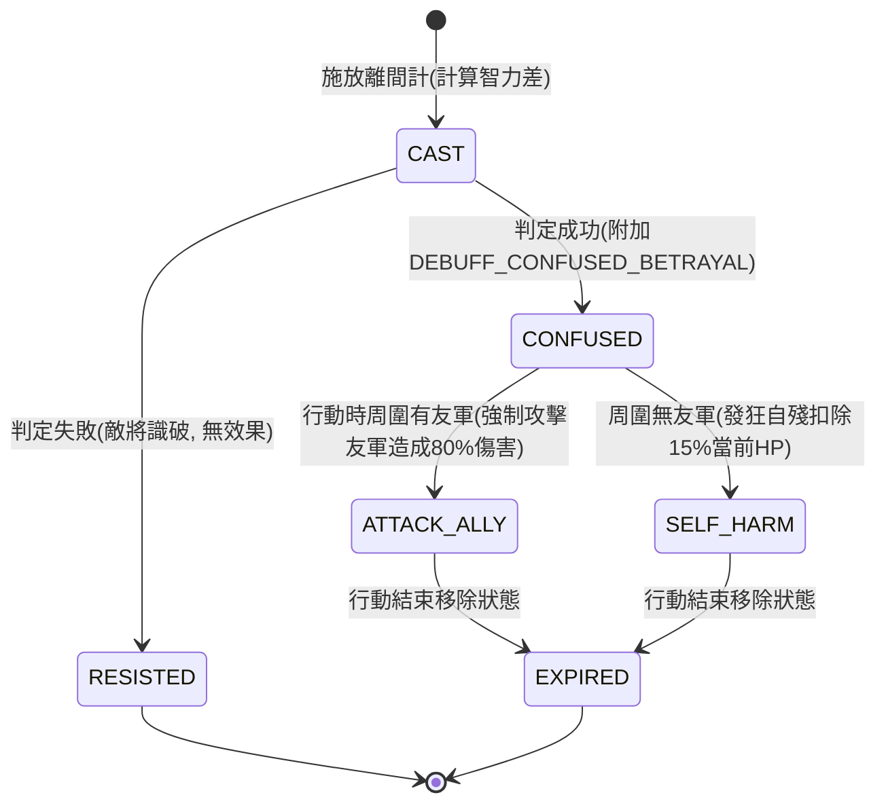

# 控制類格子戰法離間互鬥與環境干擾定義規格書

<!-- doc_id: doc_spec_0607 -->

> 本規格書依據 WBS `SCN-09`（格子戰法分類：突擊/控制/環境，與離間等未列戰法定義）制定，為戰場策略計策裁決之單一真相來源（Single Source of Truth）。
> 核心約束：無副作用純邏輯架構、三大戰法類型正式收斂、離間計智力判定與友傷反戈狀態機、環境擾動地格聯動、全繁體中文台灣慣用術語。

---

## 1. 格子戰法三大分類架構

戰場地格戰法正式收斂為三大戰術類型，規範其作用目標與結算特性：



1. **突擊型（ASSAULT）**：以物理衝撞、強推與穿透為主，改變敵方陣型並引發碰撞傷害。
2. **控制型（CONTROL）**：以智力攻心、擾亂精神與行動限制為主，使敵軍陷入混亂互鬥或定身。
3. **環境型（ENVIRONMENT）**：改變戰場天候、風向、地格濕度，間接放大水火災害效益。

---

## 2. 核心控制戰法：離間計（Alienation Tactic）

軍師鎖定敵方陣列中一支部隊，透過偽造書信與造謠離間，使其陷入敵友不分的叛變互鬥狀態。



### 2.1 成功率計算公式
成功率受雙方軍師／主將智力（`INT`）差距影響，設有 20% 保底與 90% 天花板：

$$P = \min\left(90\%, \max\left(20\%, 50\% + (\text{INT}_{\text{caster}} - \text{INT}_{\text{target}}) \times 2\%\right)\right)$$

- 若施法者智力 95，目標智力 70：$P = \min(90\%, 50\% + 25 \times 2\%) = 90\%$（達上限）。
- 若施法者智力 60，目標智力 80：$P = \max(20\%, 50\% - 20 \times 2\%) = 20\%$（保底）。

### 2.2 混亂行動決策
處於 `DEBUFF_CONFUSED_BETRAYAL` 的單位輪到其行動階段時：
1. 檢索其攻擊範圍內是否存在其原本陣營之友軍。
2. 若存在：強制發動普通攻擊打擊最近友軍，造成相當於標準攻擊 80% 之友傷。
3. 若不存在友軍：部隊陷入內鬨自相踩踏，扣除自身當前生命值 15%（無防禦減免）。

---

## 3. 資料結構與純邏輯介面

```typescript
export interface IAlienationCheckParams {
    readonly casterInt: number;
    readonly targetInt: number;
    readonly roll: number; // 0.00 ~ 1.00
}

export function calculateAlienationSuccess(params: IAlienationCheckParams): boolean {
    const diff = params.casterInt - params.targetInt;
    const rawRate = 0.50 + diff * 0.02;
    const clampedRate = Math.min(0.90, Math.max(0.20, rawRate));
    return params.roll < clampedRate;
}

export interface IConfusedActionResult {
    readonly actionType: 'ATTACK_ALLY' | 'SELF_HARM';
    readonly damageRate: number; // 友軍傷害比率 0.80 或 自殘當前HP比率 0.15
}

export function resolveConfusedUnitTurn(hasNearbyAlly: boolean): IConfusedActionResult {
    if (hasNearbyAlly) {
        return { actionType: 'ATTACK_ALLY', damageRate: 0.80 };
    }
    return { actionType: 'SELF_HARM', damageRate: 0.15 };
}
```

---

## 4. 驗收測試案例（Test Cases）

| 測試編號 | 測試情境 | 輸入條件 | 預期輸出 |
|---|---|---|---|
| `TC-ALIEN-01` | 高智力差距成功率上限壓制 | 智力 100 施放於智力 50，roll=0.88 | 成功率鎖定 90%，判定成功 |
| `TC-ALIEN-02` | 低智逆風施放保底判定 | 智力 40 施放於智力 90，roll=0.18 | 成功率保底 20%，判定成功 |
| `TC-ALIEN-03` | 混亂單位反戈打擊友軍 | 周圍有友軍，觸發行動 | 回傳 `ATTACK_ALLY`, 造成 80% 傷害 |
| `TC-ALIEN-04` | 孤立無援混亂自殘 | 周圍無友軍，觸發行動 | 回傳 `SELF_HARM`, 扣除 15% 當前生命值 |
