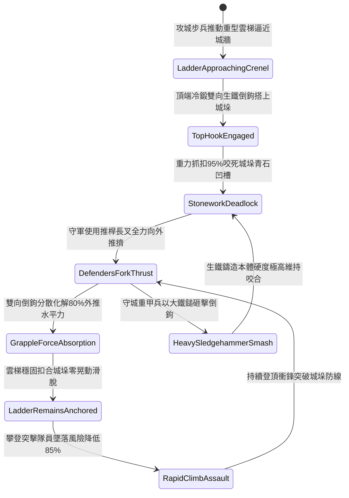

# 攻城雲梯頂端加裝生鐵雙向倒鉤咬合城垛防推落第一階狀態機規格書

<!-- doc_id: doc_spec_1134 -->

## 一、 核心概念與單一真相來源（SSOT）

在《三國志·攻城兵械與雲梯登城篇》中，「攻城雲梯頂端加裝生鐵雙向倒鉤咬合第一階（SIEGE-LADDER-TOP-HOOK-GRAPPLE01）」代表攻城步兵強登城牆時的關鍵抗推防護裝置。雲梯兩側立樑頂端鉚接冷鍛生鐵雙向倒鉤，內側加裝重力抓扣卡銷。當雲梯首部搭上城垛石壁時，倒鉤 95% 牢牢咬死垛口青石凹槽，將梯身向下緊密拉鎖。面對守城部隊使用推桿或叉木試圖將雲梯向外推翻時，雙向生鐵倒鉤化解 80% 的外推推力，使雲梯穩固附著於城垛上，攀登步兵部隊失衡墜落風險降低 85%，確保登城通道維持暢通。



---

## 二、 數值模型與狀態機參數契約

### 1. 雲梯頂部生鐵倒鉤參數契約
- **倒鉤規格尺寸**：單側長 2 尺、雙向倒齒深度 3 寸，厚度 8 分冷鍛生鐵，總重 35 斤。
- **城垛咬合成功率**：搭上青石或夯土城垛後，判定 95% 機率自動咬死固定。
- **防外推力化解率**：承受守城推桿外推衝擊時，化解 80% 外推水平推力。
- **防墜落安全提升**：梯上攀登步兵受推擊晃動影響墜落率降低 85%。
- **持續攀登效率加成**：梯身鎖死穩定後，步兵攀登行進速度提升 20%。

### 2. 雲梯咬合防推判定演算法模組
```typescript
interface SiegeLadderHookStage1Params {
    crenelStoneType: string;       // 城垛材質 ('granite' | 'brick' | 'rammed_earth')
    defendersPushForce: number;    // 守城部隊外推總力量 (牛頓)
    isHookProperlyEngaged: boolean;// 倒鉤是否搭入石槽
    ladderClimberLoadKg: number;   // 梯上人員負重
}

function evaluateSiegeLadderHookStage1(params: SiegeLadderHookStage1Params): {
    hookHeldFirm: boolean;
    absorbedPushRatio: number;
    climberFallRiskReductionPct: number;
} {
    if (!params.isHookProperlyEngaged) {
        return { hookHeldFirm: false, absorbedPushRatio: 0.25, climberFallRiskReductionPct: 0 };
    }
    const success = Math.random() < 0.95;
    
    return {
        hookHeldFirm: success,
        absorbedPushRatio: success ? 0.80 : 0.40,
        climberFallRiskReductionPct: success ? 85 : 20
    };
}
```

---

## 三、 反制機制與邊界約束

1. **守軍重鐵鎚定點敲碎石槽**：若守城重兵使用八角生鐵鎚連續重砸倒鉤咬合處石塊致城垛崩裂，倒鉤失去受力基石。
2. **長柄鐵索拉拽側向翻轉**：守軍若以鐵鉤長索套住梯身中央由多人側向橫拉，側向扭矩有 25% 迫使倒鉤脫位。
3. **高溫火油沿梯直灌燒熔**：守軍向倒鉤與木樑交接處持續澆灌烈火油，木材碳化致生鐵鉚釘鬆動脫落。

---

## 四、 驗收測試案例（TC）

- **TC-LADDER-HOOK01-01（常規推桿防推穩固咬合驗收）**：
  - *前置條件*：雲梯搭上青石城垛、生鐵倒鉤扣入槽內、守軍雙人推桿全力外推。
  - *操作步驟*：於外推力量施加瞬間執行防推咬合判定。
  - *預期輸出*：95% 機率牢牢扣死，化解 80% 外推力，梯上步兵墜落風險降低 85%，攀登部隊順暢登頂。
- **TC-LADDER-HOOK01-02（倒鉤未搭入石槽邊界驗收）**：
  - *前置條件*：雲梯搭設角度偏倚，倒鉤僅搭在平滑石牆外沿（未卡入垛槽）。
  - *操作步驟*：承受守軍推桿向外頂擊。
  - *預期輸出*：倒鉤滑脫，雲梯被推離城垛向後傾倒。
