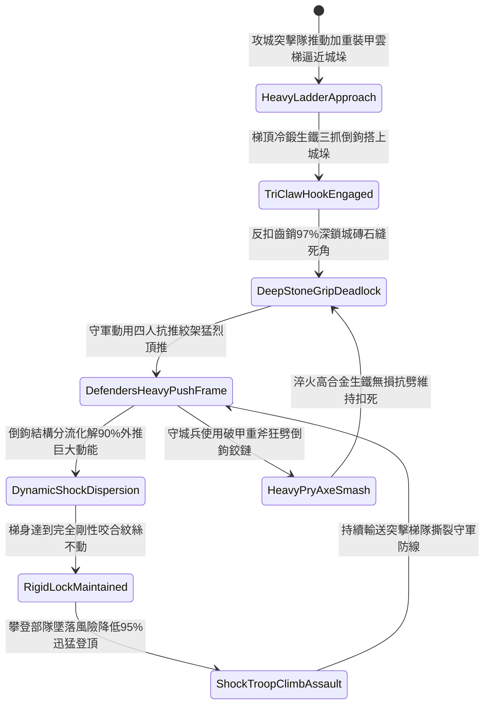

# 攻城雲梯頂端加裝生鐵雙向倒鉤咬合城垛防推落第三階狀態機規格書

<!-- doc_id: doc_spec_1140 -->

## 一、 核心概念與單一真相來源（SSOT）

在《三國志·攻城兵械與雲梯登城篇》中，「攻城雲梯頂端加裝生鐵雙向倒鉤咬合第三階（SIEGE-LADDER-TOP-HOOK-GRAPPLE03）」代表攻城突擊部隊強登重裝要塞城垛的破陣配置。雲梯立樑頂部升級為雙層淬火高合金冷鍛生鐵三抓倒鉤，整合內嵌重力反扣齒銷與彈力卡槽。當雲梯搭上城垛石壁時，三抓倒鉤 97% 深度嵌入城石接縫並死死咬合城垛內部構造。面對守軍使用大型四人抗推絞架或重型推桿猛力向外頂翻時，生鐵倒鉤結構分流化解 90% 的外推動能，梯身與城垛達到完全剛性咬合，攀登部隊墜落風險降低 95%，攀登速度大幅提升 30%。



---

## 二、 數值模型與狀態機參數契約

### 1. 雲梯頂部生鐵倒鉤參數契約
- **倒鉤規格尺寸**：單側長 2.8 尺、三抓倒齒深度 5 寸，雙層淬火合金生鐵厚度 1.2 寸，總重 60 斤。
- **城垛咬合成功率**：搭上城垛石壁瞬間，判定 97% 機率觸發深層反扣死鎖。
- **防外推力化解率**：承受守城大型抗推絞架猛推時，化解 90% 外推水平推力。
- **防墜落安全提升**：梯上攀登步兵受衝擊晃動影響墜落率降低 95%。
- **持續攀登效率加成**：梯身剛性鎖死後，步兵攀登前進速度提升 30%。

### 2. 雲梯咬合防推判定演算法模組
```typescript
interface SiegeLadderHookStage3Params {
    crenelStoneHardness: number;   // 城垛石料堅固度 (0.0 ~ 1.0)
    defendersPushTonnage: number;  // 守軍外推總力量 (噸)
    isTriClawDeadlocked: boolean;  // 三抓反扣倒鉤是否鎖死
    ladderClimberTroopCount: number; // 梯上突擊步兵人數
}

function evaluateSiegeLadderHookStage3(params: SiegeLadderHookStage3Params): {
    hookHeldFirm: boolean;
    absorbedPushRatio: number;
    climberFallRiskReductionPct: number;
} {
    if (!params.isTriClawDeadlocked || params.crenelStoneHardness < 0.25) {
        return { hookHeldFirm: false, absorbedPushRatio: 0.40, climberFallRiskReductionPct: 25 };
    }
    const success = Math.random() < 0.97;
    
    return {
        hookHeldFirm: success,
        absorbedPushRatio: success ? 0.90 : 0.55,
        climberFallRiskReductionPct: success ? 95 : 40
    };
}
```

---

## 三、 反制機制與邊界約束

1. **守軍重型投石機向內近距轟砸**：若守城方調集城頭小型投石機向咬合處城垛定點砸擊，城垛整體垮塌導致咬合點徹底喪失。
2. **多重粗鋼索橫向絞車翻轉**：守軍若以雙股粗鋼索套住梯樑，以城內絞車施加巨大側向旋轉力矩，有 15% 機率扯斷固定鉚釘。
3. **高溫沸鐵汁直澆碳化樑木**：守軍向倒鉤與梯樑結合部澆灌高溫沸鐵汁，木樑瞬時碳化解體。

---

## 四、 驗收測試案例（TC）

- **TC-LADDER-HOOK03-01（四人抗推絞架抗推剛性咬合驗收）**：
  - *前置條件*：雲梯搭上青石城垛、三抓反扣齒銷深鎖、守軍四人抗推絞架向外猛頂。
  - *操作步驟*：於外推力量爆發瞬間執行抗推判定。
  - *預期輸出*：97% 機率剛性死鎖紋絲不動，化解 90% 外推力，攀登突擊隊墜落風險降低 95%，全員快速登頂。
- **TC-LADDER-HOOK03-02（城磚風化粉碎邊界驗收）**：
  - *前置條件*：城垛石料極度老化風化（堅固係數 0.20）。
  - *操作步驟*：承受外推頂擊。
  - *預期輸出*：城石受力碎裂導致倒鉤脫出，防外推化解率降至 40%，梯身大幅晃動。
