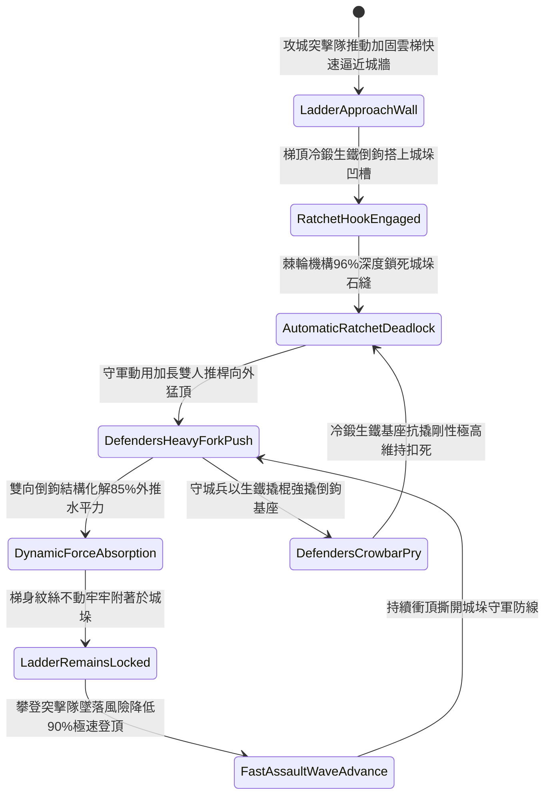

# 攻城雲梯頂端加裝生鐵雙向倒鉤咬合城垛防推落第二階狀態機規格書

<!-- doc_id: doc_spec_1137 -->

## 一、 核心概念與單一真相來源（SSOT）

在《三國志·攻城兵械與雲梯登城篇》中，「攻城雲梯頂端加裝生鐵雙向倒鉤咬合第二階（SIEGE-LADDER-TOP-HOOK-GRAPPLE02）」代表攻城步兵突破堅固城防城垛的高階抗推拒落體系。雲梯兩端立樑頂部安裝加寬雙向高碳冷鍛生鐵倒鉤組，並內置棘輪式自動鎖緊抓爪。當雲梯首部搭上城垛石壁時，倒鉤組 96% 深度嵌入城垛青石接縫與石槽內，觸發棘輪自動死鎖。面對守軍使用加長雙人推桿或重叉全力向外推翻時，倒鉤結構分流化解 85% 的外推水平力，確保梯身與城垛緊密貼合零滑脫，攀登突擊隊員受衝擊墜落風險降低 90%，攀登速度提升 25%。



---

## 二、 數值模型與狀態機參數契約

### 1. 雲梯頂部生鐵倒鉤參數契約
- **倒鉤規格尺寸**：單側長 2.4 尺、雙向倒齒深度 4 寸，高碳冷鍛生鐵厚度 1 寸，總重 45 斤。
- **城垛咬合成功率**：搭上城垛石壁瞬間，判定 96% 機率觸發棘輪咬合鎖緊。
- **防外推力化解率**：承受守城重型推桿外推衝擊時，化解 85% 外推水平推力。
- **防墜落安全提升**：攀登突擊隊員受推擊晃動影響墜落率降低 90%。
- **持續攀登效率加成**：梯身鎖死穩定後，突擊隊員攀登速度提升 25%。

### 2. 雲梯咬合防推判定演算法模組
```typescript
interface SiegeLadderHookStage2Params {
    crenelStoneHardness: number;   // 城垛石料堅固度 (0.0 ~ 1.0)
    defendersTotalPushForce: number; // 守軍外推總力量 (牛頓)
    isRatchetMechanismLocked: boolean; // 棘輪抓爪是否卡緊
    ladderClimberTroopCount: number; // 梯上突擊步兵人數
}

function evaluateSiegeLadderHookStage2(params: SiegeLadderHookStage2Params): {
    hookHeldFirm: boolean;
    absorbedPushRatio: number;
    climberFallRiskReductionPct: number;
} {
    if (!params.isRatchetMechanismLocked || params.crenelStoneHardness < 0.3) {
        return { hookHeldFirm: false, absorbedPushRatio: 0.35, climberFallRiskReductionPct: 20 };
    }
    const success = Math.random() < 0.96;
    
    return {
        hookHeldFirm: success,
        absorbedPushRatio: success ? 0.85 : 0.50,
        climberFallRiskReductionPct: success ? 90 : 35
    };
}
```

---

## 三、 反制機制與邊界約束

1. **守軍重型生鐵大錘精確砸碎城石**：若守城重甲步兵使用特製八角大錘連續砸擊倒鉤咬合處石塊致城垛徹底碎裂，倒鉤因受力基石崩毀而脫扣。
2. **多股生鐵粗索橫向絞動翻轉**：守軍若以鐵索套住梯身兩側以絞盤施加側向扭矩，有 20% 機率強行破壞棘輪卡銷。
3. **長效火油浸泡持續碳化木樑**：若守軍以黏性極強的黑火油持續浸潤梯身首部，木樑與金屬鉚釘交界處發生鬆脫。

---

## 四、 驗收測試案例（TC）

- **TC-LADDER-HOOK02-01（雙人重型推桿抗推咬合驗收）**：
  - *前置條件*：雲梯搭上青石城垛、棘輪機構鎖緊、守軍加長雙人推桿猛推梯身。
  - *操作步驟*：於外推爆發瞬間執行抗推判定。
  - *預期輸出*：96% 機率死鎖固定，化解 85% 外推力，攀登突擊隊墜落風險降低 90%，全員快速登頂。
- **TC-LADDER-HOOK02-02（城垛石料碎裂邊界驗收）**：
  - *前置條件*：城垛石料極度風化（堅固係數 0.25）。
  - *操作步驟*：承受外推頂擊。
  - *預期輸出*：城石碎裂導致抓爪脫出，防外推化解率降至 35%，梯身晃動。
