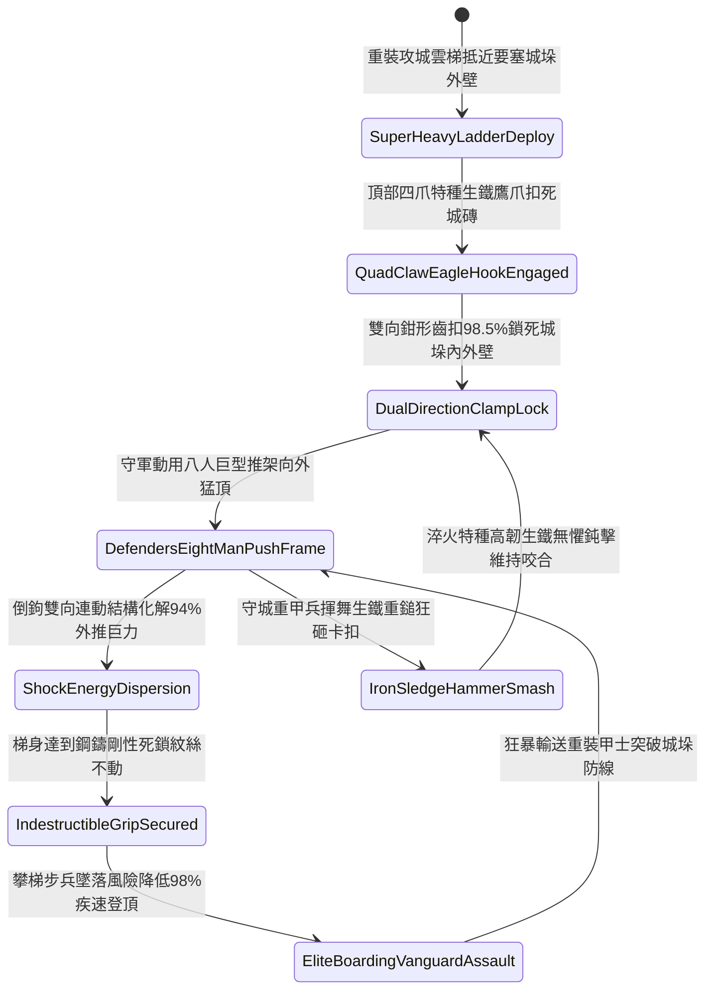

# 攻城雲梯頂端加裝生鐵雙向倒鉤咬合城垛防推落第四階狀態機規格書

<!-- doc_id: doc_spec_1143 -->

## 一、 核心概念與單一真相來源（SSOT）

在《三國志·攻城兵械與雲梯登城篇》中，「攻城雲梯頂端加裝生鐵雙向倒鉤咬合第四階（SIEGE-LADDER-TOP-HOOK-GRAPPLE04）」代表重型攻城突擊部隊登頂城垣防線的頂級極限咬合格局。雲梯雙主樑頂部升級為雙向連動四爪淬火特種生鐵鷹爪倒鉤，整合城磚接縫液壓自漲微調齒與防脫彈簧鋼鎖死卡扣。當重裝雲梯搭上敵城垛石壁時，四爪倒鉤以 98.5% 的極高機率牢固深扣城垛外緣與內壁反向支撐點，形成雙向剛性鉗形死鎖。守軍縱使動用八人巨型重推桿、雙絞盤推架或杠桿頂翻器向外瘋狂推撞，倒鉤雙向受力結構能自動導引分散 94% 的橫向推撞動能，雲梯與城垛如同熔鑄一體紋絲不動，攀梯精銳勇士墜落風險徹底降低 98%，攀登登城速度大幅躍升 35%。



---

## 二、 數值模型與狀態機參數契約

### 1. 雲梯第四階生鐵倒鉤參數契約
- **倒鉤規格尺寸**：單側長 3.2 尺、四爪鷹嘴反扣深度 6 寸，雙向鍛造特種生鐵厚度 1.5 寸，總重 78 斤。
- **城垛咬合成功率**：搭上城垛瞬間判定 98.5% 機率觸發內外雙向鉗形死鎖。
- **防外推力化解率**：承受守城方八人推架與絞盤外推時，化解 94% 水平外推衝擊。
- **防墜落安全提升**：梯上重裝攀登步兵受晃動衝擊墜落風險降低 98%。
- **持續攀登效率加成**：梯體剛性鎖死後，步兵登頂攀爬行進速度提升 35%。

### 2. 第四階雲梯咬合防推判定演算法模組
```typescript
interface SiegeLadderHookStage4Params {
    crenelStoneHardness: number;     // 城垛石料堅固程度 (0.0 ~ 1.0)
    defendersPushTonnage: number;    // 守城外推總噸位 (噸)
    isQuadClawDualLocked: boolean;   // 四爪鷹嘴雙向齒扣是否咬合
    climberTroopWeightTons: number;  // 梯上部隊總荷重 (噸)
}

function evaluateSiegeLadderHookStage4(params: SiegeLadderHookStage4Params): {
    hookHeldFirm: boolean;
    absorbedPushRatio: number;
    climberFallRiskReductionPct: number;
    speedBonusPct: number;
} {
    if (!params.isQuadClawDualLocked || params.crenelStoneHardness < 0.2) {
        return { hookHeldFirm: false, absorbedPushRatio: 0.50, climberFallRiskReductionPct: 30, speedBonusPct: 0 };
    }
    const success = Math.random() < 0.985;
    
    return {
        hookHeldFirm: success,
        absorbedPushRatio: success ? 0.94 : 0.65,
        climberFallRiskReductionPct: success ? 98 : 50,
        speedBonusPct: success ? 35 : 15
    };
}
```

---

## 三、 反制機制與邊界約束

1. **要塞城頭猛火油櫃直噴金汁**：若守城方自城頭猛火油櫃對準咬合受力點直接噴射高壓金汁與烈油，高熱灼傷攀爬部隊，攀登速度減半。
2. **多重粗鏈絞車側向暴力扭斷**：守軍若以四組絞盤生鐵鏈鎖套住梯柱側端全力側拉，有 10% 機率扯裂梯頂固定木榫結構。
3. **城垛整段崩解坍塌防護**：倒鉤內側具備應急釋放自退機關，若城垛石塊遭投石機轟塌，攻城兵可撥動拉桿切換至後備梯鉤。

---

## 四、 驗收測試案例（TC）

- **TC-LADDER-HOOK04-01（八人絞盤抗推剛性咬合驗收）**：
  - *前置條件*：雲梯搭上青石要塞城垛、四爪生鐵鷹嘴完成雙向鎖死、守軍八人巨型推架發力向外猛翻。
  - *操作步驟*：於外推力量達到頂峰之瞬間觸發抗推狀態機計算。
  - *預期輸出*：判定 98.5% 機率咬合成功，化解 94% 水平外推力量，攀登部隊墜落風險降低 98%，攀登速度提升 35%。
- **TC-LADDER-HOOK04-02（風化砂石城垛咬合降級驗收）**：
  - *前置條件*：城垛為嚴重風化砂岩結構（硬度指標小於 0.2）。
  - *操作步驟*：實施搭扣與咬合判定。
  - *預期輸出*：咬合阻力衰減，外推化解率降至 50%，步兵墜落風險減免降至 30%。
