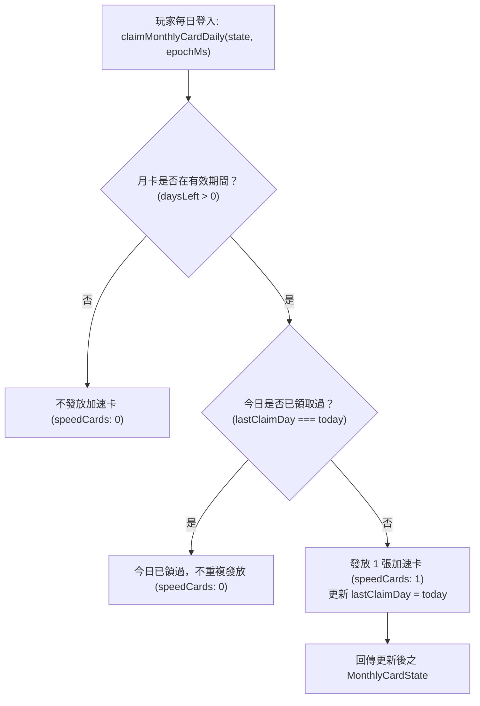

<!-- doc_id: doc_spec_0409 -->
# 月卡30天效期權益與每日精力加速卡發放模型規格書

> 本規格書為 3KLife 系統月卡權益效期、續約堆疊計算、每日加速卡遞送與精力回復倍率加成之唯一真相來源（Single Source of Truth）。
> 相關實作對齊：`assets/scripts/core/systems/MonthlyCard.ts`、`LoginStreak.ts`。

---

## 1. 系統定位與核心權益設計

1. **長期留存與資源增益樞紐**：
   - 月卡作為高性價比之持續型特權，提供穩定的許願池加速卡供應與季度精力回復增幅。
   - 純邏輯解耦設計，狀態以純資料結構 `MonthlyCardState` 儲存，交由存檔序列化服務持久化。
2. **四大核心特權矩陣**：
   - **固定 30 天效期**：開通即獲得 30 天特權天數。
   - **無損續約堆疊**：效期內續約自動向後累加 30 天，絕不吞食現有剩餘天數。
   - **每日加速卡遞送**：有效期間內，每日登入免費領取 1 張許願加速卡（縮短 2 小時）。
   - **精力回復加成（+20%）**：有效期間每季精力自然回復倍率提升為 **1.2 倍**（對齊 `VIT-08`）。

---

## 2. 數值模型與狀態計算

### 2.1 效期與剩餘天數計算（monthlyCardDaysLeft）
- 日期計算基準：統一以 **UTC+8** 自然日（`YYYY-MM-DD`）為單位，計算以天為顆粒度：
  $$\text{daysLeft} = \max\left(0, \text{dayIndex}(\text{expiresDay}) - \text{dayIndex}(\text{today}) + 1\right)$$
  - 當天開通即算為第 1 天（含當天）。
  - 若 `state` 為空或計算結果 $\le 0$，判定為月卡已失效，天數回傳 `0`。

### 2.2 開通與續約累加機制（activateMonthlyCard）
- **首次開通（或過期後重新開通）**：
  $$\text{expiresDay} = \text{today} + 30 - 1$$
- **效期內無損續約**：
  $$\text{expiresDay}' = \text{expiresDay} + 30$$
  保留原到期日，直接向後順延 30 天，確保玩家提早續約權益不受損失。

### 2.3 到期警示預警（isMonthlyCardExpiring）
- **預警門檻**：剩餘天數 $\le 3$ 天（`MONTHLY_CARD_EXPIRING_DAYS = 3`）。
- **警示文案**：
  > `月卡即將到期，續約可保持每日加成。`（`MONTHLY_CARD_EXPIRING_TEXT`）
- UI 於大廳與商城介面顯示專屬醒目標籤，引導玩家及時續約。

---

## 3. 每日權益發放與精力加成流轉



### 3.1 每日加速卡遞送規則（claimMonthlyCardDaily）
- 每日發放量：固定發放 **1 張** 加速卡（可於許願池縮短 2 小時等待）。
- 防重複驗證：依 `lastClaimDay`（UTC+8 日期字串）嚴格查核，當日已領取後不可重複提領。

### 3.2 季末精力回復倍率（monthlyCardVitalityMultiplier）
- 當 `monthlyCardDaysLeft > 0` 時：
  $$\text{multiplier} = 1.20 \quad (+20\%)$$
- 當月卡失效或未開通時：
  $$\text{multiplier} = 1.00$$
- 此倍率直接作用於每季精力結算總公式，與書院設施或武將天賦乘算。

---

## 4. 介面契約與資料正規化

```typescript
export interface MonthlyCardState {
    readonly expiresDay: string;        // 到期日 YYYY-MM-DD (含當日)
    readonly lastClaimDay: string | null; // 上次領取日 YYYY-MM-DD
}

export interface MonthlyCardClaim {
    readonly state: MonthlyCardState | null;
    readonly speedCards: number;         // 本次派發數量 (0 或 1)
    readonly daysLeft: number;           // 當前剩餘天數
}

export function monthlyCardDaysLeft(state: MonthlyCardState | null, epochMs: number): number;
export function isMonthlyCardExpiring(state: MonthlyCardState | null, epochMs: number): boolean;
export function activateMonthlyCard(state: MonthlyCardState | null, epochMs: number): MonthlyCardState;
export function claimMonthlyCardDaily(state: MonthlyCardState | null, epochMs: number): MonthlyCardClaim;
export function monthlyCardVitalityMultiplier(state: MonthlyCardState | null, epochMs: number): number;
export function normalizeMonthlyCard(raw: unknown): MonthlyCardState | null;
```
