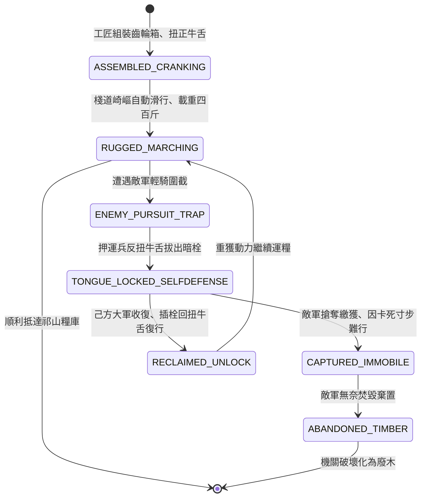

<!-- doc_id: doc_spec_0810 -->
# 3KLife 木牛流馬山地運糧機械機關卡榫與防敵繳獲自毀狀態機規格書

## 模組基本資訊
- **模組代號**：`WOODEN-OX-TRANSPORT01`
- **系統定位**：三國蜀漢山地自動機械運輸系統，負責木牛流馬連桿卡榫組裝、崎嶇棧道行駛、拔舌機關防繳獲自鎖與敵軍繳獲後寸步難行之完整狀態流。
- **架構依賴**：`BattleGridSystem`、`SupplyLineEngine`、`PioneerEngineering`、`VFXBlockRegistry`。

---

## 核心設計概念
諸葛亮北伐出祁山，地勢高下懸絕，秦嶺棧道車馬難行。諸葛亮特製「木牛流馬」：木牛載一歲之糧，日行二十里，行者無倦。其精妙在於腹內槓桿齒輪與牛舌處之「簧片機關卡榫」。扭轉牛舌即可推動輪機行進；若遇曹魏精騎截擊，押運蜀軍只需迅速反向反轉牛舌並拔除核心暗栓（自鎖卡死）。敵軍不知機關奧秘，縱得木牛亦重若泰山、寸步難移，反成累贅。



---

## 狀態機定義與轉換條件

### 1. `ASSEMBLED_CRANKING`（組裝上簧狀態）
- **進入條件**：蜀漢工坊消耗 80 份優質硬木與 10 份生鐵簧片完成組裝。
- **行為表現**：
  - 順時針扭轉牛舌 3 圈上緊主發條與偏心輪。
  - 載重容量高達 400 斤糧米，僅需 1 名軍士扶持操縱。
- **轉換**：出發進入山道地格 -> 轉移至 `RUGGED_MARCHING`。

### 2. `RUGGED_MARCHING`（山地滑行狀態）
- **行為表現**：
  - 行駛於山地、陡坡或懸空棧道時，完全免疫「崎嶇地形移速懲罰」（固定 4 格/回合）。
  - 機械齒輪咬合穩定，運損耗率為 0%。
- **轉換**：
  - 遭遇敵軍部隊截截 -> 轉移至 `ENEMY_PURSUIT_TRAP`。
  - 抵達前線大本營地格 -> 結束退出。

### 3. `ENEMY_PURSUIT_TRAP`（遇敵危急狀態）
- **行為表現**：
  - 敵軍先鋒部隊靠近至 1 格範圍。
  - 操縱軍士評估無法突圍，啟動防繳獲安全協議。
- **轉換**：執行反扭牛舌指令 -> 轉移至 `TONGUE_LOCKED_SELFDEFENSE`。

### 4. `TONGUE_LOCKED_SELFDEFENSE`（舌簧自鎖卡死狀態）
- **行為表現**：
  - 操縱兵反向扭轉牛舌 90 度並抽走暗藏生鐵舌簧插銷。
  - 機械四足內部棘輪死死咬合，單個重量感受等同 2000 斤巨石。
- **轉換**：
  - 敵軍上前俘獲推挽 -> 轉移至 `CAPTURED_IMMOBILE`。
  - 己方後援及時打退敵騎 -> 轉移至 `RECLAIMED_UNLOCK`。

### 5. `CAPTURED_IMMOBILE`（繳獲癱瘓無解狀態）
- **行為表現**：
  - 敵軍無法推動木牛（移動力強制 0 格），且無法藉由一般牛馬牽拉。
  - 敵軍若試圖用刀斧暴力劈砍破解，有 75% 機率觸發內部彈簧崩飛造成敵軍受傷。
- **轉換**：敵軍放棄推運直接放火焚毀 -> 轉移至 `ABANDONED_TIMBER`。

### 6. `RECLAIMED_UNLOCK`（解鎖復行狀態）
- **行為表現**：
  - 蜀漢工兵重新插入舌簧插銷並順向撥正牛舌，齒輪解脫鎖死。
  - 恢復正常山地滑行能力。
- **轉換**：重啟完畢 -> 轉移至 `RUGGED_MARCHING`。

---

## 數值公式與配置契約

```typescript
export interface WoodenOxConfig {
  oxId: string;
  grainCapacity: number;          // 單具木牛載糧量 (斤)
  mountainSpeedGrids: number;     // 山地棧道恆定移動格數
  ruggedPenaltyImmunity: boolean; // 崎嶇地形懲罰免疫
  lockedImmobileWeightKg: number; // 鎖死後等效推動阻力 (kg)
  antiTamperDamage: number;       // 暴力拆解彈簧反傷
}

export const WOODEN_OX_PRESETS: Record<string, WoodenOxConfig> = {
  ZHUGE_WOODEN_OX: {
    oxId: 'OX_ZHUGE_01',
    grainCapacity: 400,
    mountainSpeedGrids: 4,
    ruggedPenaltyImmunity: true,
    lockedImmobileWeightKg: 1000,
    antiTamperDamage: 180,
  }
};
```

---

## 單元測試與驗收標準
1. **棧道崎嶇免疫**：行經消耗 3 點移動力之懸空棧道地格時，木牛移動力固定消耗 1 點，維持每回合 4 格高速推進。
2. **舌簧卡死癱瘓判定**：觸發自鎖後，敵軍俘獲木牛移動力強制降為 0，任何牽引指令皆返回「機關鎖死無法推動」。
3. **暴力破解反噬反傷**：敵軍未持插銷嘗試強行拆毀木牛時，確實觸發 180 點彈簧破片反傷。
