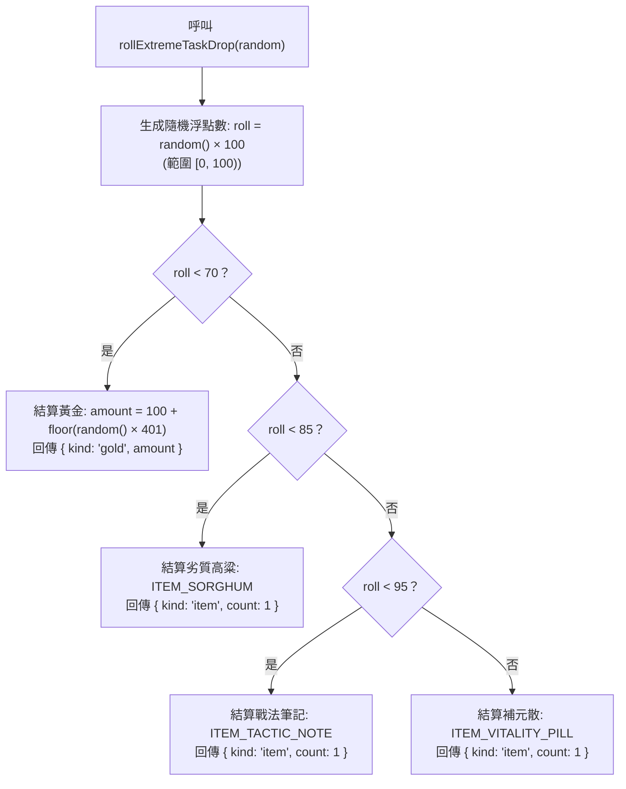

<!-- doc_id: doc_spec_0415 -->
# 極限任務掉落機率模型與獎勵權重分配規格書

> 本規格書為 3KLife 極限任務獎勵掉落權重、百分比抽樣演算法與黃金區間分佈模型之唯一真相來源（Single Source of Truth）。
> 相關實作對齊：`assets/scripts/core/systems/ExtremeTaskDrop.ts`、`PlayerInventory.ts`。

---

## 1. 系統定位與架構設計

1. **高難度挑戰結算獎勵庫（High-Risk Loot Table）**：
   - 極限任務作為檢驗部隊戰力極限之挑戰玩法，完成後觸發單次獨立掉落抽樣。
   - 純邏輯解耦設計，隨機源採用可替換介面注入（`RandomSource`），支援單元測試與伺服器端確定性回放。
2. **百分比累加權重抽樣（Cumulative Weight Sampling）**：
   - 掉落表以百分比（總和 100%）劃分階梯區間，演算法藉由連續累加門檻進行逐級比對。
   - Unity 概念對照：相當於獨立的 `WeightedLootTableSO`，根據抽樣結果生成掉落實體交由結算面板渲染。

---

## 2. 掉落權重分佈全表（EXTREME_TASK_DROP_WEIGHTS）

| 獎勵項目類別 | 掉落品項識別碼 | 權重百分比 (`percent`) | 累積區間 $[start, end)$ | 產出數量規則 |
|---|---|:---:|:---:|---|
| **黃金貨幣** | `kind: 'gold'` | **70%** | $[0, 70)$ | $100 \sim 500$ 均勻隨機整數 |
| **劣質高粱** | `ITEM_SORGHUM` | **15%** | $[70, 85)$ | 固定 1 份 |
| **戰法筆記** | `ITEM_TACTIC_NOTE` | **10%** | $[85, 95)$ | 固定 1 份 |
| **補元散** | `ITEM_VITALITY_PILL` | **5%** | $[95, 100)$ | 固定 1 份 |

---

## 3. 抽樣運算流程與黃金分佈模型



### 3.1 黃金數量均勻分佈計算
- **常數邊界**：
  - 最小值：`EXTREME_TASK_GOLD_MIN = 100`
  - 最大值：`EXTREME_TASK_GOLD_MAX = 500`
- **生成公式**：
  $$\text{span} = 500 - 100 + 1 = 401$$
  $$\text{amount} = 100 + \min\left(400, \lfloor \text{random}() \times 401 \rfloor\right)$$
- 保證產出之黃金數量為 $[100, 500]$ 閉區間內均勻分佈之正整數。

### 3.2 浮點數精度極限防護
- 當 `roll` 浮點數因極端精度接近 100.0 時，演算法末端自動保底結算為 `pill`（補元散），避免陣列越界。

---

## 4. 介面型別契約

```typescript
export const EXTREME_TASK_ITEM_SORGHUM = 'ITEM_SORGHUM';
export const EXTREME_TASK_ITEM_TACTIC_NOTE = 'ITEM_TACTIC_NOTE';
export const EXTREME_TASK_GOLD_MIN = 100;
export const EXTREME_TASK_GOLD_MAX = 500;

export type ExtremeTaskDrop =
    | { readonly kind: 'gold'; readonly amount: number }
    | { readonly kind: 'item'; readonly itemId: string; readonly count: 1 };

export type RandomSource = () => number;

export function rollExtremeTaskDrop(random?: RandomSource): ExtremeTaskDrop;
```

---

## 5. 驗收標準與統計檢核

1. **大數抽樣統計驗證**：
   - 模擬抽樣 $100,000$ 次：
     - 黃金落入區間頻率符合 $70.0\% \pm 0.8\%$
     - 劣質高粱落入頻率符合 $15.0\% \pm 0.6\%$
     - 戰法筆記落入頻率符合 $10.0\% \pm 0.5\%$
     - 補元散落入頻率符合 $5.0\% \pm 0.4\%$
2. **黃金數值範圍驗收**：
   - 抽出的黃金數額嚴格落於 $[100, 500]$ 區間內，無低於 100 或超越 500 之例外。
