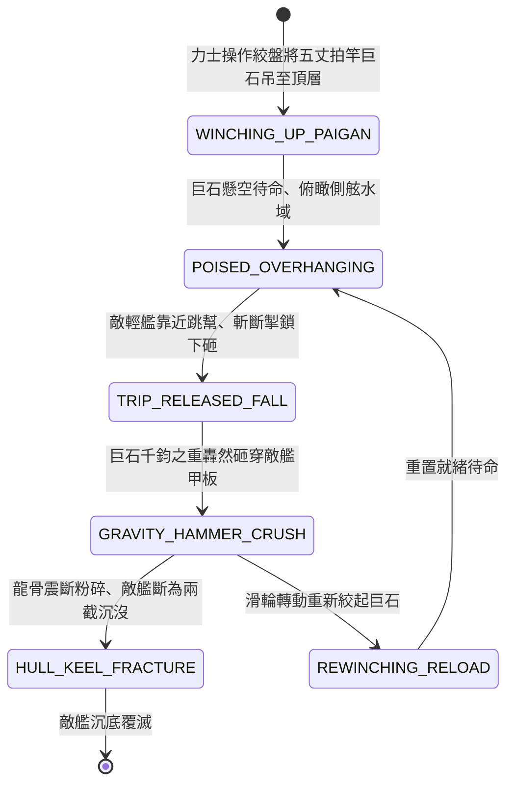

<!-- doc_id: doc_spec_0838 -->
# 3KLife 樓船頂層拍竿巨石下墜砸碎敵艦甲板龍骨狀態機規格書

## 模組基本資訊
- **模組代號**：`SHIP-PAIGAN-HAMMER-CRUSH01`
- **系統定位**：三國大型樓船水戰重力機械打擊系統，負責高架長竿旋轉蓄勢、梢頭巨石重錘重力下墜、敵艦甲板龍骨砸穿粉碎與連帶傾覆沉沒之完整狀態流。
- **架構依賴**：`WaterGridSystem`、`NavalCombatController`、`NavalHullDamageEngine`、`VFXBlockRegistry`。

---

## 核心設計概念
三國與南北朝水戰大型樓船（五層巨艦）配備之終極近程重力打擊武器「拍竿」：於樓船三層甲板兩舷各架設高達五丈之粗重巨木長臂，梢頭以粗鐵鏈繫掛重達五百斤至千斤之花崗巨石或實心生鐵大錘。平時以滑輪絞盤拉起懸於半空。當敵方輕舟、走舸或蒙衝企圖強行靠舷跳幫之際，樓船守軍猛然斬斷掣鎖。巨石長臂自三丈高空呼嘯砸下，攜萬鈞雷霆之勢將敵艦自甲板至龍骨直直砸穿成兩截，瞬息翻沉江中。



---

## 狀態機定義與轉換條件

### 1. `WINCHING_UP_PAIGAN`（絞盤吊裝狀態）
- **進入條件**：大型樓船或鬥艦兩舷配備「拍竿」裝置（每側 2~4 具）。
- **行為表現**：
  - 4 名力士轉動棘輪絞盤，將千斤巨石吊至 15 公尺頂層高架鎖定。
  - 準備耗時 2 回合。
- **轉換**：鎖定栓卡死 -> 轉移至 `POISED_OVERHANGING`。

### 2. `POISED_OVERHANGING`（懸空待發狀態）
- **行為表現**：
  - 巨石如泰山壓頂懸於舷外，威懾相鄰 1 格水面。
  - 對任何企圖接近之敵船產生強大心理威懾。
- **轉換**：敵中小型戰艦行至舷下 1 格範圍 -> 轉移至 `TRIP_RELEASED_FALL`。

### 3. `TRIP_RELEASED_FALL`（掣鎖拔除下墜狀態）
- **行為表現**：
  - 守將拔除掣鎖，長木臂攜千斤巨石以重力加速度狂暴下甩破空。
  - 釋放沉悶撕裂風聲，下墜需時 0.4 秒。
- **轉換**：巨石抵達落點碰撞體 -> 轉移至 `GRAVITY_HAMMER_CRUSH`。

### 4. `GRAVITY_HAMMER_CRUSH`（砸頂粉碎打擊狀態）
- **行為表現**：
  - 巨石精準砸中敵艦正中央甲板，產生 1500 點重力鈍擊真實傷害。
  - 敵艦甲板木板直接被砸碎穿透，甲板上敵兵全部砸成齏粉。
- **轉換**：
  - 敵艦為輕型走舸或艨艟 -> 轉移至 `HULL_KEEL_FRACTURE`。
  - 敵艦為重型鬥艦（耐久未歸零） -> 轉移至 `REWINCHING_RELOAD`。

### 5. `HULL_KEEL_FRACTURE`（龍骨粉碎斷裂狀態）
- **行為表現**：
  - 衝擊力直接貫穿底艙，主龍骨震裂折斷，船體從中斷為兩截。
  - 江水狂湧，敵艦在 3 秒內垂直翻沉沒入長江。
- **轉換**：沉沒結算完畢 -> 結束退出。

### 6. `REWINCHING_RELOAD`（絞盤復位重裝狀態）
- **行為表現**：
  - 拍竿經由麻繩拉扯復位，力士重新絞盤收緊備用巨石。
  - 冷卻耗時 2 回合。
- **轉換**：復位完成 -> 回歸 `POISED_OVERHANGING`。

---

## 數值公式與配置契約

```typescript
export interface ShipPaiganConfig {
  paiganId: string;
  boulderWeightKg: number;         // 梢頭巨石重量 (kg)
  dropHeightMeters: number;        // 下墜垂直高度 (米)
  smashDirectDamage: number;       // 直接砸碎基礎傷害
  keelFractureThreshold: number;   // 誘發龍骨斷裂耐久閾值
  reloadingTurnDuration: number;   // 重新吊裝所需回合
  crewInstantKillRadius: number;   // 砸擊落點士卒秒殺半徑
}

export const PAIGAN_PRESETS: Record<string, ShipPaiganConfig> = {
  HEAVY_TOWER_SHIP_PAIGAN: {
    paiganId: 'PAIGAN_HEAVY_01',
    boulderWeightKg: 800,
    dropHeightMeters: 15,
    smashDirectDamage: 1500,
    keelFractureThreshold: 1200,
    reloadingTurnDuration: 2,
    crewInstantKillRadius: 1.5,
  }
};
```

---

## 單元測試與驗收標準
1. **重力高空落錘傷害結算**：千斤拍竿下砸對舷下敵艦造成 1500 點真實穿甲鈍擊傷害，不被一般側舷生牛皮格擋。
2. **走舸艨艟秒殺斷龍骨**：耐久小於 1200 之輕型戰船承受拍竿打擊，100% 觸發 `HULL_KEEL_FRACTURE` 直接斷裂沉沒。
3. **絞盤冷卻裝填限制**：發動一次拍竿下砸後，部隊嚴格進入 2 回合絞盤復位期，無法連續無限連砸。
