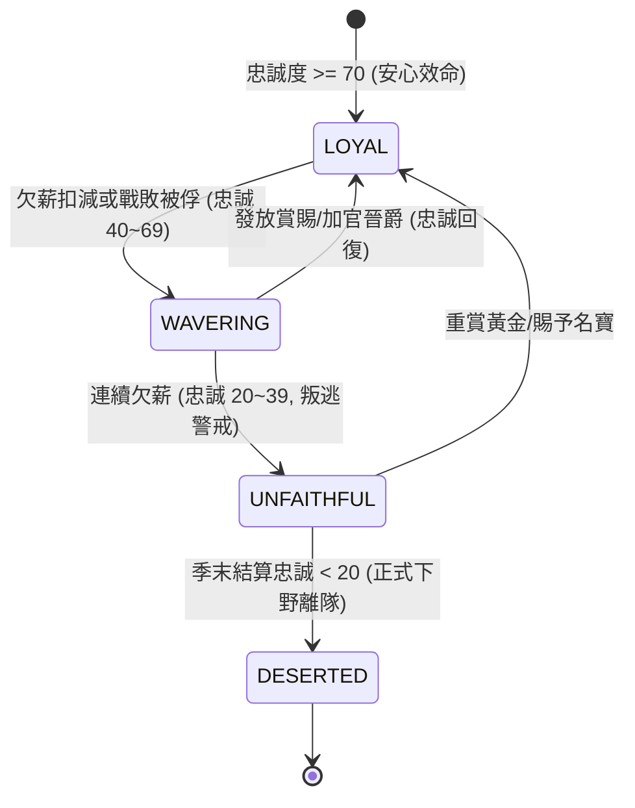

# 武將俸祿薪資發放欠薪忠誠下降與下野叛離規格書

<!-- doc_id: doc_spec_0620 -->

> 本規格書依據 WBS `RET-10`（薪資/懲罰系統：離隊與忠誠下降裁決補齊）制定，為武將俸祿發放、國庫欠薪處罰與忠誠流失下野之單一真相來源（Single Source of Truth）。
> 核心約束：歷史空白正式裁決定案、無副作用純邏輯架構、季度俸祿公式、欠薪忠誠扣減階梯、忠誠低於門檻叛離狀態機、全繁體中文台灣慣用術語。

---

## 1. 業務定位與裁決定案（Single Source of Truth）

過去規格僅有一句「離隊或忠誠下降的懲罰機制」，缺少具體薪資數值與處罰內容。本規格書正式進行業務裁決定案：
1. **季度俸祿發放時機**：每季季初結算點（`QuarterSeasonTick`）由國庫統一核發。
2. **俸祿精算公式**：與武將個人將階（General Rank 1~10）及朝廷任命官職（Officer Tier 1~5）直接連動。
3. **欠薪與叛離處罰**：國庫黃金不足時觸發欠薪，忠誠度扣減；忠誠度低於 $40$ 進入叛逃警戒，低於 $20$ 觸發下野離隊。



---

## 2. 俸祿計算與忠誠扣減階梯

### 2.1 武將季度俸祿公式
每位在職武將每季應領俸祿黃金數：

$$\text{Salary} = \text{Rank} \times 30 + \text{Tier} \times 70$$

- 若武將將階 5、官職 Tier 3（偏將軍）：$\text{Salary} = 5 \times 30 + 3 \times 70 = 360$ 兩黃金。
- 若名將僅有將階 3、無朝廷官職（Tier 0）：$\text{Salary} = 3 \times 30 = 90$ 兩黃金。

### 2.2 欠薪處罰與忠誠流失
若換季時國庫庫存黃金 $\text{TreasuryGold} < \sum \text{Salary}$：
1. **全額欠薪（黃金為 0）**：所有受影響武將忠誠度一次性扣減 $-15$ 點。
2. **部分欠薪（黃金不足全額）**：依忠誠度由低至高優先發放保全軍心，未領到俸祿之武將忠誠度扣減 $-10$ 點。

### 2.3 下野離隊狀態機（Desertion Trigger）
- **離隊判定點**：每季俸祿結算後立即執行。
- **門檻檢查**：若武將當前忠誠度 $\text{Loyalty} < 20$，且非「結義兄弟（`isSwornBrother = true`）」或「嫡系子嗣」：
  - 該武將立即解除出征與太守府任職。
  - 轉化為「下野在野」狀態，攜帶自身專屬私兵流亡至相鄰中立或敵對城池。
  - 系統彈出軍機急報 Toast：「武將 {Name} 因長年欠薪、忠誠喪盡，已憤然下野離去！」

---

## 3. 資料模型與純邏輯介面

```typescript
export interface IGeneralSalaryRecord {
    readonly id: string;
    readonly name: string;
    readonly rank: number;        // 1..10
    readonly officerTier: number; // 0..5
    readonly loyalty: number;     // 0..100
    readonly isImmuneToDesertion: boolean; // 結義或子嗣免離隊
}

export interface ISalarySettlementResult {
    readonly totalSalaryNeeded: number;
    readonly goldPaid: number;
    readonly unpaidGeneralIds: readonly string[];
    readonly updatedGenerals: readonly {
        readonly id: string;
        readonly nextLoyalty: number;
        readonly isDeserted: boolean;
    }[];
}

export function settleQuarterSalaries(
    generals: readonly IGeneralSalaryRecord[],
    treasuryGold: number
): ISalarySettlementResult {
    let availableGold = Math.max(0, treasuryGold);
    let totalNeeded = 0;
    const unpaidIds: string[] = [];
    const updated: { id: string; nextLoyalty: number; isDeserted: boolean }[] = [];

    // 計算總需求並依忠誠低者優先發放
    const sorted = [...generals].sort((a, b) => a.loyalty - b.loyalty);

    for (const g of sorted) {
        const salary = g.rank * 30 + g.officerTier * 70;
        totalNeeded += salary;

        let nextLoyalty = g.loyalty;
        if (availableGold >= salary) {
            availableGold -= salary;
        } else {
            unpaidIds.push(g.id);
            nextLoyalty = Math.max(0, g.loyalty - 15);
        }

        const isDeserted = nextLoyalty < 20 && !g.isImmuneToDesertion;
        updated.push({ id: g.id, nextLoyalty, isDeserted });
    }

    return {
        totalSalaryNeeded: totalNeeded,
        goldPaid: treasuryGold - availableGold,
        unpaidGeneralIds: unpaidIds,
        updatedGenerals: updated,
    };
}
```

---

## 4. 驗收測試案例（Test Cases）

| 測試編號 | 測試情境 | 輸入條件 | 預期輸出 |
|---|---|---|---|
| `TC-SAL-01` | 國庫充裕足額發放 | 需 500 黃金，國庫有 2,000 | `unpaidGeneralIds=[]`, 忠誠度不變，無人離隊 |
| `TC-SAL-02` | 全額欠薪扣減忠誠度 | 國庫 0 黃金，武將忠誠 80 | 忠誠扣減至 65（$-15$ 點），無人離隊 |
| `TC-SAL-03` | 忠誠跌破 20 觸發下野 | 忠誠 25，欠薪後降至 10，非結義 | `isDeserted=true`，武將正式下野離去 |
| `TC-SAL-04` | 結義兄弟欠薪免離隊保護 | 忠誠 10，欠薪降至 0，`isImmuneToDesertion=true` | 忠誠降為 0，但 `isDeserted=false` 保留隊伍 |
