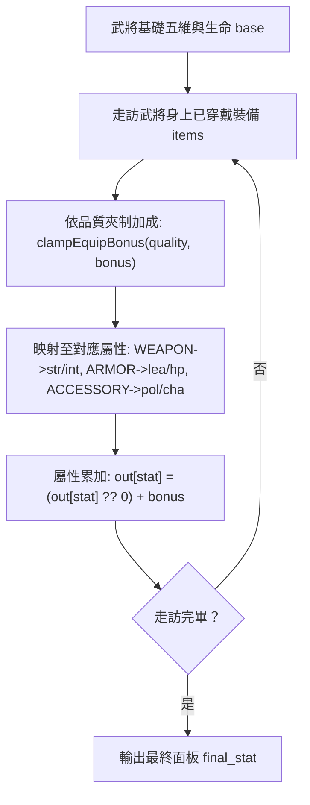
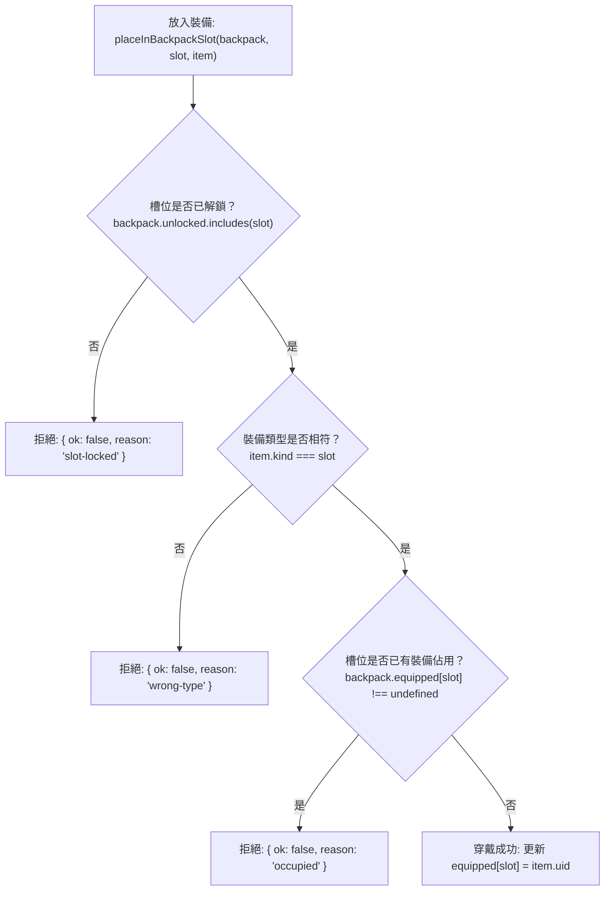

<!-- doc_id: doc_spec_0423 -->
# 武將六槽裝備配置與最終屬性累加模型規格書

> 本規格書為 3KLife 武將個人背包六欄槽位架構、品質加成區間與面板屬性累加總公式之唯一真相來源（Single Source of Truth）。
> 相關實作對齊：`assets/scripts/core/systems/GeneralBackpack.ts`、`GearDefinitions.ts`、`EquipmentBonus.ts`。

---

## 1. 系統定位與槽位分級

1. **武將個人專屬裝備體系**：
   - 每位武將具備獨立的個人背包裝備面板，固定劃分為「3 基礎欄位」與「3 進階欄位」共 6 個槽位。
   - 虎符與英靈卡不納入此六槽體系，維持獨立槽位與裝配通道。
2. **槽位類型與解鎖條件（EQUIP_SLOTS）**：
   - **基礎欄（預設全解鎖）**：
     - `WEAPON`（武器）：主加武力（`str`）、智力（`int`）。
     - `ARMOR`（防具）：主加統帥（`lea`）、生命值（`hp`）。
     - `ACCESSORY`（飾品）：主加政治（`pol`）、魅力（`cha`）。
   - **進階欄（條件/成就/付費解鎖）**：
     - `MOUNT`（名馬）、`TOME`（古書）、`TREASURE`（秘寶）。

---

## 2. 裝備品質階級與數值加成區間（EQUIP_BONUS_RANGE）

裝備屬性加成值嚴格受限於品質階級（Tier）區間，超出範圍之浮動值一律夾回邊界：

| 品質階級 (`EquipQuality`) | 加成數值區間 $[\min, \max]$ | 作用槽位與屬性分派 | 穿戴所需將階門檻 |
|:---:|:---:|---|:---:|
| **N** (凡品) | **$+1 \sim +4$** | 基礎對應兩維屬性同步獲得此加成 | 0 階（開局可用） |
| **R** (良品) | **$+5 \sim +19$** | 基礎對應兩維屬性同步獲得此加成 | 1 階 |
| **SR** (上品) | **$+20 \sim +49$** | 基礎對應兩維屬性同步獲得此加成 | 2 ～ 3 階 |
| **SSR** (絕品) | **$+50 \sim +100$** | 基礎對應兩維屬性同步獲得此加成 | 4 ～ 5 階（滿階） |

---

## 3. 面板屬性累加總公式（applyEquipBonuses）



### 3.1 累加總公式
$$\text{final\_stat} = \text{base\_stat} + \sum_{i \in \text{EquippedItems}} \text{bonus}_i$$

- 各裝備加成為純加法累加（Additive Stacking），無額外隱藏係數，運算結果透明可驗證。

---

## 4. 裝備穿戴檢驗狀態機（placeInBackpackSlot）

嘗試放入裝備時，依序執行三道嚴格檢查，任何一項失敗即拒絕且不改動背包：



---

## 5. 介面型別契約

```typescript
export type EquipSlot = 'WEAPON' | 'ARMOR' | 'ACCESSORY' | 'MOUNT' | 'TOME' | 'TREASURE';
export type EquipQuality = 'SSR' | 'SR' | 'R' | 'N';
export type EquipStatKey = 'str' | 'int' | 'lea' | 'pol' | 'cha' | 'hp';

export interface GeneralBackpack {
    readonly unlocked: EquipSlot[];
    readonly equipped: Partial<Record<EquipSlot, string>>;
}

export function placeInBackpackSlot(
    backpack: Readonly<GeneralBackpack>,
    slot: EquipSlot,
    item: Readonly<{ uid: string; kind: EquipSlot }>
): BackpackPlaceResult;

export function applyEquipBonuses(
    base: Readonly<Partial<Record<EquipStatKey, number>>>,
    items: readonly Readonly<{ kind: EquipSlot; quality: EquipQuality; bonus: number }>[]
): Partial<Record<EquipStatKey, number>>;
```
