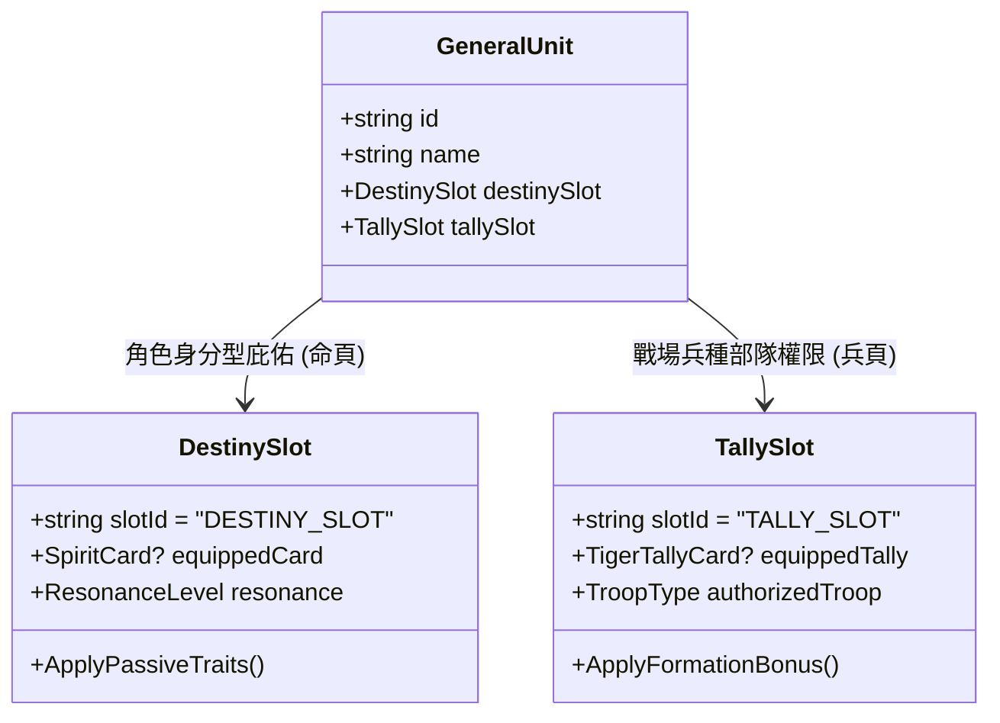
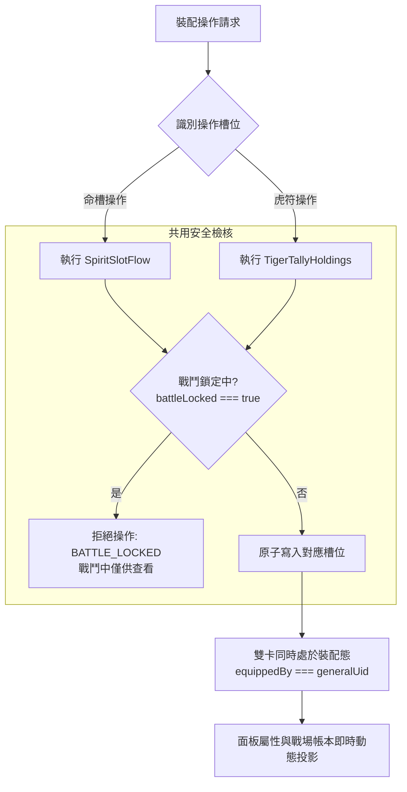

<!-- doc_id: doc_spec_0443 -->
# 武將命鏡與虎符雙卡同裝共存契約規格書

## 1. 核心定位與職責範圍

本規格書定義武將同時裝配「先祖英靈卡（Spirit Card）」與「部隊虎符卡（Tiger Tally）」的雙卡同裝共存架構，對應 WBS **SPI-04**。
武將在戰場與日常成長中，同時承載個人血脈先祖的庇佑與軍團精銳的調度信物。
系統明確切分英靈卡（命頁 `DESTINY_SLOT`）與虎符卡（兵頁 `TALLY_SLOT`）之職責邊界，確保雙卡槽位物理獨立、數值加成正交疊加，並具備統一的戰鬥鎖定（Battle Lock）保護。

---

## 2. 雙卡職責分工與正交架構

### 2.1 雙卡槽位核心特徵比較
| 維度 | 命鏡槽（`DESTINY_SLOT`） | 虎符槽（`TALLY_SLOT`） |
|---|---|---|
| **裝載物件** | 先祖英靈卡（`Item_Type: 'SPIRIT_CARD'`） | 部隊虎符卡（`Item_Type: 'TALLY'`） |
| **插槽數量** | **單插槽（每將限插 1 張）** | **單插槽（每將限插 1 張）** |
| **定位偏向** | **角色身分型加成**（血脈特性、五維修正、專屬奧義） | **戰場兵種型權限**（精銳兵種解鎖、陣型攻防、帶兵糧耗） |
| **所屬分頁** | 人物頁 · 命（`Bloodline`） | 人物頁 · 兵（`Aptitude`） |
| **替換代價** | 原卡被動立即卸除，無忠誠懲罰 | 強制拔除扣減武將忠誠度（非轉蛋名將） |

---

## 3. 雙卡同裝狀態機與驗證規則

### 3.1 槽位互不排斥鐵律
- **物理隔離**：英靈卡**絕不可**被誤穿入虎符槽，虎符卡亦**絕不可**被穿入命鏡槽。底層呼叫以型別守衛（`NOT_SPIRIT_CARD` / `NOT_TALLY`）強制阻斷。
- **正交並存**：同一武將同時插滿 1 張英靈卡與 1 張虎符卡為標準滿配狀態。兩者在統一物件庫中分別佔據不同的記錄列，`equippedBy` 皆指向該武將 UID，互不覆蓋。

---

## 4. 戰鬥鎖定與替換保護（E-4）

1. **出征狀態鎖定**：
   - 當大軍出征進入戰役沙盤（`battleLocked: true`），雙卡槽位立即切換為唯讀檢視模式。
   - 任何卸下（`unequip`）、插入（`insert`）或替換（`replace`）請求一律拋出 `BATTLE_LOCKED` 拒絕代碼，杜絕戰中換卡作弊。
2. **替換二次確認契約**：
   - 替換英靈卡時，前端彈出警告：「替換英靈卡將解除當前先祖之被動奧義庇佑」。
   - 替換虎符卡時，前端彈出警告：「更換虎符將重置該部隊之戰場士氣與扣減忠誠度」。

---

## 5. 驗收標準與單元測試契約

1. **雙卡並存驗證**：
   - 武將 A 同時裝備英靈卡 S1 與虎符 T1，查詢武將背包視圖，兩者均正確顯示為已裝配狀態。
2. **單卡替換獨立性驗證**：
   - 替換武將 A 的英靈卡 S1 為 S2，驗證虎符 T1 的裝配狀態完全不受影響，反之亦然。
3. **重複插入攔截驗證**：
   - 命鏡槽已有英靈卡時，再次呼叫 `insertSpiritCard` 必定回傳 `SLOT_OCCUPIED`，強制引導使用 `replaceSpiritCard`。
