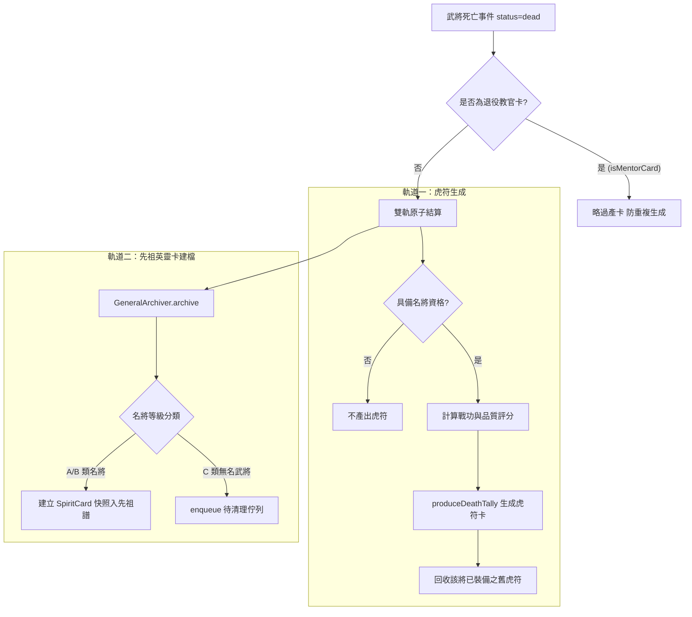

<!-- doc_id: doc_spec_0428 -->
# 武將死亡結算虎符生成與先祖英靈卡建檔規格書

## 1. 核心定位與職責範圍

本規格書定義武將生命週期終結（陣亡或壽終）時的雙軌資產結算與歸檔狀態機，對應 WBS **EQP-08**。
當武將狀態轉換為死亡（`status === 'dead'`）時，底層系統由純邏輯無副作用服務觸發雙軌轉換：
1. **虎符生成（Tiger Tally Generation）**：將陣亡名將的戰鬥資歷與品級凝練為部隊虎符卡片。
2. **先祖英靈卡建檔（Ancestor Spirit Card Archival）**：建立不可篡改的歷史快照，存入先祖世系譜牒。
本系統與 Cocos 渲染層完全解耦，所有結算計算保證純整數、無副作用且支援種子回放。

---

## 2. 死亡結算雙軌流程狀態機



---

## 3. 虎符生成數學模型與唯一識別規則

### 3.1 產卡資格與防重複檢查
- **資格判定**：僅女性名將或具備正式模板 ID（`templateId`）的名將具備產卡資格（`isTallyEligible`）。
- **教官防重複鐵律**：已退役為教官卡的武將（`isMentorCard === true`）在退役時已完成虎符生成，壽終時嚴禁二次產卡（PROG-2-0739）。
- **重複死亡防護**：僅處理 `alive -> dead` 狀態轉換，同一武將在同季重複呼叫不重複產卡。

### 3.2 評分與品質映射公式
綜合評分 $Score$ 結合戰場表現分數 $S_{battle}$ 與歷史品級補正 $S_{legacy}$：
$$Score = \lfloor S_{battle} \times 0.6 + S_{legacy} \times 0.4 \rfloor$$
虎符品質（`TigerTallyQuality`）依評分嚴格劃分階梯：
- **UR**：$Score \ge 90$
- **SSR**：$75 \le Score < 90$
- **SR**：$55 \le Score < 75$
- **R**：$Score < 55$

### 3.3 唯一 UID 命名規範
虎符卡 UID 具備時間與身分雙重維度：
$$\text{uid} = \text{"tally-death-" } + \text{sourceGeneralUid} + \text{"-" } + \text{season}$$
- 同武將在同季結算重試必得出相同 UID，天然實現冪等性；若因輪迴復出於不同季死亡，則產生獨立版本。

---

## 4. 戰場移交與封賞擴充規則

除了死亡結算外，虎符另有兩種衍生取得管道：
1. **俘虜招降移交（`transferSurrenderTally`）**：
   - 俘虜降伏後需歷經至少一整季之軍心整頓期：
     $$\text{currentSeason} \ge \text{recruitedSeason} + 1$$
   - 移交後來源標記重置為 `source: 'surrender'`。
2. **破釜沉舟封賞（`awardTopTally`）**：
   - 當戰役具備破釜沉舟條件（`hasNoRetreat === true`）且獲得完全勝利（`victory === true`）時觸發。
   - 從參戰武將所攜虎符中挑選最高品質與最高分數之虎符，標記為 `source: 'reward'` 授予玩家。

---

## 5. 先祖英靈卡建檔與資料介面契約

### 5.1 英靈卡快照資料結構（`SpiritCard`）
```typescript
export interface SpiritCard {
    readonly uid: string;              // 格式：spirit-{generalId}-{deathSeason}
    readonly generalId: string;        // 原始武將 ID
    readonly name: string;             // 武將名號
    readonly bloodlineId: string;      // 家族血脈標記
    readonly finalStats: {             // 臨終五維屬性快照
        lea: number; str: number; int: number; pol: number; cha: number;
    };
    readonly deathSeason: number;      // 離世季數
    readonly legacyTraits: string[];   // 繼承傳家特質
    readonly isPrimary: boolean;       // 命鏡槽啟用標記
}
```

### 5.2 歸檔雙向分流（`GeneralArchiver`）
- **A/B 類歷史名將**：建立不可變之 `SpiritCard` 快照，永久收錄至世代家族譜牒（Ancestral Vault），供後代於「命頁」進行命鏡單槽裝配。
- **C 類大眾臉武將**：不建立英靈卡，資料轉入 `PendingDeleteStore`，釋放記憶體避免存檔膨脹。

---

## 6. 邊界約束與驗收條件

1. **裝備自動解除**：武將死亡時，其原先裝配之虎符與六槽裝備立即強制解綁歸還府庫（`onGeneralDeath`），不可隨角色銷毀而遺失。
2. **單一真相來源**：所有虎符資產統一登記於 `InventoryRecordBridge`，視圖層透過 `projectInventoryViews` 動態投影，禁止另設獨立快照表。
3. **驗收測試覆蓋**：
   - `TRP-07`：驗證武將死亡時同步生成 `TigerTallyCard` 與 `SpiritCard`。
   - `PROG-2-0739`：驗證已退役教官死亡不再重複產出虎符。
