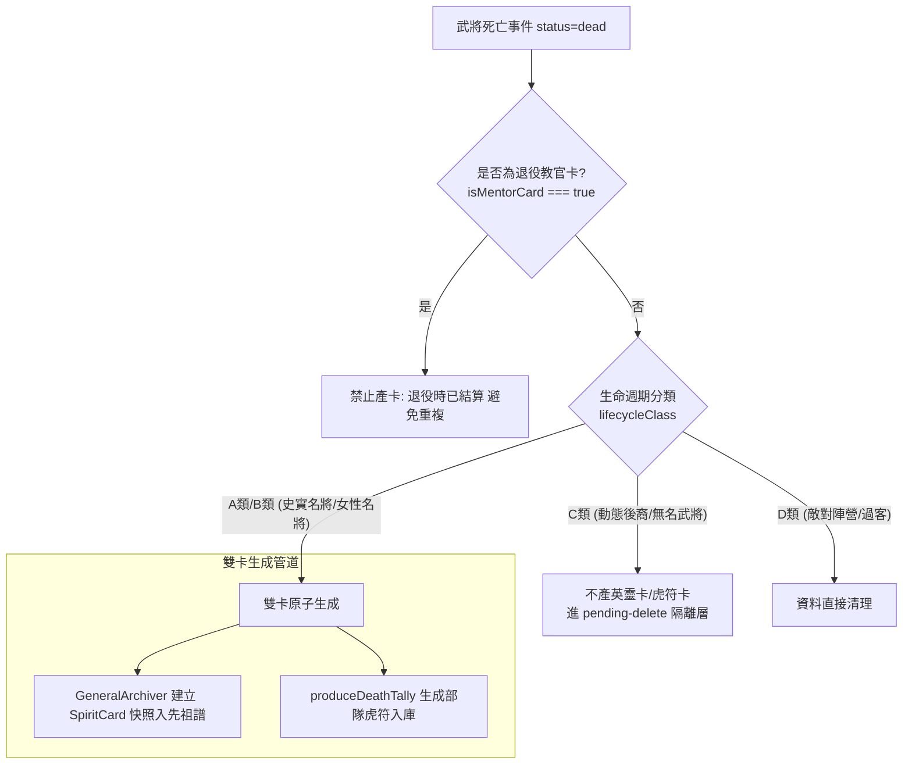

<!-- doc_id: doc_spec_0440 -->
# 武將死亡雙卡結算與產卡資格判定規格書

## 1. 核心定位與職責範圍

本規格書定義武將生命週期終結時，「英靈卡（Spirit Card）」與「部隊虎符卡（Tiger Tally）」的雙卡原子結算與產卡資格判定矩陣，對應 WBS **SPI-01**。
在長局單機生命週期中，武將陣亡或壽終離世是世家傳承的重要轉折點。
系統透過無副作用的純邏輯服務（`GeneralArchiver.ts`、`TigerTally.ts`），依據武將歷史品級與生命週期分類，精準分流產卡決策，杜絕普通大眾臉武將造成的資料庫膨脹與退役重覆發卡問題。

---

## 2. 產卡資格判定矩陣與分流模型

### 2.1 資格判定矩陣規範
| 武將生命週期類別 | 範例代表人物 | 英靈卡產出（`SpiritCard`） | 虎符卡產出（`TigerTally`） | 備註說明 |
|---|---|:---:|:---:|---|
| **A 類（史實名將）** | 關羽、諸葛亮、周瑜 | **生成**（永久先祖快照） | **生成**（專屬部隊虎符） | 具備唯一模板 ID，觸發輪迴覆蓋 |
| **B 類（女性名將）** | 貂蟬、黃月英、孫尚香 | **生成**（先祖譜牒快照） | **生成**（專屬部隊虎符） | 具備特殊血脈與部隊特性 |
| **C 類（動態後裔）** | 自訂子女、非名將動態官員 | **不生成** | **不生成** | 轉入 `pending-delete`，釋放記憶體 |
| **退役教官卡** | 65 歲以上轉教官之老將 | **嚴格禁止生成** | **嚴格禁止生成** | 退役時已完成傳承，壽終不二次產卡 |

---

## 3. 雙卡獨立性與生命週期職責

### 3.1 先祖英靈卡（`SpiritCard`）職責
- 由歸檔服務 `GeneralArchiver.archive(general, context)` 建立。
- 凍結臨終前之五維數值、英勇事蹟、專屬戰法與遺言，存入世家先祖譜牒（Ancestral Vault）。
- 供後代武將於「命頁」進行命鏡槽（`DESTINY_SLOT`）裝配，啟動先祖被動庇佑。

### 3.2 部隊虎符卡（`TigerTally`）職責
- 由部隊系統 `produceDeathTally(general, battleScore, legacyScore, season)` 建立。
- 將武將軍旅生涯之戰功凝練為兵團調度信物（品質 R/SR/SSR/UR）。
- 存入統一物件庫（`TALLY_SLOT`），供軍團出征時編制精銳部隊。

---

## 4. 防呆機制與邊界約束

1. **退役防重複鐵律（武將壽命系統 §M-1）**：
   - 武將達退休年齡轉為教官卡（`MentorCard`）時，已享受退休榮譽與傳承媒介注入。其後續因壽終離世時，`isMentorCard === true` 條件強制攔截產卡邏輯，絕不重複派發英靈卡或虎符卡。
2. **記憶體防膨脹（GC 隔離）**：
   - C 類非名將死亡後，主體資料自活耀陣列移出並寫入 `PendingDeleteStore`，避免長局存檔無限擴大。
3. **單元測試驗收**：
   - `SpiritRelic.test.ts`：驗證史實名將陣亡必定同步生成兩張卡片。
   - 驗證退役武將死亡時產卡函式回傳 `null`，產卡清單長度為 0。
