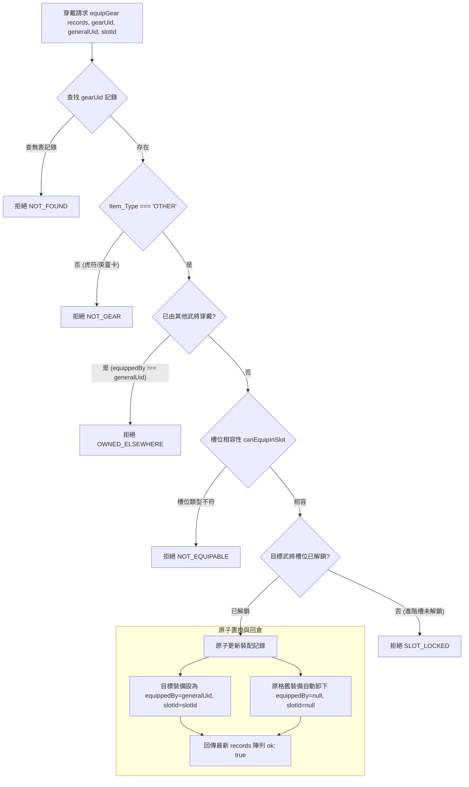

<!-- doc_id: doc_spec_0434 -->
# 武將裝備穿戴卸下操作與雙端資料一致性規格書

## 1. 核心定位與職責範圍

本規格書定義武將裝備六槽（WEAPON、ARMOR、ACCESSORY、MOUNT、TOME、TREASURE）的穿戴與卸下流程，對應 WBS **BAG-03**。
依據統一物件庫（Canonical Inventory Service）架構，遊戲內不存在孤立的「武將個人裝備存檔」，所有裝備實體皆為全域物件庫中的一列（`InventoryRecord`）。
「武將個人背包」僅為前端依武將 UID 篩選之唯讀投影視圖（Read-only Projection View）。
本模組由純邏輯無副作用服務（`GearEquipFlow.ts`）驅動，嚴格保證倉庫與武將兩端狀態的一致性與操作原子性。

---

## 2. 裝備穿戴狀態機與檢核流程



---

## 3. 操作契約與拒絕原因枚舉

### 3.1 穿戴拒絕代碼（`GearEquipRejectReason`）
- `NOT_FOUND`：倉庫中找不到指定裝備 UID，或卸下時目標格位無任何裝備。
- `NOT_GEAR`：該物品非一般裝備（例如試圖將虎符或英靈卡穿入一般裝備槽）。
- `OWNED_ELSEWHERE`：該裝備正由陣營中另一位武將穿戴，嚴禁直接跨武將搶奪，必須先由原主卸下回倉。
- `NOT_EQUIPABLE`：裝備所屬類別與目標槽位不匹配（例：武器不能放入防具槽）。
- `SLOT_LOCKED`：武將該格位尚未達到解鎖條件（進階槽位需特定門檻或持有對應資產）。

### 3.2 舊裝備自動頂替回倉機制
- 當武將嘗試向已裝備有防具的格子穿戴新防具時，系統**自動將原格位之舊防具卸下並返還倉庫**（`equippedBy: null, slotId: null`）。
- 全流程在單一陣列投影轉換中完成，無任何中繼不一致狀態，防止舊裝備憑空消失。

---

## 4. 裝備卸下流程（`unequipGear`）

卸下操作為穿戴之逆向原子操作：
```typescript
export function unequipGear(
    records: readonly InventoryRecord[],
    generalUid: string,
    slotId: EquipSlot,
): GearEquipResult {
    const target = records.find(
        (r) => r.Item_Type === 'OTHER' && r.equippedBy === generalUid && r.slotId === slotId
    );
    if (!target) return { ok: false, reason: 'NOT_FOUND' };
    const next = records.map((r): InventoryRecord =>
        r.Inventory_ID === target.Inventory_ID ? { ...r, equippedBy: null, slotId: null } : r
    );
    return { ok: true, records: next };
}
```
- 卸下後物品立即回歸主城倉庫視圖，並即刻可用於其他武將之裝配或於鐵匠鋪進行分解。

---

## 5. 資料不可變性與驗收標準

1. **不可變資料流動（Immutable State）**：所有穿戴與卸下運算一律透過 `.map()` 建立全新物件庫陣列，絕對禁止原地修改輸入的 `records` 物件。
2. **單一資料來源原則**：前端 UI 元件（`GearSlotPickController`）僅負責捕捉玩家點擊並發起指令，絕不自行快取裝備狀態。
3. **驗收測試覆蓋**：
   - 驗證成功穿戴後，倉庫視圖與武將背包視圖資料同步更新。
   - 驗證裝備已被武將 A 穿戴時，武將 B 穿戴該物品必被攔截並回傳 `OWNED_ELSEWHERE`。
   - 驗證目標槽位被頂替時，原舊裝備正確安全回倉且屬性加成即時重算。
