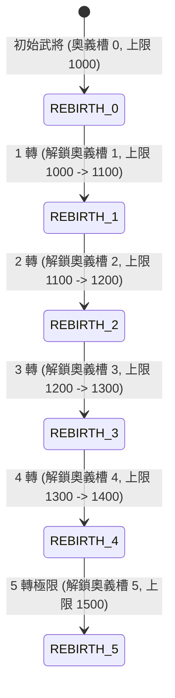

<!-- doc_id: doc_spec_0593 -->
# 武將轉生奧義槽位解鎖與五維上限突破演算法規格書

> 標記：Single Source of Truth（單一真相來源）  
> 涵蓋工作包：`ULT-03`  
> 狀態：正式發布 / 核心邏輯規格

---

## 1. 系統定位與架構

本模組規範名將在歷經世代宿命後執行的「宿命轉生 / 輪迴覺醒（Reincarnation）」系統。武將在達到當前等級與屬性瓶頸後，透過消耗轉生材料（如輪迴玉、將魂碎片）完成 1 至 5 次轉生。每次轉生將依序解鎖 1 個專屬奧義槽位（最高 5 槽），並逐步突破個人五維屬性上限（自 1,000 點逐步突破至 1,500 點），為名將提供深度的終局養成維度。



---

## 2. 轉生階梯與屬性上限精算（ULT-03）

### 2.1 轉生階梯對照表（1 ~ 5 轉）
| 轉生階數 | 解鎖奧義槽代碼 | 單項五維上限（`StatCap`） | 五維總和上限（`TotalCap`） | 消耗將魂材料 | 前置武將等級 |
|:---:|:---:|:---:|:---:|:---:|:---:|
| **0 轉（初始）** | 無專屬奧義槽 | 1,000 | 4,000 | 無 | 初始 1 級 |
| **1 轉** | `ULT_SLOT_1` | 1,100 | 4,400 | 將魂 $\times 50$ | 50 級 |
| **2 轉** | `ULT_SLOT_2` | 1,200 | 4,800 | 將魂 $\times 100$ | 60 級 |
| **3 轉** | `ULT_SLOT_3` | 1,300 | 5,200 | 將魂 $\times 200$ | 70 級 |
| **4 轉** | `ULT_SLOT_4` | 1,400 | 5,600 | 將魂 $\times 350$ | 80 級 |
| **5 轉（極限）** | `ULT_SLOT_5` | **1,500** | **6,000** | 輪迴玉 $\times 1$ + 將魂 $\times 500$ | 90 級（滿級） |

### 2.2 轉生狀態資料模型
```typescript
export type ReincarnationTier = 0 | 1 | 2 | 3 | 4 | 5;

export interface IReincarnationState {
  readonly generalId: string;
  tier: ReincarnationTier;
  readonly unlockedUltimateSlots: readonly string[]; // ['ULT_SLOT_1', ...]
  statCap: number;                                  // 當前五維單項上限
  totalStatCap: number;                             // 當前五維總和上限
}

export function evaluateReincarnationProgress(tier: ReincarnationTier): {
  statCap: number;
  totalStatCap: number;
  unlockedSlots: readonly string[];
} {
  const caps: Record<ReincarnationTier, { stat: number; total: number }> = {
    0: { stat: 1000, total: 4000 },
    1: { stat: 1100, total: 4400 },
    2: { stat: 1200, total: 4800 },
    3: { stat: 1300, total: 5200 },
    4: { stat: 1400, total: 5600 },
    5: { stat: 1500, total: 6000 },
  };

  const unlockedSlots = Array.from({ length: tier }, (_, i) => `ULT_SLOT_${i + 1}`);
  return {
    statCap: caps[tier].stat,
    totalStatCap: caps[tier].total,
    unlockedSlots,
  };
}
```

---

## 3. 轉生突破處理機制

1. **五維突破無損繼承**：
   - 轉生操作執行時，武將當前已分配的基礎屬性、經驗值與等級完全保留，不重置回 1 級。
   - 上限槽位即時擴展，允許後續繼續透過修行丹藥或戰鬥歷練提升五維。
2. **奧義插槽狀態切換**：
   - 解鎖的新奧義插槽初始為空置（`null`），狀態標記為 `isUnlocked = true`。
   - 玩家可進入武將「奧義配裝面板」自由裝配對應階位之專屬奧義技能。

---

## 4. 驗收與測試標準

1. **階梯解鎖測試（TC-ULT-03-01）**：
   - 驗證從 0 轉推進至 5 轉過程中，奧義槽位數量精確由 0 增加至 5 個。
2. **屬性上限邊界校驗（TC-ULT-03-02）**：
   - 驗證 0 轉武將單項屬性嘗試加至 1,001 時被嚴格攔截於 1,000；5 轉武將允許提升至 1,500。
3. **材料扣除與等級門檻（TC-ULT-03-03）**：
   - 未滿 50 級嘗試進行 1 轉時，檢核回傳 `LEVEL_TOO_LOW` 錯誤；材料不足時拒絕扣款。
