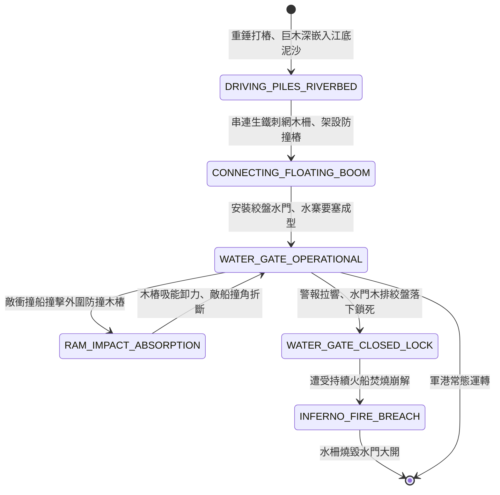

<!-- doc_id: doc_spec_0836 -->
# 3KLife 水寨巨木連環水柵營盤與防撞角木樁水門防禦狀態機規格書

## 模組基本資訊
- **模組代號**：`WATER-FORT-PALISADE01`
- **系統定位**：三國江面軍港水寨與水柵要塞防禦系統，負責水底深樁打入、浮動水柵木排連結、防衝撞緩衝木樁、水門起閉與江灣封鎖之完整狀態流。
- **架構依賴**：`WaterGridSystem`、`NavalShipMovement`、`NavalHullDamageEngine`、`VFXBlockRegistry`。

---

## 核心設計概念
三國長江沿線軍事重地（如赤壁曹公水寨、濡須口東吳塢堡、白帝城水門）：長江江面寬闊，水軍宿營停泊若無工事，極易遭敵夜襲火攻。主帥令隨軍工兵將粗大巨木削尖，借重錘重力打入長江江底深泥數丈，水面形成數道犬牙交錯之「防撞木樁陣」。木樁間以粗麻索串連帶刺浮動木柵，中央設巨大絞盤吊起之「水門木閘」。敵戰船即便全速衝撞，撞角先受外圍緩衝木樁阻滯卸力，無法威脅水寨核心停泊艦船。



---

## 狀態機定義與轉換條件

### 1. `DRIVING_PILES_RIVERBED`（江底打樁狀態）
- **進入條件**：江灣水域（靠近岸邊 1~2 格），工兵船作業。
- **行為表現**：
  - 以重錘落石將 20 根粗大杉木直直砸入河床泥層。
  - 耐久度基礎值 1800 點。
- **轉換**：基樁穩固（耗時 2 回合） -> 轉移至 `CONNECTING_FLOATING_BOOM`。

### 2. `CONNECTING_FLOATING_BOOM`（連環木柵串聯狀態）
- **行為表現**：
  - 木樁外圍串接粗麻索帶倒刺浮動木排，形成水上刺欄。
  - 阻絕輕舟走舸與水鬼潛泳通行。
- **轉換**：木排安裝完成 -> 轉移至 `WATER_GATE_OPERATIONAL`。

### 3. `WATER_GATE_OPERATIONAL`（水門防衛運轉狀態）
- **行為表現**：
  - 水寨門樓架設 2 具巨型棘輪絞盤，平日敞開水門供己方巡邏船進出。
  - 兩側瞭望哨塔駐守弓弩手，覆蓋水門前方 3 格射界。
- **轉換**：
  - 遭遇敵艦正面高速度衝撞 -> 轉移至 `RAM_IMPACT_ABSORPTION`。
  - 偵測到敵大軍來襲警報 -> 轉移至 `WATER_GATE_CLOSED_LOCK`。

### 4. `RAM_IMPACT_ABSORPTION`（衝撞吸能卸力狀態）
- **行為表現**：
  - 外圍交錯防撞木樁吸收 80% 撞擊動能，敵船撞角折斷破裂。
  - 木樁損耗 300 點耐久，但水寨本體骨架毫髮無損。
- **轉換**：敵船動能耗盡被彈開 -> 回歸正常防衛。

### 5. `WATER_GATE_CLOSED_LOCK`（水門落閘鎖閉狀態）
- **行為表現**：
  - 絞盤釋放，重達萬斤之厚實鐵皮排柵轟然落入水中，水道完全截斷封死。
  - 阻止任何外敵船隻衝入內港池。
- **轉換**：遭遇敵軍火攻大筏或火船持續焚燒超過 3 回合 -> 轉移至 `INFERNO_FIRE_BREACH`。

### 6. `INFERNO_FIRE_BREACH`（木柵焚毀失守狀態）
- **行為表現**：
  - 水柵與水門被烈火燒成黑炭坍塌，防禦判定徹底解除。
  - 敵艦隊得以直接突入水寨內部港灣。
- **轉換**：要塞破滅 -> 結束退出。

---

## 數值公式與配置契約

```typescript
export interface WaterFortPalisadeConfig {
  fortId: string;
  pileMaxDurability: number;      // 木樁耐久上限
  ramEnergyAbsorptionRate: number;// 撞擊動能吸收比 (0.0 ~ 1.0)
  enemyRamDamageRecoilRate: number;// 反震敵船撞角損壞率
  waterGateCloseTurnCost: number;  // 落閘所需回合數
  fireVulnerabilityMultiplier: number; // 火焰易傷係數
}

export const WATER_FORT_PRESETS: Record<string, WaterFortPalisadeConfig> = {
  CHIBI_NORTHERN_WATER_CAMP: {
    fortId: 'FORT_CHIBI_01',
    pileMaxDurability: 1800,
    ramEnergyAbsorptionRate: 0.80,
    enemyRamDamageRecoilRate: 0.90,
    waterGateCloseTurnCost: 1,
    fireVulnerabilityMultiplier: 2.2,
  }
};
```

---

## 單元測試與驗收標準
1. **衝撞吸能防禦驗證**：敵方撞角戰艦以移速 5 格衝擊防撞木樁，80% 動能被吸收，敵船撞角 90% 判定斷裂損毀。
2. **水門落閘封鎖水道**：進入 `WATER_GATE_CLOSED_LOCK` 後，該水域地格通行權限 100% 關閉，敵艦無法穿透。
3. **火攻高溫易傷突破**：水柵遭受火攻打擊時，傷害乘上 2.2 倍，大火持續 3 回合後木柵自然坍塌燒毀。
