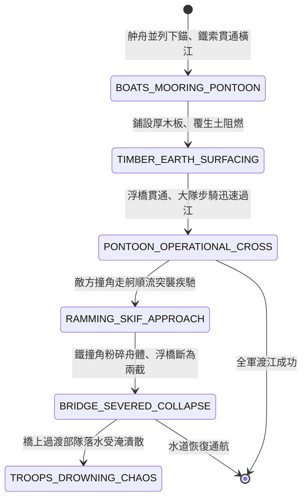

<!-- doc_id: doc_spec_0835 -->
# 3KLife 水寨浮橋水上渡河兵團機動與走舸撞角斷橋狀態機規格書

## 模組基本資訊
- **模組代號**：`PONTOON-BRIDGE-NAVAL-RAM01`
- **系統定位**：三國大江水上浮橋工程與突擊斷橋反制作戰系統，負責平底舯舟並列架橋、木板覆土鋪道、陸軍跨江急行、鋒銳鐵撞角走舸疾馳衝撞與浮橋斷裂半渡擊潰之完整狀態流。
- **架構依賴**：`WaterGridSystem`、`NavalShipMovement`、`PioneerEngineering`、`VFXBlockRegistry`。

---

## 核心設計概念
大江大河兩岸調兵之速決關鍵「水上浮橋」：進攻方於狹窄水域調集二十艘平底大舯舟，以粗麻索與鐵錨定泊於江面，舟上橫鋪厚木板並覆蓋生土以防火箭，化天塹為通途，供萬名步騎大軍迅速過江包抄側後。防守方水軍則深知「半渡而擊」之勝機：趁敵軍大隊行至浮橋中央，遣輕捷走舸艦首安裝鋒銳三叉生鐵撞角，藉長江順流之勢如離弦飛箭直衝浮橋中段，硬生生將浮舟撞碎斷纜，使半渡敵軍落水覆滅。



---

## 狀態機定義與轉換條件

### 1. `BOATS_MOORING_PONTOON`（舯舟錨定狀態）
- **進入條件**：兩岸皆為己方控制之地格，江面跨度 <= 4 格，工兵下達「架設浮橋」指令。
- **行為表現**：
  - 投入 8 艘平底舯舟，以四爪鐵錨定泊於江心。
  - 舟與舟之間以粗鐵纜鎖定。
- **轉換**：舟身固定（耗時 2 回合） -> 轉移至 `TIMBER_EARTH_SURFACING`。

### 2. `TIMBER_EARTH_SURFACING`（鋪板覆土狀態）
- **行為表現**：
  - 鋪設 3 寸厚堅硬松木板，表面均勻撒布濕生土。
  - 獲得「防火防滑」特性，免受敵軍常規火箭直接引燃。
- **轉換**：路面完工 -> 轉移至 `PONTOON_OPERATIONAL_CROSS`。

### 3. `PONTOON_OPERATIONAL_CROSS`（浮橋通行狀態）
- **行為表現**：
  - 浮橋地格轉為「常態陸地通行」屬性，步騎通行無移速懲罰。
  - 耐久度為 1200 點。
- **轉換**：
  - 步騎全軍安全過渡完畢 -> 結束退出。
  - 遭遇敵軍裝備鐵撞角之快艇走舸順流俯衝 -> 轉移至 `RAMMING_SKIF_APPROACH`。

### 4. `RAMMING_SKIF_APPROACH`（撞角走舸突襲狀態）
- **行為表現**：
  - 走舸以 6 格/回合順流疾馳，艦首生鐵撞角散發破甲寒芒。
  - 鎖定浮橋中段核心承重舟體。
- **轉換**：撞角正面接觸浮橋 -> 轉移至 `BRIDGE_SEVERED_COLLAPSE`。

### 5. `BRIDGE_SEVERED_COLLAPSE`（撞毀斷橋狀態）
- **行為表現**：
  - 猛烈撞擊造成 1500 點毀滅性穿透傷害，中央 2 艘舯舟粉碎解體。
  - 粗鐵纜崩斷，浮橋由中段斷裂，兩截木板道隨江水漂散。
- **轉換**：橋體斷裂瞬間 -> 轉移至 `TROOPS_DROWNING_CHAOS`。

### 6. `TROOPS_DROWNING_CHAOS`（半渡落水潰滅狀態）
- **行為表現**：
  - 正身處斷裂地格之士卒戰馬全部墜落江中，直接承受 70% 溺水戰損。
  - 兩端未渡部隊退路斷絕，士氣暴跌 40 點。
- **轉換**：戰場結算完成 -> 結束退出。

---

## 數值公式與配置契約

```typescript
export interface PontoonBridgeConfig {
  bridgeId: string;
  boatsRequiredCount: number;     // 所需舯舟數量
  bridgeDurabilityMax: number;    // 浮橋耐久上限
  rammingImpactDamage: number;    // 撞角走舸衝撞傷害
  troopsDrowningCasualtyRate: number; // 斷橋落水戰損率 (0.0 ~ 1.0)
  halfCrossMoraleShock: number;   // 半渡被截士氣震懾值
}

export const PONTOON_PRESETS: Record<string, PontoonBridgeConfig> = {
  YANGTZE_RAPID_PONTOON: {
    bridgeId: 'PONTOON_YANGTZE_01',
    boatsRequiredCount: 8,
    bridgeDurabilityMax: 1200,
    rammingImpactDamage: 1500,
    troopsDrowningCasualtyRate: 0.70,
    halfCrossMoraleShock: -40,
  }
};
```

---

## 單元測試與驗收標準
1. **陸路通行屬性轉變**：浮橋鋪設完成後，水域地格 100% 賦予步騎陸行權限，不觸發落水判定。
2. **鐵撞角一擊粉碎斷橋**：走舸正面撞擊浮橋，造成 1500 點超額傷害，浮橋耐久直接歸零並分裂。
3. **半渡部隊溺斃結算**：斷橋時正處於中央地格之部隊，70% 兵力直接判定溺亡除名，士氣扣除 40 點。
