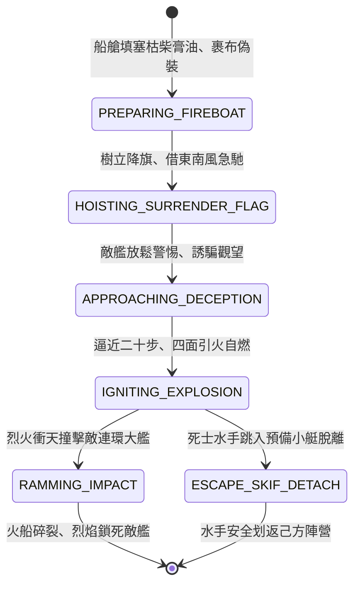

<!-- doc_id: doc_spec_0813 -->
# 3KLife 水戰快艇走舸滿載膏油伏火偽降詐降突擊點火狀態機規格書

## 模組基本資訊
- **模組代號**：`FIRE-ATTACK-SURRENDER-BOAT01`
- **系統定位**：三國水戰詐降火攻突襲系統，負責走舸蒙衝裝載乾柴油脂、青油幔帳隱匿、插降旗借順風急馳、接近敵艦點火撞擊與死士跳舟逃生之完整狀態流。
- **架構依賴**：`WaterGridSystem`、`NavalShipMovement`、`WindSystem`、`VFXBlockRegistry`。

---

## 核心設計概念
赤壁水戰名將黃蓋之火攻奇謀：以二十艘輕捷蒙衝走舸，艙內實以乾荻枯柴，灌以魚膏桐油，上裹青布幔帳以遮蔽機關，船頭樹立白底黑字「降」旗。趁江面東南風大起之際，火船以驚人極速順風直駛曹軍水寨。當敵軍士卒擠在舷邊觀看「納降」之時，火船行至距敵二十步，同時發火引燃。火烈風狂，火船如離弦之箭撞入敵軍連環大艦，二十步外水手迅速斬纜跳入預備小舟逃生。



---

## 狀態機定義與轉換條件

### 1. `PREPARING_FIREBOAT`（火船整備狀態）
- **進入條件**：水軍工坊改造輕捷走舸，指派 1 名敢死船長與 4 名劃槳水手。
- **行為表現**：
  - 填裝 30 桶魚膏桐油與高密度易燃乾荻柴草。
  - 外覆青油布簾，從外觀無法探測內部火工材料。
- **轉換**：整備完畢 -> 轉移至 `HOISTING_SURRENDER_FLAG`。

### 2. `HOISTING_SURRENDER_FLAG`（詐降掛旗狀態）
- **行為表現**：
  - 船頭豎起白降旗，船帆乘東南順風全開，航速提升至 8 格/回合。
  - 敵軍遠程投石機與床弩因「詐降標籤」暫停攻擊 2 回合。
- **轉換**：航行進入敵軍水陣 3 格半徑 -> 轉移至 `APPROACHING_DECEPTION`。

### 3. `APPROACHING_DECEPTION`（欺瞞逼近狀態）
- **行為表現**：
  - 敵水兵聚集船頭指點觀看，防禦警惕性降為 0。
  - 火船舵手鎖定目標敵艦核心龍骨方位。
- **轉換**：距離目標敵艦小於 1 格（約二十步） -> 轉移至 `IGNITING_EXPLOSION`。

### 4. `IGNITING_EXPLOSION`（點火引爆狀態）
- **行為表現**：
  - 敢死水手拔出火引，點燃船內膏油乾柴，整艘火船瞬間被丈餘烈火吞沒。
  - **同步脫離**：船尾預先繫掛之輕捷小划子解纜，水手縱身跳入小舟划水撤退。
- **轉換**：
  - 燃燒火船憑藉強大慣性向前撞擊 -> 轉移至 `RAMMING_IMPACT`。
  - 撤退小舟轉移至 `ESCAPE_SKIF_DETACH`。

### 5. `RAMMING_IMPACT`（烈焰衝撞結算狀態）
- **行為表現**：
  - 火船前端釘鐵倒鉤死死咬入敵艦木質側舷。
  - 目標敵艦直接承受 1200 點高溫撞擊破壞，且 100% 陷入不可逆之全面烈火。
- **轉換**：火船本體燒塌碎裂 -> 結束退出。

### 6. `ESCAPE_SKIF_DETACH`（小艇撤離狀態）
- **行為表現**：
  - 小划子輕快穿梭於火海邊緣，朝己方主力水陣返航。
  - 敢死水手生還率高達 85%。
- **轉換**：脫離戰鬥水域 -> 結束退出。

---

## 數值公式與配置契約

```typescript
export interface FireAttackBoatConfig {
  boatId: string;
  sailSpeedTailwindGrids: number;  // 順風極速格數
  deceptionHoldTurns: number;      // 詐降欺瞞持續回合
  fireIgnitionDelaySec: number;    // 點火引燃延遲秒數
  rammingFireDamage: number;       // 衝撞引發基礎火傷
  harpoonBiteLockRate: number;     // 船頭倒鉤咬入目標機率
  escapeSkifSurvivalRate: number;  // 死士脫生機率 (0.0 ~ 1.0)
}

export const FIRE_BOAT_PRESETS: Record<string, FireAttackBoatConfig> = {
  HUANGGAI_SPECIAL_FIREBOAT: {
    boatId: 'BOAT_FIRE_01',
    sailSpeedTailwindGrids: 8,
    deceptionHoldTurns: 2,
    fireIgnitionDelaySec: 0.5,
    rammingFireDamage: 1200,
    harpoonBiteLockRate: 0.95,
    escapeSkifSurvivalRate: 0.85,
  }
};
```

---

## 單元測試與驗收標準
1. **詐降安全逼近**：掛降旗火船在前進過程中，敵防禦床弩不主動開火，順利進入 1 格核心撞擊區。
2. **二十步點火衝撞**：抵達距敵 1 格時，火船 100% 自動引燃並觸發帶火衝撞，目標敵艦立刻獲得大火持續燃燒狀態。
3. **死士生還結算**：衝撞結算後，系統正確產生逃生小舟實體，敢死人員依 85% 概率安全返航，無無故人員直接消失。
