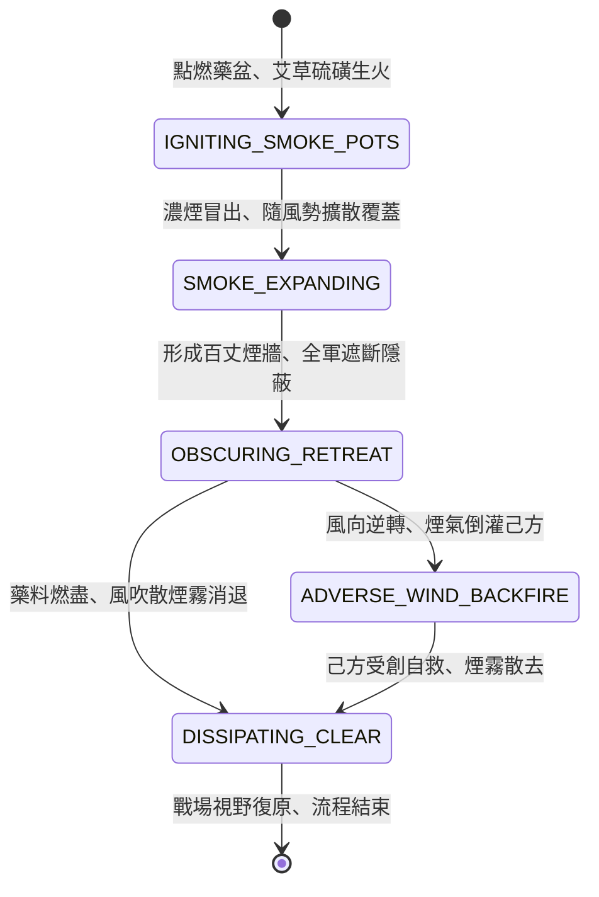

<!-- doc_id: doc_spec_0796 -->
# 3KLife 水戰燃放艾草硫磺生煙掩護全軍撤退狀態機規格書

## 模組基本資訊
- **模組代號**：`SMOKE-SCREEN-WATER01`
- **系統定位**：三國江面戰術煙幕與撤退匿蹤系統，負責引燃艾草硫磺煙盆、隨風向擴散煙障遮蔽、敵軍命中率壓制與水軍斷後脫困之完整狀態流程。
- **架構依賴**：`NavalCombatController`、`WindSystem`、`NavalShipMovement`、`VFXBlockRegistry`。

---

## 核心設計概念
三國水戰處於劣勢或伏兵突襲前夕，水師指揮官常令走舸或殿後戰艦引燃裝滿陳年艾草、硫磺、雄黃與濕松枝之大鐵盆。藥料燃燒釋出刺鼻滾滾黃白色濃煙，江面上隨風迅速蔓延成百丈煙幕牆。追擊之敵船陷入茫茫濃煙，不僅無法目測目標與旗號，且強烈辛辣煙氣致使水手咳嗽流淚、劃槳節奏大亂，使己方主力艦隊得以神不知鬼不覺轉舵脫離戰場。



---

## 狀態機定義與轉換條件

### 1. `IGNITING_SMOKE_POTS`（點燃生煙狀態）
- **進入條件**：旗艦發出「放煙斷後」指令，殿後走舸點燃鐵盆中的艾草與硫磺混合料。
- **行為表現**：
  - 引燃需耗時 1.5 秒，鐵盆冒出初生濃煙。
  - 每艘放煙走舸每秒消耗 1 份硫磺艾草儲備。
- **轉換**：煙柱成型且連續燃燒達到 2 秒 -> 轉移至 `SMOKE_EXPANDING`。

### 2. `SMOKE_EXPANDING`（風向擴散狀態）
- **行為表現**：
  - 煙霧沿當前江面風向（順風方位角 +-30 度）以每秒 4.5 公尺速度向外蔓延。
  - 煙幕覆蓋區域長度可達 80 至 150 公尺，寬度約 30 公尺。
- **轉換**：
  - 煙幕覆蓋面積達到最大閾值 -> 轉移至 `OBSCURING_RETREAT`。
  - 若遇大雨天，擴散速度降低 50%，最大覆蓋減半。

### 3. `OBSCURING_RETREAT`（濃煙遮斷狀態）
- **行為表現**：
  - **視野遮斷**：身處煙幕內的己方戰艦脫離敵方鎖定，敵軍遠程弓弩命中率下降 75%。
  - **追擊阻滯**：進入煙幕範圍之敵船，視野降為 1 格；敵軍舵手與槳手陷入「嗆咳流淚」狀態，航速降低 40%。
  - 己方主力艦隊趁機轉舵加速撤離。
- **轉換**：
  - 江面風向突發大逆轉（角度超過 120 度） -> 轉移至 `ADVERSE_WIND_BACKFIRE`。
  - 煙盆燃燒達到預設時長（預設 25 秒） -> 轉移至 `DISSIPATING_CLEAR`。

### 4. `ADVERSE_WIND_BACKFIRE`（逆風倒灌狀態）
- **行為表現**：
  - 煙霧反向吹拂己方艦陣，己方艦船同樣受到視野遮蔽與航速減緩 30% 負面效果。
  - 指揮官可下達「立即推盆入江」指令，終止生煙以減少損失。
- **轉換**：推盆熄火或煙霧消散 -> 轉移至 `DISSIPATING_CLEAR`。

### 5. `DISSIPATING_CLEAR`（煙消霧散狀態）
- **行為表現**：
  - 煙源中斷，殘留煙霧透明度每秒衰減 15%，直至完全透明。
  - 戰場視野與水軍航速完全恢復常態。
- **轉換**：江面能見度恢復 100% -> 流程結束退出。

---

## 數值公式與配置契約

```typescript
export interface SmokeScreenConfig {
  smokeId: string;
  durationSeconds: number;       // 生煙燃燒時長 (秒)
  windSpreadSpeed: number;        // 隨風蔓延速率 (m/s)
  accuracyReductionRate: number;  // 敵軍命中率降低幅度 (0.0 ~ 1.0)
  enemySpeedPenaltyRate: number;  // 敵船減速懲罰 (0.0 ~ 1.0)
  coughDebuffDurationSec: number; // 辛辣嗆咳減益持續秒數
  rainDampenFactor: number;       // 雨天煙霧衰減係數
}

export const SMOKE_PRESETS: Record<string, SmokeScreenConfig> = {
  SULFUR_WORMWOOD_DENSE: {
    smokeId: 'SMOKE_HEAVY_01',
    durationSeconds: 25,
    windSpreadSpeed: 4.8,
    accuracyReductionRate: 0.75,
    enemySpeedPenaltyRate: 0.40,
    coughDebuffDurationSec: 6.0,
    rainDampenFactor: 0.50,
  },
  QUICK_LIGHT_SCREEN: {
    smokeId: 'SMOKE_LIGHT_01',
    durationSeconds: 12,
    windSpreadSpeed: 3.5,
    accuracyReductionRate: 0.50,
    enemySpeedPenaltyRate: 0.20,
    coughDebuffDurationSec: 3.0,
    rainDampenFactor: 0.40,
  }
};
```

---

## 單元測試與驗收標準
1. **煙障遮蔽判定**：敵軍遠程投射部隊朝向煙幕內部開火時，實際命中率扣減 75% 且敵軍無法維持原鎖定目標。
2. **風向蔓延方向性**：煙幕產生之多邊形碰撞體必須沿當前風向角延伸，無風時以圓形均勻向外擴散。
3. **逆風自噬防呆**：當江面風向轉變超過 120 度時，狀態機精確轉入 `ADVERSE_WIND_BACKFIRE`，並觸發己方艦隊咳嗆警告。
