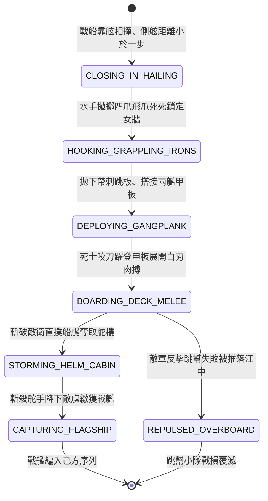

<!-- doc_id: doc_spec_0837 -->
# 3KLife 水軍登艦跳幫接舷短兵白刃甲板肉搏奪艦狀態機規格書

## 模組基本資訊
- **模組代號**：`NAVAL-BOARDING-CLASH01`
- **系統定位**：三國水軍接舷肉搏與敵艦奪取戰鬥系統，負責飛爪生鐵鉤拋擲鎖定、搭設登艦跳板、晃動甲板短兵白刃死鬥、奪取舵樓斬殺舵手與俘獲主力戰艦之完整狀態流。
- **架構依賴**：`WaterGridSystem`、`NavalCombatController`、`TroopTypeMovement`、`VFXBlockRegistry`。

---

## 核心設計概念
三國水戰白刃交鋒之精髓「接舷跳幫奪艦」（如甘寧帶銅鈴披錦袍翻身登艦、周泰浴血護主斬將奪舟）。當戰船貼近相撞至數步之內，遠程弓弩失去施展空間，水軍死士揮臂拋出帶倒鉤之生鐵飛爪，死死扣住敵艦女牆與側舷木欄，拉緊纜繩搭下寬厚跳板。勇士手握短環首刀、短鐵戟與圓盾，踏板飛躍登艦。在傾斜顛簸之甲板上展開殊死短兵肉搏，肅清敵軍水兵並直撲船艉舵樓，奪取船舵將戰艦繳獲。



---

## 狀態機定義與轉換條件

### 1. `CLOSING_IN_HAILING`（接舷靠船狀態）
- **進入條件**：兩艘水面戰艦處於相鄰地格且相對速度差 <= 1 格。
- **行為表現**：
  - 兩艦木質側舷劇烈刮擦撞擊，木屑飛濺。
  - 觸發「跳幫接舷準備」指令。
- **轉換**：下達登艦指令 -> 轉移至 `HOOKING_GRAPPLING_IRONS`。

### 2. `HOOKING_GRAPPLING_IRONS`（拋擲飛爪鎖定狀態）
- **行為表現**：
  - 4 名力士同時拋出繫有粗麻繩之四爪生鐵鉤，扣入敵艦木質側舷。
  - 兩艦相對位移被鎖死，無法轉向或拉開距離。
- **轉換**：鐵爪扣緊（耗時 0.5 秒） -> 轉移至 `DEPLOYING_GANGPLANK`。

### 3. `DEPLOYING_GANGPLANK`（搭設跳板狀態）
- **行為表現**：
  - 翻下帶鋼齒之厚木跳板，架於兩艦船舷之間。
  - 形成 1 格寬度之水上白刃通道。
- **轉換**：跳板就位 -> 轉移至 `BOARDING_DECK_MELEE`。

### 4. `BOARDING_DECK_MELEE`（甲板短兵白刃狀態）
- **行為表現**：
  - 死士持短刀藤盾衝上敵艦甲板，水戰晃動下進行高頻肉搏。
  - 造成每回合 400 點高暴擊短兵傷害；長兵器防禦受到壓制。
- **轉換**：
  - 殲滅甲板守兵 60% 以上 -> 轉移至 `STORMING_HELM_CABIN`。
  - 己方登艦部隊傷亡過半被敵長矛推下船舷 -> 轉移至 `REPULSED_OVERBOARD`。

### 5. `STORMING_HELM_CABIN`（強攻舵樓狀態）
- **行為表現**：
  - 猛將一腳踹開船艉舵樓木門，斬殺敵軍掌舵領航官。
  - 敵艦徹底喪失機動控制權，剩餘水兵士氣崩潰。
- **轉換**：控制舵輪 -> 轉移至 `CAPTURING_FLAGSHIP`。

### 6. `CAPTURING_FLAGSHIP`（繳獲戰艦狀態）
- **行為表現**：
  - 砍斷敵軍帥字旗繩索，升起己方戰旗。
  - 該艘戰艦直接原地轉為己方可操控單位。
- **轉換**：俘獲手續完成 -> 結束退出。

---

## 數值公式與配置契約

```typescript
export interface NavalBoardingConfig {
  tacticId: string;
  grapplingHookHoldStrength: number;// 飛爪抗拉強度
  gangplankDeploySec: number;        // 搭板耗時 (秒)
  deckMeleeDamageBonus: number;      // 晃動甲板近戰加成比
  helmStormSuccessThreshold: number; // 舵樓攻克所需殲敵比例
  shipCaptureMoraleShock: number;    // 旗艦被奪對敵全軍士氣打擊
}

export const BOARDING_PRESETS: Record<string, NavalBoardingConfig> = {
  GANNING_TIGER_BOARDING: {
    tacticId: 'BOARD_GANNING_01',
    grapplingHookHoldStrength: 1000,
    gangplankDeploySec: 0.5,
    deckMeleeDamageBonus: 0.35,
    helmStormSuccessThreshold: 0.60,
    shipCaptureMoraleShock: -30,
  }
};
```

---

## 單元測試與驗收標準
1. **飛爪鎖定航速歸零**：飛爪成功扣入敵船後，兩艦相對位移差 100% 歸零，舵機強制鎖定不可分離。
2. **甲板晃動短兵加成**：在搖晃甲板上展開近戰時，短刀兵種攻擊力自動增加 35%，長兵器部隊受懲罰命中降低 30%。
3. **奪取舵樓旗幟變更**：舵樓攻克瞬間，敵艦 factionId 即時轉移為己方，並廣播全場士氣震懾 -30 點。
