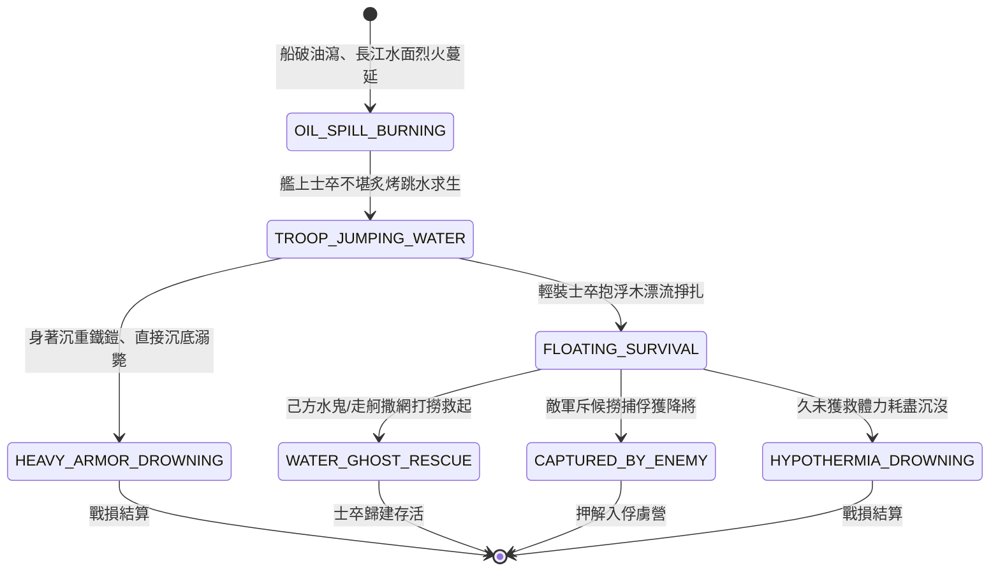

<!-- doc_id: doc_spec_0814 -->
# 3KLife 水面火勢烈火燎原江面跳水潰逃與水鬼救援撈捕狀態機規格書

## 模組基本資訊
- **模組代號**：`WATER-SURFACE-FIRE-RESCUE01`
- **系統定位**：三國水戰江面燃燒蔓延與落水人員打撈救援系統，負責浮油水面起火、士卒炙烤跳水求生、重甲溺水死亡與水鬼小隊撒網打撈之完整狀態流。
- **架構依賴**：`WaterGridSystem`、`FireSpreadEngine`、`TroopTypeMovement`、`VFXBlockRegistry`。

---

## 核心設計概念
赤壁水戰烈火焚燒連環船後，大量桐油、魚油溢出漂浮於長江水面，江面瞬間化為流動的火海。戰艦甲板被燒穿之士卒慘遭烈焰灼烤，只能盲目跳入江中逃生。北方士卒身披重甲且不習水性，多數墜江即被重鎧拖入江底溺斃；僅少數輕甲者能抱殘木漂浮。戰場指揮官可指派熟諳水性之「水鬼營」或輕捷走舸攜帶漁網，於火海邊緣展開「落水救援」或「江面撈捕敵將」，兼具拯救己方殘部與活捉敵名將之功。



---

## 狀態機定義與轉換條件

### 1. `OIL_SPILL_BURNING`（浮油燃燒狀態）
- **進入條件**：燃燒戰船耐久歸零解體，或火油桶破裂溢出江面。
- **行為表現**：
  - 水面地格附加「水面浮火」標籤，隨江水流向以每回合 1 格速度漂移。
  - 對行經水面之任何人員與未覆鐵皮輕舟每秒造成 80 點灼燒傷害。
- **轉換**：相鄰起火戰艦人員跳江 -> 轉移至 `TROOP_JUMPING_WATER`。

### 2. `TROOP_JUMPING_WATER`（跳江逃生狀態）
- **行為表現**：
  - 士卒拋棄兵刃躍入江中，生命值削扣 20%（高空墜水衝擊）。
  - 檢定士卒著裝屬性：身著重鎧（重步/重騎）或輕裝（弓手/水兵）。
- **轉換**：
  - 裝甲為「生鐵重鎧」且水性數值 < 30 -> 轉移至 `HEAVY_ARMOR_DROWNING`。
  - 輕甲或水性數值 >= 30 -> 轉移至 `FLOATING_SURVIVAL`。

### 3. `HEAVY_ARMOR_DROWNING`（重甲沉底溺亡狀態）
- **行為表現**：
  - 鐵鎧吸水下墜，士卒無法浮出水面，0.5 秒內耐久歸零。
  - 戰損直接計入陣亡名單。
- **轉換**：沉沒結算完成 -> 結束退出。

### 4. `FLOATING_SURVIVAL`（江面漂浮掙扎狀態）
- **行為表現**：
  - 人員抱住燒焦船板漂浮於水面，移動力受江流推動。
  - 體力值每回合扣除 15 點（低溫江水消耗）。
- **轉換**：
  - 己方水鬼或走舸靠近相鄰 1 格 -> 轉移至 `WATER_GHOST_RESCUE`。
  - 敵方斥候小艇靠近相鄰 1 格 -> 轉移至 `CAPTURED_BY_ENEMY`。
  - 體力值耗盡歸零 -> 轉移至 `HYPOTHERMIA_DROWNING`。

### 5. `WATER_GHOST_RESCUE`（水鬼撒網打撈狀態）
- **行為表現**：
  - 水鬼跳入水中或走舸拋擲粗繩麻網，將落水士卒拉上小艇。
  - 恢復 50% 基礎生命值，送回水寨大營。
- **轉換**：人員獲救 -> 結束退出。

### 6. `CAPTURED_BY_ENEMY`（敵軍捕俘狀態）
- **行為表現**：
  - 敵軍用鐵鉤搭住浮木，落水將士無力反抗，成為俘虜。
  - 若落水者為名將，觸發「水戰擒獲敵將」戰報。
- **轉換**：俘獲成功 -> 結束退出。

---

## 數值公式與配置契約

```typescript
export interface WaterRescueConfig {
  systemId: string;
  surfaceFireDriftSpeedGrids: number; // 水面火勢順流漂移速
  heavyArmorDrownRate: number;        // 重甲落水即溺率 (0.0 ~ 1.0)
  waterColdStaminaDrainPerTurn: number; // 冰冷江水每回合消耗體力
  ghostNetRescueSpeedUnits: number;   // 水鬼每回合打撈人數
  namedGeneralCaptureRate: number;    // 名將江面被俘率
}

export const WATER_RESCUE_PRESETS: Record<string, WaterRescueConfig> = {
  YANGTZE_CHIBI_RESCUE: {
    systemId: 'RESCUE_CHIBI_01',
    surfaceFireDriftSpeedGrids: 1,
    heavyArmorDrownRate: 0.95,
    waterColdStaminaDrainPerTurn: 15,
    ghostNetRescueSpeedUnits: 50,
    namedGeneralCaptureRate: 0.80,
  }
};
```

---

## 單元測試與驗收標準
1. **重甲士卒溺斃判定**：重步兵單位在連環船燒毀跳水時，95% 機率直接判定溺斃沉沒，不生成江面漂浮實體。
2. **水鬼撒網打撈復原**：水鬼單位靠近漂浮人員 1 格內施放救援，單回合成功挽救 50 名士卒並結算回大本營。
3. **低溫體力耗盡沉沒**：未獲救士卒漂浮超過 6 回合（體力歸零）後，狀態自動轉移為 `HYPOTHERMIA_DROWNING`。
