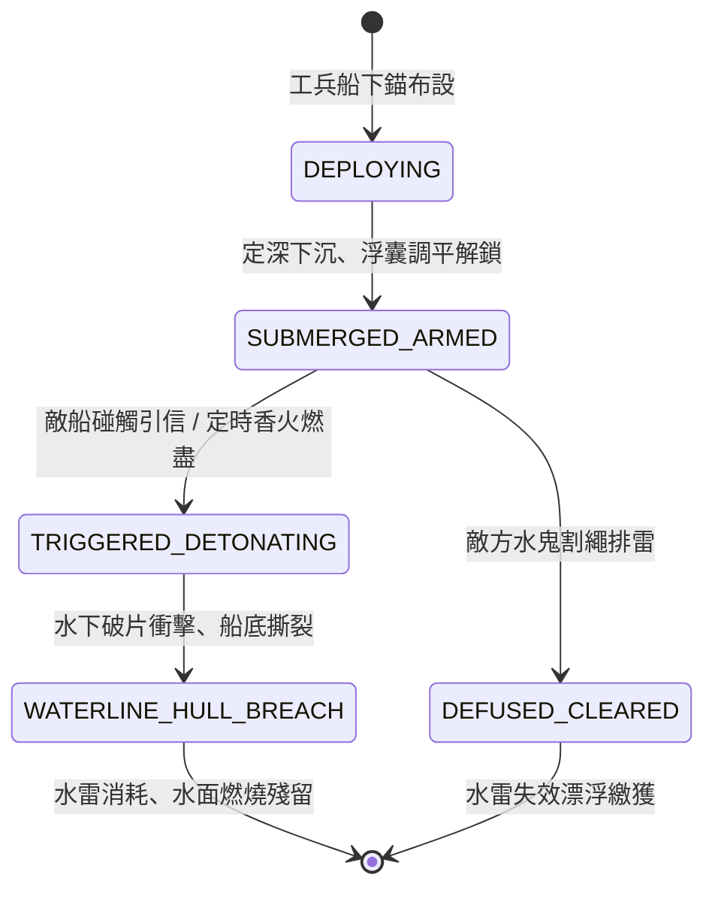

<!-- doc_id: doc_spec_0794 -->
# 3KLife 江面漂浮引信伏火水雷水底定深炸裂狀態機規格書

## 模組基本資訊
- **模組代號**：`FLOATING-MINE-FIRE01`
- **系統定位**：三國水戰江面防禦阻絕與水下爆破系統，負責伏火水雷布設、定深浮囊錨泊、觸發引信判定與船底水線破甲爆炸之完整生命週期。
- **架構依賴**：`WaterGridSystem`、`NavalShipMovement`、`NavalHullDamageEngine`、`VFXBlockRegistry`。

---

## 核心設計概念
三國水戰中，於狹窄江道、水寨隘口或急流轉彎處，守軍利用密封生鐵水雷或生漆桐油木桶，內填猛火油、硫磺與引火藥（水底伏火雷），下墜生鐵石碇與定深繩索，使水雷懸浮於水面下 0.5 至 1.5 公尺深度。水面僅露出鵝翎引信或浮水暗標。當敵艦船底龍骨或側舷撞擊時，即刻觸發碰火機關，於水線下引發猛烈爆裂，造成外板碎裂、龍骨震損與大量江水湧入。



---

## 狀態機定義與轉換條件

### 1. `DEPLOYING`（布署錨泊狀態）
- **進入條件**：己方走舸或工兵艟舟抵達指定水域地格，下達「布設伏火雷」指令。
- **行為表現**：
  - 投入鐵石錨碇，定深麻繩下放至指定吃水深度（預設 0.8 公尺）。
  - 布設需消耗時間 3 秒，若期間受到敵軍衝撞或火箭射擊，有 25% 機率自爆。
- **轉換**：布設倒數完畢且未遭破壞 -> 轉移至 `SUBMERGED_ARMED`。

### 2. `SUBMERGED_ARMED`（定深懸浮警戒狀態）
- **行為表現**：
  - 水雷隱蔽於水面下，水面視野僅具備 15% 可見度（大霧或雨天降至 5%）。
  - 持續偵測半徑 2.0 公尺內通過之水面艦船碰撞體。
- **轉換**：
  - 敵船吃水碰撞引信箱 -> 轉移至 `TRIGGERED_DETONATING`。
  - 遭遇具備「排雷/水鬼」特長之兵種潛渡靠近並執行剪線 -> 轉移至 `DEFUSED_CLEARED`。

### 3. `TRIGGERED_DETONATING`（碰撞起爆狀態）
- **行為表現**：
  - 引信激發，延遲 0.2 秒後觸發水下轟爆。
  - 對撞擊艦船造成水下衝擊波與破甲撕裂傷害（無視舷外生牛皮防護）。
- **轉換**：爆炸能量釋放完畢 -> 轉移至 `WATERLINE_HULL_BREACH`。

### 4. `WATERLINE_HULL_BREACH`（破孔進水結算狀態）
- **行為表現**：
  - 被擊中艦船立即產生「底艙大漏水」狀態（進水速率每秒 +12%）。
  - 若敵艦為輕型走舸直接斷裂沉沒；若為中型蒙衝則移速降低 60%；若為巨型樓船則造成底艙失火與龍骨受損。
  - 水面釋放猛火油燃燒 VFX，持續 8 秒。
- **轉換**：傷害與狀態賦予完成 -> 結束退出。

### 5. `DEFUSED_CLEARED`（排雷拆除狀態）
- **行為表現**：
  - 碇繩被切斷，水雷浮出水面失去擊發能力。
  - 己方或敵方可打撈獲得「未爆生鐵水雷」物資。
- **轉換**：打撈或隨水漂流出圖 -> 結束退出。

---

## 數值公式與配置契約

```typescript
export interface FloatingMineConfig {
  mineId: string;
  mineType: 'IRON_BOMB' | 'TIMBER_BARREL' | 'TIMED_FIRE';
  tetherDepthMeter: number;        // 定深吃水深度 (0.5 ~ 2.0m)
  detectionRadiusGrid: number;     // 觸碰半徑 (公尺)
  baseBreachDamage: number;        // 基礎船體耐久傷害
  hullWaterInflowRate: number;     // 每秒進水百分比 (0.0 ~ 1.0)
  stealthVisibilityRate: number;   // 水面被察覺機率
  chainReactionChance: number;     // 誘發相鄰水雷連鎖爆炸機率
}

export const DEFAULT_MINE_PRESETS: Record<string, FloatingMineConfig> = {
  HEAVY_IRON_MINE: {
    mineId: 'MINE_IRON_01',
    mineType: 'IRON_BOMB',
    tetherDepthMeter: 1.2,
    detectionRadiusGrid: 2.5,
    baseBreachDamage: 850,
    hullWaterInflowRate: 0.15,
    stealthVisibilityRate: 0.12,
    chainReactionChance: 0.35,
  },
  LIGHT_TIMBER_MINE: {
    mineId: 'MINE_TIMBER_01',
    mineType: 'TIMBER_BARREL',
    tetherDepthMeter: 0.6,
    detectionRadiusGrid: 1.8,
    baseBreachDamage: 420,
    hullWaterInflowRate: 0.08,
    stealthVisibilityRate: 0.25,
    chainReactionChance: 0.20,
  }
};
```

---

## 單元測試與驗收標準
1. **隱蔽偵測驗證**：在非大霧天氣下，敵軍艦船常規偵測只有 12% 機率標記出 `HEAVY_IRON_MINE` 位置；大霧環境降至 4%。
2. **定深吃水判定**：吃水深度小於 0.8m 之輕舟經過定深 1.2m 之鐵雷時，不觸發碰撞；吃水 1.5m 之蒙衝或樓船通過必定起爆。
3. **水鬼剪線排除**：派遣水鬼小隊在定深雷未被撞擊前介入，成功剪斷碇繩後狀態轉移為 `DEFUSED_CLEARED`，無爆炸產生。
