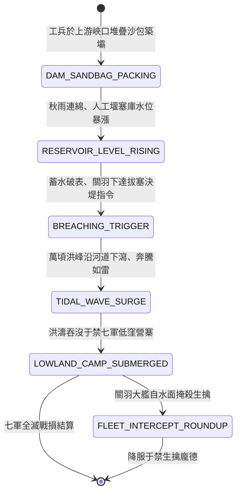

<!-- doc_id: doc_spec_0824 -->
# 3KLife 沙袋壅塞河道蓄積千重洪濤決堤水淹七軍狀態機規格書

## 模組基本資訊
- **模組代號**：`FLOOD-SEVEN-ARMIES01`
- **系統定位**：三國戰場水文大水攻與蓄水決堤系統，負責上游沙袋壅塞築壩、漢水水位暴漲累積、拔塞決堤萬頃洪峰衝擊與敵軍低窪淹溺之完整狀態流。
- **架構依賴**：`WaterGridSystem`、`WeatherSystem`、`BattleGridSystem`、`VFXBlockRegistry`。

---

## 核心設計概念
關羽威震華夏之「水淹七軍」：八月秋霖連綿，漢水猛漲。曹魏左將軍于禁率龐德等七軍三萬精銳扎營於樊城以北低窪平地。關羽精研天時水文，遣工兵於襄江上游狹口以數萬沙袋麻包壅塞河道，蓄積億萬立方滔天洪濤。待水位蓄至極限且雨勢最急之夜，關羽傳令放水決堤。狂瀾如千軍萬馬破閘而出，平地水深丈五尺，七軍營寨瞬間化為澤國，戰馬浮屍無算。



---

## 狀態機定義與轉換條件

### 1. `DAM_SANDBAG_PACKING`（堆袋築壩狀態）
- **進入條件**：天候處於「暴雨」或「連綿陰雨」，河流地格滿足峽口狹窄地形（寬度 <= 2 格）。
- **行為表現**：
  - 工兵消耗 2 回合時間與 500 份沙包麻袋，構築「堰塞蓄水壩」。
  - 下游河流水位暫時下降 50%（形成假象）。
- **轉換**：大壩閉合完成 -> 轉移至 `RESERVOIR_LEVEL_RISING`。

### 2. `RESERVOIR_LEVEL_RISING`（水位暴漲累積狀態）
- **行為表現**：
  - 壩後庫區每回合水位蓄能值 +25 點（雨季每回合 +40 點）。
  - 水位計量條達到 100 點時，形成毀滅性洪峰勢能。
- **轉換**：
  - 指揮官下達「決堤放水」指令 -> 轉移至 `BREACHING_TRIGGER`。
  - 水位超載未決堤（超過 140 點） -> 發生自然潰壩。

### 3. `BREACHING_TRIGGER`（拔塞決堤瞬間狀態）
- **行為表現**：
  - 工兵斬斷牽引索，拔除核心沙包插銷，大壩瞬間瓦解。
  - 釋放巨型水浪轟鳴聲效與地面震顫。
- **轉換**：洪峰成型（0.2 秒延遲） -> 轉移至 `TIDAL_WAVE_SURGE`。

### 4. `TIDAL_WAVE_SURGE`（狂濤下瀉奔騰狀態）
- **行為表現**：
  - 巨浪沿河道與相鄰 3 格平原以每秒 8 格極速俯衝推進。
  - 沿途摧毀所有木質鹿角、營帳與箭樓，衝撞實體造成 900 點水力撞擊真實傷害。
- **轉換**：巨浪灌入敵軍低窪平川營寨 -> 轉移至 `LOWLAND_CAMP_SUBMERGED`。

### 5. `LOWLAND_CAMP_SUBMERGED`（營寨澤國覆沒狀態）
- **行為表現**：
  - 敵營地格瞬間轉變為「深水澤國」地貌（水深 1.5 公尺）。
  - 敵步騎大軍陷入泥水淹溺：戰馬淹死、火藥報廢、弓弩弦鬆，全軍士氣歸零。
- **轉換**：己方大型樓船艨艟自上游順流而下展開圍剿 -> 轉移至 `FLEET_INTERCEPT_ROUNDUP`。

### 6. `FLEET_INTERCEPT_ROUNDUP`（乘舟抄截生擒狀態）
- **行為表現**：
  - 關羽水軍駕大船居高臨下射箭逼降，放下跳板與繩索俘獲殘敵。
  - 主帥于禁率部投降，副將龐德孤島力戰被擒。
- **轉換**：俘獲結算完畢 -> 結束退出。

---

## 數值公式與配置契約

```typescript
export interface FloodSevenArmiesConfig {
  damId: string;
  rainLevelWaterAccumulateRate: number;// 雨量轉化蓄水速度
  breachFloodWaveSpeedGrids: number;  // 決堤洪峰奔流速度
  hydraulicImpactDamage: number;      // 洪濤衝擊純物理傷害
  submergedDurationTurns: number;     // 水浸澤國維持回合
  enemyTroopDrowningMoraleDrop: number;// 淹溺部隊士氣扣減
  surrenderCaptureRateBonus: number;  // 水困逼降俘獲加成比
}

export const FLOOD_PRESETS: Record<string, FloodSevenArmiesConfig> = {
  GUANYU_FANCHENG_FLOOD: {
    damId: 'DAM_FANCHENG_01',
    rainLevelWaterAccumulateRate: 40,
    breachFloodWaveSpeedGrids: 8,
    hydraulicImpactDamage: 900,
    submergedDurationTurns: 5,
    enemyTroopDrowningMoraleDrop: -100,
    surrenderCaptureRateBonus: 0.85,
  }
};
```

---

## 單元測試與驗收標準
1. **蓄水閾值滿載決堤**：蓄水條達到 100 點時釋放決堤，下游 6 格範圍內低窪地格 100% 轉為深水澤國。
2. **水力衝撞摧毀工事**：木質營寨與箭樓承受洪濤衝擊，耐久直接扣減 900 點，100% 被衝垮碎裂。
3. **七軍士氣歸零逼降**：被大水淹沒之敵軍部隊士氣強制清零，投降接受率提升至 85%。
