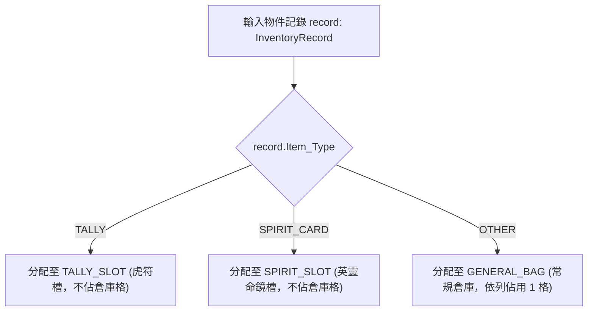

<!-- doc_id: doc_spec_0422 -->
# 物件分類與來源追蹤欄位規格書

> 本規格書為 3KLife 統一物件庫顯示分域（`BagDomain`）、物件來源追蹤代碼（`Source_Type`）與容量格數計算機制之唯一真相來源（Single Source of Truth）。
> 相關實作對齊：`assets/scripts/core/systems/BagDomain.ts`、`InventoryProjection.ts`、`ReadModelValidators.ts`。

---

## 1. 系統定位與架構設計

1. **統一物件庫的顯示與系統分域（Domain Partitioning）**：
   - 遊戲內物件依照根類別（`Item_Type`）自動劃分顯示與存放分域，嚴禁各系統各存一份。
   - 虎符與英靈卡屬於獨立裝配體系，擁有專屬的系統卡槽，不流入一般消耗品倉庫；一般道具與常規裝備則匯入常規倉庫。
2. **全生命週期來源追蹤（Source Tracking）**：
   - 每一筆寫入物件庫之記錄均必須攜帶標準化的來源標識（`Source_Type`），貫穿武將死亡結算、戰場繳獲、退役回收與俘虜搜繳，以利日後查核與防弊回放。

---

## 2. 顯示分域與倉庫容量計算（BagDomain）



### 2.1 分域映射定義（bagDomainOf）
- `TALLY_SLOT`：僅收納 `Item_Type === 'TALLY'` 之虎符。
- `SPIRIT_SLOT`：僅收納 `Item_Type === 'SPIRIT_CARD'` 之英靈卡。
- `GENERAL_BAG`：收納一般裝備、消耗品、鍛造材料等 `OTHER` 類型物件。

### 2.2 容量計算原則（countGeneralBagSlots）
- **依列計格**：一般倉庫僅統計 `GENERAL_BAG` 分域之列數（Rows）。
- **數量堆疊不佔格**：同一列記錄之 `Quantity` 數值堆疊於列內，不額外消耗倉庫格位。

---

## 3. 物件來源追蹤標準代碼表（Source_Type）

所有入庫記錄之 `Source_Type` 必須嚴格遵照以下列舉值，嚴禁任意自創字串：

| 來源識別碼 (`Source_Type`) | 業務觸發場景 | 適用物件類別 | 範例與特徵 |
|---|---|:---:|---|
| **`DeathSettlement`** | 武將陣亡/壽終正寢死亡結算 | 虎符、英靈卡 | 陣亡生成先祖英靈與固有虎符 |
| **`Recruitment`** | 招募傭兵/名士入仕 | 虎符、道具 | 招降名將自帶專屬虎符 |
| **`WarConquest`** | 戰場獲勝/攻城掠奪 | 虎符、材料、黃金 | 戰場打撈拾取武器素材與戰功虎符 |
| **`Retirement`** | 武將年邁退役回歸家譜 | 裝備、材料 | 退役武將裝備卸下回收至倉庫 |
| **`Prisoner`** | 敵將俘虜判處沒收/無期徒刑 | 寶物、裝備 | 俘虜交出傳家寶物（`ITEM_TREASURE`） |
| **`SHOP`** | 百寶閣商城/許願池提領 | 道具、禮包 | 消耗精元購買或許願到期熟成 |
| **`TASK`** | 極限任務/歷練成就結算 | 道具、材料 | 極限任務機率掉落戰法筆記與高粱 |

---

## 4. 介面型別契約

```typescript
export type BagDomain = 'GENERAL_BAG' | 'TALLY_SLOT' | 'SPIRIT_SLOT';

export interface InventoryRecord {
    readonly Inventory_ID: string;
    readonly Item_Type: 'TALLY' | 'SPIRIT_CARD' | 'OTHER';
    readonly Slot_Type: string;
    readonly Bound_General_UID: string | null;
    readonly Quantity: number;
    readonly Quality: string;
    readonly Source_Type: string;
    readonly Display_Bucket: string;
    readonly Is_Displayed: boolean;
    readonly isLocked?: boolean | null; // BAG-07 鎖定防分解
}

export function bagDomainOf(record: Pick<InventoryRecord, 'Item_Type'>): BagDomain;
export function countGeneralBagSlots(records: readonly InventoryRecord[]): number;
```

---

## 5. 驗收標準與相容性

1. **分域隔離防護**：
   - 物件庫中包含 50 個虎符與 20 張英靈卡，若無一般道具，`countGeneralBagSlots` 輸出精確為 0。
2. **來源追蹤追溯性**：
   - 死亡結算產生之物件，其 `Source_Type` 必為 `DeathSettlement`，不得遺失或標記為空。
