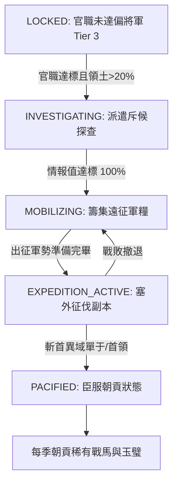

<!-- doc_id: doc_spec_0633 -->
# 異域外部壓力源與全球遠征檔案狀態機規格書

> **規格代碼**：`RAI-16`
> **版本**：v1.0 (Single Source of Truth)
> **狀態**：正式定案 (Approved)
> **檔案大小限制**：嚴格 <6144 bytes

---

## 1. 系統定位與架構

本規格定義遊戲進展至 S3 階段後，世界沙盤面臨之三大外部壓力源（External Power）演繹機制，以及全球遠征卷宗（Expedition Dossier）狀態推進模型。
打破中原內鬥單一視角，營造「安內攘外」的宏大歷史沙盤環境。



---

## 2. 三大異域壓力源模型

```typescript
export enum ExternalThreatType {
  HUNS = "HUNS",         // 北方匈奴/鮮卑: 狼騎劫掠，威脅幽并涼
  NANMAN = "NANMAN",     // 南方南蠻孟獲: 毒瘴象兵，威脅益交
  DONGYI = "DONGYI",     // 東方沿海勢力: 樓船襲擾，威脅揚青
}

export interface ExternalThreatDef {
  type: ExternalThreatType;
  name: string;
  threatLevel: number;   // 1~5 級動態威脅強度
  targetProvinces: string[];
  seasonalRaidChance: number; // 每季襲擾機率 (0.2 ~ 0.6)
  raidPenalty: { foodLoss: number; defenseDebuff: number };
}

export const EXTERNAL_THREAT_CONFIG: Record<ExternalThreatType, ExternalThreatDef> = {
  [ExternalThreatType.HUNS]: {
    type: ExternalThreatType.HUNS,
    name: "北漠塞外匈奴",
    threatLevel: 3,
    targetProvinces: ["YOUZHOU", "BINGZHOU", "LIANGZHOU"],
    seasonalRaidChance: 0.35,
    raidPenalty: { foodLoss: 3000, defenseDebuff: 0.15 },
  },
  [ExternalThreatType.NANMAN]: {
    type: ExternalThreatType.NANMAN,
    name: "南中百越蠻王",
    threatLevel: 2,
    targetProvinces: ["YIZHOU", "JIAOZHOU"],
    seasonalRaidChance: 0.25,
    raidPenalty: { foodLoss: 2000, defenseDebuff: 0.10 },
  },
  [ExternalThreatType.DONGYI]: {
    type: ExternalThreatType.DONGYI,
    name: "東荒海隅島夷",
    threatLevel: 2,
    targetProvinces: ["YANGZHOU", "QINGZHOU"],
    seasonalRaidChance: 0.20,
    raidPenalty: { foodLoss: 1500, defenseDebuff: 0.05 },
  },
};
```

---

## 3. 遠征卷宗狀態機（Expedition Dossier）

```typescript
export type DossierStatus = "LOCKED" | "INVESTIGATING" | "MOBILIZING" | "EXPEDITION_ACTIVE" | "PACIFIED";

export interface ExpeditionDossier {
  dossierId: string;
  threatType: ExternalThreatType;
  status: DossierStatus;
  investigationProgress: number; // 0 ~ 100%
  requiredFoodSupply: number;    // 遠征出征軍糧儲備
  pacifiedSeasonsRemaining: number; // 臣服朝貢剩餘季數 (歸零後叛亂)
}
```

### 3.1 狀態躍遷判定規範
1. **解鎖門檻**：玩家官職晉升為 `TIER_3`（偏將軍）且天下版圖佔比 $\ge 20\%$，解鎖遠征卷宗。
2. **斥候探查**：太守府派遣軍師執行「塞外探查」任務，每季推進 $25\%$ 進度，達 $100\%$ 後躍遷至 `MOBILIZING`。
3. **征討戰役**：消耗 20,000 點出征軍糧與 10,000 城市兵源，開啟跨圖 BOSS 征伐戰。
4. **臣服朝貢**：擊破首領後進入 `PACIFIED`，維持 12 季度（3 年）和平，每季納貢「精元 ×50、特種戰馬 ×2」。
